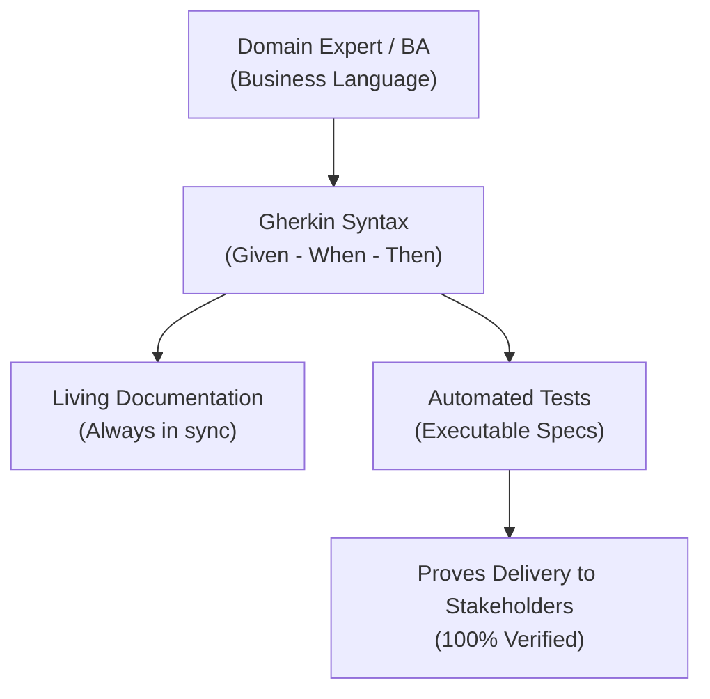

# 17. Benefits of BDD – Tóm tắt

**Khóa học:** Software Testing, Deployment, and Maintenance Strategies  
**Module 1:** Testing Strategies and Practices  
**Thời lượng video:** 2:25  
**Ngày lưu:** 2026-10-16  

---

## 🎯 Mục tiêu bài học
- Nắm bắt các lợi ích cốt lõi của **Behavior-Driven Development (BDD)** trong tự động hóa kiểm thử phần mềm.
- Hiểu được vai trò của cú pháp chung (**Single Syntax / Gherkin**) trong việc xóa bỏ rào cản giao tiếp giữa kỹ thuật và kinh doanh.
- Khám phá khả năng tự động sinh tài liệu (Living Documentation) và tự động tạo bài test trực tiếp từ đặc tả BDD.

---

## 🌟 4 Lợi ích cốt lõi của BDD

### 1. Cú pháp thống nhất (Single Syntax for All)
- BDD mô tả hành vi hệ thống bằng **một cú pháp duy nhất** mà tất cả các bên liên quan đều hiểu được:
  - **Chuyên gia nghiệp vụ (Domain Experts / BA / Product Owners)**
  - **Kiểm thử viên (Testers / QA)**
  - **Lập trình viên (Developers)**
  - **Bên liên quan (Stakeholders / Customers)**
- Chuyên gia nghiệp vụ có thể nói bằng chính ngôn ngữ ngành của họ, và đội ngũ kỹ thuật ghi nhận lại tài liệu bằng đúng ngôn ngữ đó $\to$ Giảm thiểu hiểu lầm và sai lệch yêu cầu.

### 2. Ngôn ngữ tự nhiên & Dễ tiếp cận (Gherkin Syntax)
- Sử dụng cấu trúc gần gũi với ngôn ngữ giao tiếp hàng ngày: **Given - When - Then**.
  - **Given (Giả định/Bối cảnh ban đầu):** Trạng thái của hệ thống trước khi có hành động.
  - **When (Khi xảy ra sự kiện):** Hành động kích hoạt từ phía người dùng/hệ thống.
  - **Then (Thì kết quả mong đợi):** Phản ứng hoặc kết quả đầu ra của hệ thống.
- **Cú pháp Gherkin:** Chuẩn cú pháp phổ biến nhất trong BDD (xuất phát từ công cụ kiểm thử nổi tiếng **Cucumber**). Có độ dốc học tập thấp (shallow learning curve), thân thiện hơn nhiều so với mã kiểm thử unit test trong TDD.

### 3. Tự động sinh tài liệu (Living Documentation)
- Các công cụ BDD hỗ trợ khả năng tự động trích xuất đặc tả BDD thành tài liệu kỹ thuật và tài liệu hướng dẫn người dùng.
- **Tài liệu luôn đồng bộ (Always in sync):** Vì kịch bản BDD chạy liên tục trong pipeline kiểm thử, tài liệu mô tả hệ thống không bao giờ bị lỗi thời hay sai lệch so với sản phẩm thực tế đang chạy.

### 4. Tự động sinh test từ đặc tả (Executable Specifications)
- Đặc tả BDD chính là kịch bản kiểm thử có thể thực thi được (**Executable Specs**).
- Cho phép sinh bài test tự động để xác nhận xem tính năng đã được hiện thực đầy đủ chưa.
- Cung cấp bằng chứng minh bạch chứng minh với Stakeholders rằng hệ thống bàn giao hoạt động chính xác 100% như những gì họ đã yêu cầu.

---

## 📊 Tổng kết nhanh BDD

---

## 📌 Ghi nhớ cốt lõi
> - **Cú pháp duy nhất (Single Syntax):** Xóa bỏ khoảng cách giao tiếp giữa Dev, QA và Business.
> - **Gherkin (`Given-When-Then`):** Ngôn ngữ tự nhiên, trực quan, dễ học.
> - **Đặc tả kiêm tài liệu và bài test:** Tài liệu luôn đồng bộ với mã nguồn thực tế và kiểm chứng trực tiếp sự hài lòng của Stakeholder.
