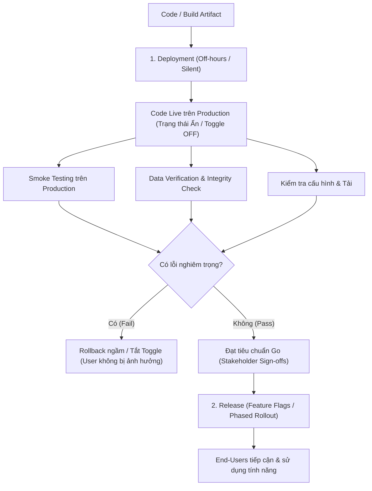

# 01. Deployment versus Release: Key Concepts and Responsibilities – Tóm tắt

**Khóa học:** Strategies to Test, Deploy, and Maintain Software  
**Module 2:** Software Deployment, Release, and Maintenance Strategies  
**Thời lượng video:** 5 phút 02 giây  
**Ngày lưu:** 2026-10-16  

---

## 🎯 Mục tiêu bài học
- Phân biệt rõ bản chất kỹ thuật của **Deployment (Triển khai)** và khía cạnh nghiệp vụ/người dùng của **Release (Phát hành)**.
- Hiểu được lý do tại sao việc **tách rời (decoupling)** giữa Deployment và Release là nguyên tắc quan trọng để giảm thiểu rủi ro trong hệ thống production.
- Nắm vững vai trò, trách nhiệm và quy trình kiểm soát của **Systems Professionals** trong suốt vòng đời triển khai và phát hành.

---

## ⚖️ So sánh Deployment vs Release

| Đặc điểm | Deployment (Triển khai kỹ thuật) | Release (Phát hành cho người dùng) |
| :--- | :--- | :--- |
| **Bản chất** | Hoạt động kỹ thuật (Technical action) | Quyết định kinh doanh / nghiệp vụ (Business action) |
| **Định nghĩa** | Đưa code/artifact lên môi trường **Production**. Phần mềm đã live và sẵn sàng vận hành trên hạ tầng, nhưng người dùng **chưa thể nhìn thấy hoặc tương tác**. | Mở quyền truy cập, hiển thị tính năng và chức năng đã deploy cho **người dùng cuối (End-users)** tiếp cận. |
| **Hành động cụ thể** | - Cài đặt backend service / microservice mới. - Đẩy build app lên App Store (ở trạng thái chưa published). - Triển khai tính năng mới ẩn sau Feature Toggle/Flag. | - Bật **Feature Flag** cho người dùng. - Cập nhật thanh điều hướng (navigation) để mở dashboard mới. - Gửi email/thông báo thông cáo tính năng mới tới khách hàng. |
| **Ẩn dụ thực tế** | Nhập hàng và xếp vào kho sau giờ đóng cửa (hàng đã nằm trong cửa hàng nhưng khách chưa mua được). | Mở cửa bày hàng lên kệ vào giờ bán chính thức sau khi đã kiểm tra hóa đơn, tem mác và tồn kho. |
| **Đối tượng tác động** | Máy chủ, hạ tầng mạng, cơ sở dữ liệu, CI/CD pipeline. | Khách hàng, nhân viên, trải nghiệm người dùng (UX). |

---

## 🛡️ Tại sao cần tách rời Deployment và Release?

### 1. Giảm thiểu rủi ro (Risk Mitigation)
- **Tránh lộ lỗi nghiêm trọng:** Có thời gian chạy kiểm tra cuối cùng và khắc phục lỗi trước khi người dùng thực tế tiếp cận.
- **Dễ dàng Rollback:** Nếu code gặp lỗi trên production, đội ngũ kỹ thuật có thể rollback hoặc tắt toggle mà người dùng không hề hay biết hay gặp gián đoạn.
- **Giảm áp lực cho đội ngũ kỹ thuật:** Việc deploy có thể thực hiện trước vào ban đêm hoặc cuối tuần mà không cần lo lắng về việc hỗ trợ khách hàng ngay tại thời điểm đó.

### 2. Ví dụ thực tế: Corporate Payroll Dashboard (Bảng lương doanh nghiệp)
- **Tối thứ Sáu (Deployment):** IT deploy hệ thống bảng lương mới lên môi trường production. Code đã live nhưng được ẩn hoàn toàn với nhân viên.
- **Thứ Bảy & Chủ Nhật (Kiểm tra & Xác minh):** Đội ngũ tiến hành kiểm tra tính toàn vẹn dữ liệu, xác minh công thức tính lương và chạy các bài test nghiệm thu.
- **Sáng thứ Hai (Release):** Sau khi có phê duyệt (Sign-off), hệ thống được mở hiển thị (Release) cho toàn bộ nhân viên truy cập.
- *Hệ quả nếu gộp chung:* Nếu deploy xong mà release ngay lập tức khi chưa kiểm tra, việc hiển thị sai số liệu lương sẽ gây khủng hoảng nghiêm trọng trong tổ chức.

---

## 👨‍💻 Trách nhiệm của Systems Professionals

Trong quy trình Deployment và Release, kỹ sư hệ thống / DevOps / Release Manager đảm nhận các vai trò trọng yếu:

### 1. Quản lý Checklist và Tiêu chí Go / No-Go
- Rà soát toàn bộ checklist chuẩn bị triển khai, thời điểm phát hành và phương án dự phòng.
- Thiết lập và ghi chép rõ ràng các tiêu chí **Go / No-Go** (điều kiện tiên quyết để quyết định mở hay hoãn release).
- Xác nhận các phê duyệt cần thiết (**Stakeholder Sign-offs**) từ các bên liên quan.

### 2. Lập kế hoạch và diễn tập Rollback
- Luôn chuẩn bị sẵn tài liệu kế hoạch hoàn tác (**Rollback Plan**) chi tiết.
- Kiểm thử trước quy trình rollback để đảm bảo khi xảy ra sự cố có thể khôi phục trạng thái ổn định ngay lập tức.

### 3. Điều phối Feature Flags & Triển khai có kiểm soát (Controlled Rollout)
- Phối hợp với Developer sử dụng **Feature Flags / Toggles** để giữ tính năng ở trạng thái ẩn cho đến khi sẵn sàng.
- Hỗ trợ triển khai theo giai đoạn (**Phased / Canary Rollout**), ví dụ: chỉ mở tính năng cho một nhóm nhỏ (như 10% người dùng) trước khi mở rộng toàn bộ:
  - Xác định và ghi nhận cách thức phân nhóm người dùng thử nghiệm.
  - Chuẩn bị kế hoạch truyền thông và hướng dẫn rõ ràng cho nhóm người dùng này.
- Đảm bảo việc release diễn ra vào thời điểm hợp lý (thường trong khung giờ làm việc để có đủ nhân sự hỗ trợ xử lý sự cố kịp thời).
