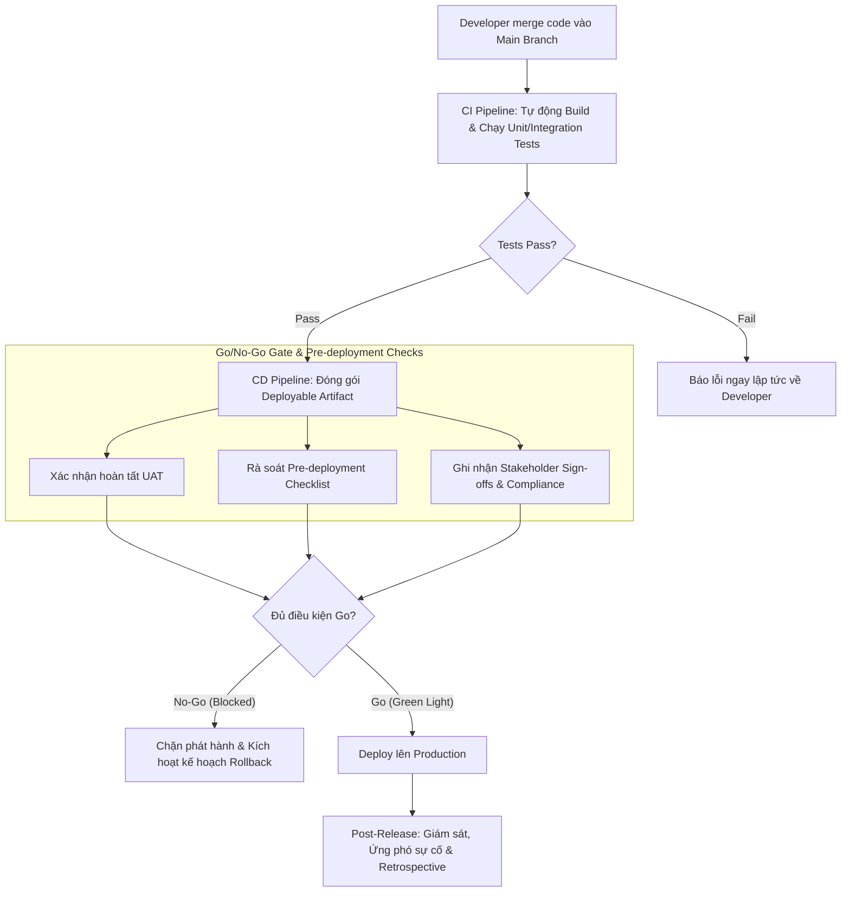

# 02. Enabling CI/CD Planning – Tóm tắt

**Khóa học:** Strategies to Test, Deploy, and Maintain Software  
**Module 2:** Software Deployment, Release, and Maintenance Strategies  
**Thời lượng video:** 4 phút 31 giây  
**Ngày lưu:** 2026-10-16  

---

## 🎯 Mục tiêu bài học
- Định nghĩa bản chất của **CI/CD** và vai trò cốt lõi trong quy trình phân phối phần mềm hiện đại.
- Nắm rõ các trách nhiệm quan trọng trong việc **lập kế hoạch CI/CD (CI/CD Planning)**: thiết lập cổng Go/No-Go, kế hoạch rollback, và quản lý thời điểm kinh doanh.
- Hiểu được giá trị gia tăng và vai trò cầu nối của **Systems Professionals** khi hợp tác với DevOps, QA và Product Owners.

---

## ⚙️ Khái niệm cốt lõi: CI vs CD

- **CI/CD** là phương pháp tiếp cận hiện đại giúp tự động hóa quy trình xây dựng (build), kiểm thử (test) và phát hành (release) phần mềm:
  - **Continuous Integration (CI):** Tự động merge code thường xuyên vào nhánh dùng chung (shared repository). Mỗi lần merge kích hoạt tự động build và chạy bộ test (Unit, Integration) để bắt lỗi từ sớm.
  - **Continuous Delivery (CD):** Tự động đóng gói code đã qua kiểm thử thành các bản dựng sẵn sàng triển khai (deployable artifacts), có thể tự động deploy lên môi trường Staging/Production hoặc chờ lệnh phê duyệt release.
- **Công cụ tiêu biểu:** Jenkins, GitHub Actions, GitLab CI, Azure DevOps.
- **Lợi ích chính:** Giảm thiểu thao tác thủ công, nâng cao chất lượng code, gia tăng tốc độ và tính nhất quán khi phát hành.

---

## 🔄 Luồng thực thi CI/CD và Vai trò của Systems Professional

---

## 📋 Trách nhiệm then chốt trong CI/CD Planning

Lập kế hoạch CI/CD không chỉ là cấu hình script tự động hóa, mà là thiết lập khung an toàn cho toàn bộ tổ chức:

### 1. Thiết lập điều kiện tiền triển khai (Pre-deployment Conditions)
- Điều phối xác nhận nghiệm thu từ đội ngũ kiểm thử (QA sign-offs).
- Lấy phê duyệt chức năng nghiệp vụ (Functional approvals).
- Đánh giá tuân thủ quy chuẩn bảo mật và pháp lý (Compliance reviews).

### 2. Thiết lập Cổng Go/No-Go và Kế hoạch Rollback
- **Tiêu chí rõ ràng:** Xác định chính xác điều kiện nào khiến đợt phát hành bị chặn đứng (**Blocked**).
- **Thẩm quyền phê duyệt:** Quy định rõ ai là người có quyền bật "đèn xanh" cuối cùng (**Final Green Light**).
- **Kế hoạch Rollback:** Tài liệu hóa chi tiết cách thức hoàn tác hệ thống và diễn tập trước để sẵn sàng xử lý sự cố tức thì.

### 3. Quản lý thời điểm kinh doanh (Business Timing & Dependencies)
- **Tránh xung đột sự kiện:** Không phát hành vào các thời điểm nhạy cảm hoặc sự kiện cao điểm của doanh nghiệp (ví dụ: ngày hội mua sắm, chốt báo cáo tài chính).
- **Quản lý phụ thuộc chéo:** Điều phối các service có liên kết phụ thuộc giữa nhiều nhóm khác nhau (Cross-team dependencies).
- **Hỗ trợ phát hành toàn cầu (Global Rollouts):** Tính toán múi giờ và vùng địa lý phù hợp cho người dùng quốc tế.

### 4. Chiến lược truyền thông (Communication Strategy)
- Thông báo minh bạch cho các bên liên quan: Phát hành nội dung gì, vào khung giờ nào, tác động ra sao.
- Chỉ dẫn rõ ràng các chỉ số cần theo dõi sát sao sau khi hệ thống go-live.

---

## 🤝 Hợp tác liên chức năng của Systems Professionals

Systems Professional đóng vai trò là "mỏ neo an toàn", cân bằng giữa **tốc độ phát hành** và **mức độ ổn định hệ thống**:

| Đối tác | Vai trò hợp tác |
| :--- | :--- |
| **DevOps Engineers** | Cùng thiết kế, tối ưu hóa và duy trì độ tin cậy của đường ống CI/CD. |
| **QA / Test Teams** | Xác thực các bản build, rà soát độ bao phủ kiểm thử (Test coverage) và xác nhận kết quả UAT. |
| **Product Owners / Business Stakeholders** | Đánh giá tính sẵn sàng của tính năng, phê duyệt phát hành và đảm bảo gắn kết với chiến lược kinh doanh. |

### Giá trị khác biệt mà Systems Professionals mang lại:
1. **Góc nhìn phi kỹ thuật về rủi ro:** Đánh giá tác động tiềm ẩn của đợt release dưới lăng kính trải nghiệm người dùng và hoạt động kinh doanh.
2. **Khả năng truy vết (Traceability) & Tuân thủ:** Duy trì hồ sơ kiểm toán, nhật ký phê duyệt phục vụ thanh tra compliance và điều tra nguyên nhân sự cố (Root Cause Analysis).
3. **Cân bằng Vận tốc và An toàn:** Ngăn chặn việc đẩy code quá nhanh dẫn đến phá vỡ tính ổn định của môi trường Production.
