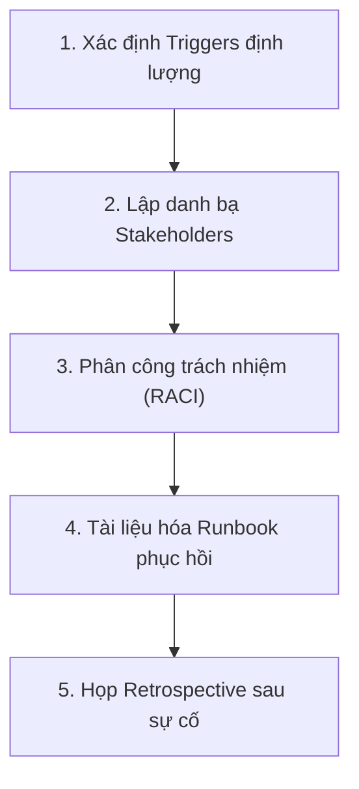

# 04. Rollback Strategy Essentials – Tóm tắt

**Khóa học:** Strategies to Test, Deploy, and Maintain Software  
**Module 2:** Software Deployment, Release, and Maintenance Strategies  
**Thời lượng video:** 4 phút 09 giây  
**Ngày lưu:** 2026-10-16  

---

## 🎯 Mục tiêu bài học
- Định nghĩa bản chất của **Rollback** và vai trò như một "lưới an toàn cuối cùng" (**Last Resort Safety Net**) trong quy trình phát hành phần mềm.
- Phân biệt rõ sự khác nhau giữa **Application Rollback** và **Data Rollback**.
- Nắm vững cách thiết lập các **điều kiện kích hoạt Rollback (Triggers)** định lượng, đo lường được.
- Hiểu rõ trách nhiệm của **Systems Professionals** trong việc lập kế hoạch rollback, phân công vai trò, quản lý truyền thông và chủ trì họp rút kinh nghiệm (**Retrospective**).

---

## 🛑 Rollback là gì?

**Rollback (Hoàn tác)** là quá trình đưa hệ thống quay trở về một trạng thái ổn định đã biết trước đó (**previously stable state**) ngay sau khi một đợt deployment thất bại hoặc gây ra tác động tiêu cực vượt quá mức chấp nhận.

> [!IMPORTANT]
> **Lưới an toàn tối hậu:** Mọi kế hoạch triển khai (Deployment Plan) bắt buộc phải có tài liệu hướng dẫn rollback chi tiết và phải được **diễn tập thực tế (rehearsed)** trước giờ G để tránh hoảng loạn, mất mát dữ liệu hoặc gián đoạn dịch vụ kéo dài.

---

## ⚖️ Phân loại: Application Rollback vs Data Rollback

| Tiêu chí | Application Rollback (Hoàn tác ứng dụng) | Data Rollback (Hoàn tác dữ liệu) |
| :--- | :--- | :--- |
| **Đối tượng hoàn tác** | Codebase, container image, server binary, frontend bundle. | Database schemas, bảng dữ liệu, records, transactions. |
| **Cách thức thực hiện** | Revert commit trên Git, redeploy version trước đó qua CI/CD pipeline, chuyển đổi trỏ traffic trên Load Balancer/Kubernetes. | Restore bản snapshot/backup DB, chạy migration rollback script (`migrate:down`), khôi phục dữ liệu point-in-time (PITR). |
| **Mức độ phức tạp** | **Thấp - Trung bình** (thường đã được tự động hóa). | **Rất cao** (đòi hỏi xử lý logic dữ liệu phức tạp). |
| **Rủi ro chính** | Downtime ngắn trong lúc redeploy. | **Mất mát dữ liệu mới sinh** trong khoảng thời gian hệ thống lỗi, sai lệch tính toàn vẹn (data integrity), xung đột phiên bản giữa code cũ và schema mới. |

---

## ⚡ Các điều kiện kích hoạt Rollback (Rollback Triggers)

Các ngưỡng kích hoạt rollback không được định nghĩa cảm tính mà phải là **chỉ số đo lường định lượng cụ thể**:

| Nhóm Trigger | Ví dụ ngưỡng đo lường thực tế | Hành động |
| :--- | :--- | :--- |
| **Lỗi chức năng nghiêm trọng** | Người dùng không thể đăng nhập, không thể thanh toán (Payment gateway fail > 3 giao dịch liên tiếp). | Kích hoạt Rollback tức thì |
| **Tỷ lệ lỗi hệ thống (Error Rate)** | Tỷ lệ HTTP 5xx vượt quá **5% liên tục trong 10 phút** trên hệ thống API. | Kích hoạt Rollback tức thì |
| **Dữ liệu bị sai hỏng (Data Corruption)** | Phát hiện sai lệch số dư, công thức tính toán tài chính hiển thị sai kết quả. | Dừng khẩn cấp, cô lập DB và Rollback |
| **Vi phạm tuân thủ & An ninh** | Phát hiện lỗ hổng bảo mật nghiêm trọng (RCE, rò rỉ dữ liệu PII) hoặc vi phạm pháp lý. | Chặn phát hành và hoàn tác ngay |
| **Lệnh dừng khẩn cấp (Emergency Stop)** | Stakeholder chủ chốt (Product Owner, C-Level) yêu cầu hủy release. | Thực thi Rollback theo playbook |

---

## 📋 5 Bước Lập kế hoạch Rollback của Systems Professionals

### 1. Định nghĩa rõ điều kiện kích hoạt (Measurable Triggers)
- Thiết lập các chỉ số KPI/SLA cụ thể để đội trực (On-call) biết chính xác khi nào cần kéo phanh khẩn cấp mà không cần chờ họp bàn.

### 2. Danh bạ Stakeholders cần thông báo
- Xác định ai có quyền phê duyệt rollback và ai cần được nhận thông tin khẩn cấp.
- Luôn cập nhật thông tin liên lạc (hotline, kênh chat sự cố) trong Release Checklist.

### 3. Phân công trách nhiệm rõ ràng (Mapping Responsibilities)
- **Ai thực thi kỹ thuật:** Kỹ sư DevOps / SysAdmin chịu trách nhiệm chạy lệnh rollback hạ tầng/code.
- **Ai truyền thông (Communications):** Người phát ngôn cập nhật tình trạng tới khách hàng, đối tác và ban lãnh đạo (tránh để khách hàng hoang mang).
- **Ai ghi chép nhật ký (Documentation):** Ghi lại chính xác mốc thời gian, hiện tượng và các bước đã thao tác.

### 4. Tài liệu hóa Runbook từng bước (Step-by-step Recovery Runbook)
- Cung cấp kịch bản thao tác lệnh chi tiết, công cụ đánh giá mức độ ảnh hưởng và các bước kiểm thử khói (smoke test) sau khi hoàn tất rollback.

### 5. Chủ trì họp rút kinh nghiệm (Post-Rollback Retrospective)
- Tổ chức phiên họp "không quy trách nhiệm cá nhân" (Blameless Retrospective).
- Phân tích nguyên nhân gốc rễ (Root Cause Analysis - RCA), đánh giá điểm hiệu quả/chưa hiệu quả của kế hoạch rollback để cải tiến cho các đợt phát hành tương lai.
