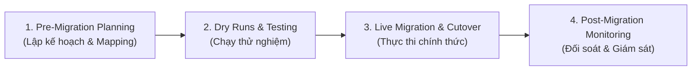

# Cơ bản về Chuyển đổi Dữ liệu: Từ Hệ thống Cũ sang Hệ thống Mới (Data Migration Basics: Legacy to New Systems)

> **Mục tiêu bài học:**  
> - Hiểu bản chất và vai trò sống còn của Data Migration trong quá trình chuyển đổi hệ thống.  
> - Nắm rõ các thách thức, cạm bẫy thường gặp khi di chuyển dữ liệu từ hệ thống legacy.  
> - Xác định rõ trách nhiệm của **Systems Professional** trước, trong và sau di chuyển.  
> - Nắm vững các Best Practices để đảm bảo dữ liệu di chuyển trọn vẹn, chính xác và giữ nguyên giá trị kinh doanh.

---

## 1. Data Migration là gì? & Mục tiêu Cốt lõi
- **Khái niệm:** Là quá trình chuyển dữ liệu từ hệ thống cũ (legacy) sang nền tảng mới hiện đại (ví dụ: on-premise lên Cloud, phần cứng cũ sang SaaS, hợp nhất dữ liệu sau sáp nhập doanh nghiệp).
- **Mục tiêu số 1:** Chuyển đổi dữ liệu **đầy đủ (complete)**, **chính xác (accurate)** và **bảo toàn nguyên vẹn giá trị/ý nghĩa nghiệp vụ (business value and meaning)** mà không làm gián đoạn kinh doanh.

---

## 2. Các thách thức lớn nhất (Tại sao Migration dễ thất bại?)
1. **Chất lượng dữ liệu legacy kém:** Dữ liệu cũ lỗi thời, trùng lặp (duplicate) hoặc không nhất quán.
2. **Lệch cấu trúc (Structural Mismatches):** Khác biệt tên trường và kiểu dữ liệu (ví dụ: `customer_email` $\rightarrow$ `email_id`).
3. **Quy tắc nghiệp vụ ngầm (Hidden Business Rules):** Các logic ẩn sâu trong code cũ hoặc quy trình vận hành bị bỏ sót khi thiết kế hệ thống mới.
4. **Áp lực thời gian (Tight Deadlines):** Thường diễn ra vào ban đêm/cuối tuần ngay trước giờ Go-Live.
5. **Thiếu quyền sở hữu (Lack of Accountability):** Không có người chịu trách nhiệm rõ ràng về việc xác thực/nghiệm thu dữ liệu.

---

## 3. Trách nhiệm của Systems Professional (Trước - Trong - Sau)
*Lưu ý: Systems Professional không trực tiếp viết script di chuyển, mà chịu trách nhiệm điều phối, tài liệu hóa và xác thực dữ liệu.*

### 1. Pre-Migration (Lập kế hoạch & Mapping Sheet)
- Xác định phạm vi dữ liệu cần chuyển và lý do kinh doanh.
- Phối hợp với Dev/DBA lên kế hoạch trích xuất (Extract) và nạp (Load).
- **Lập & sở hữu Mapping Sheet:** Bảng đối chiếu từng trường (tên cũ $\rightarrow$ tên mới $\rightarrow$ logic chuyển đổi, ví dụ: `Y/N` $\rightarrow$ `Active/Inactive`).
- Lấy phê duyệt (Sign-off) chính thức từ Business Users trước khi chạy.

### 2. Dry Runs (Chạy thử nghiệm)
- Chạy thử nghiệm trên bản sao dữ liệu thật (data replica) để phát hiện sớm lỗi mismatch schema, lỗi chuyển đổi kiểu dữ liệu, đếm số lượng bản ghi (record counts).

### 3. Post-Migration (Giám sát sau Go-Live)
- **Đối soát số lượng (Record Counts):** So sánh tổng số bản ghi giữa hệ thống cũ và mới.
- Kiểm tra mẫu (Sample checks) cùng đội ngũ nghiệp vụ đối với các trường quan trọng (giá cả, số dư, ngày tháng).
- Ghi nhận và báo cáo ngay các trường hợp lệch dữ liệu để xử lý khẩn cấp.

---

## 4. Sai lầm cần tránh & Thực hành Tốt nhất (Best Practices)

### ❌ 4 Sai lầm phổ biến cần tránh
1. **Chuyển quá nhiều dữ liệu rác:** Đưa cả dữ liệu đã lỗi thời, không còn giá trị kinh doanh vào hệ thống mới.
2. **Bỏ qua xác thực từ người dùng (Skip User Validation):** Chỉ để đội IT tự kiểm tra mà không có nghiệp vụ nghiệm thu.
3. **Bỏ sót các trường phái sinh (Derived Fields) & Bảng mã (Lookup Values).**
4. **Coi migration là việc IT đơn thuần:** Quên rằng dữ liệu ảnh hưởng trực tiếp đến hoạt động kinh doanh hàng ngày.

### ✅ Best Practices vàng
- **Backup & Version Control:** Luôn sao lưu dữ liệu trước mỗi bước và quản lý phiên bản cho migration scripts/mapping sheets.
- **Xem Migration như một đợt Release chính thức:** Có checklist, có người ký duyệt (sign-offs), và chuẩn bị sẵn kế hoạch hoàn tác (Rollback Plan).
- **Định nghĩa tiêu chí thành công (Success Criteria) trước:**  
  *Ví dụ: "100% khách hàng đang hoạt động phải được chuyển đổi thành công với số dư tài khoản khớp tuyệt đối."*
