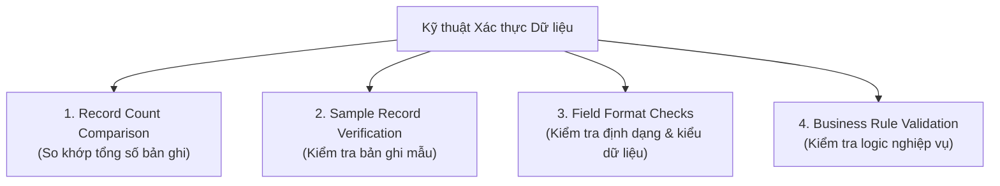

# Kỹ thuật Ánh xạ và Xác thực Dữ liệu (Data Mapping and Validation Techniques)

> **Mục tiêu bài học:**  
> - Phân biệt bản chất giữa **Data Mapping (Ánh xạ dữ liệu)** và **Data Validation (Xác thực dữ liệu)**.  
> - Nắm rõ cấu trúc của bảng mẫu ánh xạ dữ liệu (Data Mapping Template).  
> - Thành thạo 4 kỹ thuật xác thực dữ liệu cốt lõi phục vụ kiểm tra và nghiệm thu.  
> - Hiểu vai trò của Báo cáo tóm tắt xác thực (Validation Summary) trong việc cấp phép Go-Live.

---

## 1. Bản chất: Data Mapping vs. Data Validation

- **Data Mapping (Ánh xạ):** Xác định liên kết giữa các trường dữ liệu từ hệ thống nguồn (Source/Legacy) sang hệ thống đích (Target/New). Trả lời câu hỏi: *"Dữ liệu từ đâu đi đến đâu và biến đổi như thế nào?"*
- **Data Validation (Xác thực):** Kiểm tra, đối soát thực tế xem dữ liệu sau khi nạp vào hệ thống mới có chính xác, đầy đủ và đúng định dạng hay không. Trả lời câu hỏi: *"Dữ liệu đến nơi có đúng, đủ và dùng được không?"*

---

## 2. Bảng mẫu Ánh xạ Dữ liệu (Data Mapping Template)

Tài liệu này là kim chỉ nam cho đội ngũ kỹ thuật viết script chuyển đổi:

| Source Field (Hệ thống cũ) | Target Field (Hệ thống mới) | Transformation Rule (Quy tắc biến đổi) | Notes / Exceptions (Ghi chú) |
| :--- | :--- | :--- | :--- |
| `email` | `email_address` | Direct Mapping (Không đổi) | 1-to-1 |
| `salary_cents` | `salary_amount` | Divide by 100 (`/ 100`) | Đổi từ xu sang đơn vị tiền tệ chính |
| `first_name`, `last_name` | `full_name` | Concatenate (`first_name + " " + last_name`) | Ghép hai trường thành họ tên đầy đủ |
| `status_code` | `account_status` | `Y/N` $\rightarrow$ `ACTIVE/INACTIVE` | Ánh xạ bảng mã (Lookup table) |

---

## 3. 4 Kỹ thuật Xác thực Dữ liệu Cốt lõi (Validation Techniques)

1. **So khớp tổng số bản ghi (Record Count Comparison):**
   - So sánh trực tiếp tổng số dòng giữa nguồn và đích (ví dụ: cũ có `8,752` khách hàng thì mới cũng phải có đúng `8,752`).
   - *Mục đích:* Phát hiện ngay lập tức dữ liệu bị thất thoát (missing) hoặc bị nhân bản (duplicated).

2. **Kiểm tra bản ghi mẫu (Sample Record Verification):**
   - Chọn một tập mẫu đại diện (ngẫu nhiên hoặc các khách hàng VIP/quan trọng) để soi chi tiết từng trường dữ liệu trước và sau chuyển đổi.
   - *Mục đích:* Đảm bảo tính chính xác của các thuật toán biến đổi phức tạp.

3. **Kiểm tra định dạng trường (Field Format Checks):**
   - Xác minh kiểu dữ liệu và định dạng chuẩn:
     - Định dạng ngày tháng: `YYYY-MM-DD`.
     - Số điện thoại: Chuẩn hóa, loại bỏ dấu gạch ngang hoặc mã vùng thừa.
     - Tiền tệ: Đảm bảo hiển thị đúng số thập phân (ví dụ: 2 chữ số sau dấu phẩy).

4. **Kiểm tra tuân thủ quy tắc nghiệp vụ (Business Rule Validation):**
   - Đảm bảo dữ liệu sau chuyển đổi không vi phạm các ràng buộc nghiệp vụ.
   - *Ví dụ:* Không nhân viên nào có mức lương thấp hơn mức sàn tối thiểu (\$10,000), hoặc ngày kết thúc hợp đồng không được trước ngày bắt đầu.

---

## 4. Báo cáo Tóm tắt Xác thực (Validation Summary)

Systems Professional là người tổng hợp tài liệu này làm bằng chứng nghiệm thu Go-Live:
- **Nội dung gồm:**
  - Tổng số bản ghi (Record counts) trước và sau.
  - Kết quả kiểm tra mẫu (Sample check results).
  - Danh sách lỗi tồn đọng / sai lệch (Known issues & exceptions).
  - Bằng chứng thực tế: Ảnh chụp màn hình giao diện mới, file trích xuất đối soát (export files).
  - **Chữ ký phê duyệt (Sign-off status)** từ các bên liên quan (Business Stakeholders, QA, Dev).
- **Ý nghĩa:** Đây là tài liệu pháp lý kỹ thuật khẳng định dữ liệu đã an toàn và hệ thống đã sẵn sàng Go-Live.
