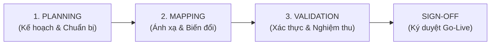

# Tóm tắt Lab: Xây dựng Bảng Kiểm tra Sẵn sàng Chuyển đổi Dữ liệu (Data Migration Readiness Checklist)

> **Tình huống:** Chuyển đổi dữ liệu khách hàng, lịch sử liên lạc và gói thuê bao từ hệ thống **CRM On-Premises cũ** sang nền tảng **Cloud CRM mới**.  
> **Vai trò:** Systems Professional (Chuyên viên hệ thống / Quản trị quy trình chuyển đổi).  
> **File bài nộp chuẩn:** [`lab-m2l2-data-migration-checklist.md`](file:///D:/Study/Coursera/IBM%20System%20Design/08.%20Strategies%20to%20Test,%20Deploy,%20and%20Maintain%20Software/Module%202%20-%20Software%20Deployment,%20Release,%20and%20Maintenance%20Strategies/lab-m2l2-data-migration-checklist.md)

---

## 📌 Cấu trúc 3 Giai đoạn cốt lõi của Checklist

### 1. Giai đoạn Planning (Lập kế hoạch & Môi trường)
- **Kiểm kê dữ liệu cũ (Data Audit/Inventory):** Phân loại dữ liệu active vs dữ liệu rác/lỗi thời để không mang rác sang hệ thống mới. *(Owner: Systems Analyst)*
- **Xác định mục tiêu & tiêu chí thành công:** Ví dụ: 100% tài khoản active khớp số dư và dữ liệu liên lạc. *(Owner: Business Lead)*
- **Xây dựng Kịch bản Rollback:** Phương án phục hồi dữ liệu nếu việc cắt chuyển (cutover) thất bại. *(Owner: Systems Architect)*
- **Thiết lập môi trường Dry-run:** Cấu hình môi trường Staging mô phỏng 1:1 hệ thống thật. *(Owner: DevOps)*

### 2. Giai đoạn Mapping (Ánh xạ trường & Quy tắc biến đổi)
- **Hoàn thiện Mapping Sheet:** Đối chiếu chi tiết từng trường nguồn $\rightarrow$ trường đích và kiểu dữ liệu. *(Owner: Systems Analyst)*
- **Quy tắc biến đổi dữ liệu (Transformation Rules):** Chuẩn hóa ngày tháng (`YYYY-MM-DD`), ghép chuỗi (họ + tên $\rightarrow$ full name), đổi đơn vị tiền tệ. *(Owner: Developer)*
- **Ánh xạ bảng mã (Lookup Codes):** Chuyển đổi mã trạng thái cũ sang mã mới (ví dụ: `Y/N` $\rightarrow$ `ACTIVE/INACTIVE`). *(Owner: Systems Analyst)*

### 3. Giai đoạn Validation (Xác thực & Chạy thử)
- **Chạy thử toàn diện (Dry Run):** Chạy thử nghiệm trên bản sao dữ liệu thật để bắt lỗi schema, lỗi script. *(Owner: DevOps / Dev)*
- **So khớp số lượng (Record Count Comparison):** Đảm bảo tổng số bản ghi khớp tuyệt đối giữa CRM cũ và mới, không mất mát, không trùng lặp. *(Owner: QA)*
- **Kiểm tra điểm mẫu (Spot Checks):** Soi chi tiết từng trường trên các hồ sơ ngẫu nhiên và khách hàng VIP. *(Owner: QA / Business Analyst)*
- **Kiểm tra ràng buộc nghiệp vụ (Business Rules):** Kiểm tra email hợp lệ, không có số dư âm. *(Owner: QA)*
- **Lập Validation Summary:** Tổng hợp số liệu, bằng chứng đối soát trình cấp thẩm quyền. *(Owner: Systems Professional)*

---

## ✍️ Mục Phê duyệt (Sign-Off Section)
Bảng checklist bắt buộc phải có chữ ký xác nhận của đủ các bên trước giờ Go-Live:
- **Systems Analyst:** Xác nhận logic nghiệp vụ và mapping chính xác.
- **Systems Architect & DevOps:** Xác nhận hạ tầng, môi trường và kịch bản rollback an toàn.
- **Developer:** Xác nhận script chuyển đổi và xử lý lỗi hoàn tất.
- **QA Lead:** Xác nhận toàn bộ kiểm thử xác thực và đối soát số lượng đạt 100%.
- **Business Lead / CRM Owner:** Người chịu trách nhiệm kinh doanh ký duyệt bàn giao hệ thống.
