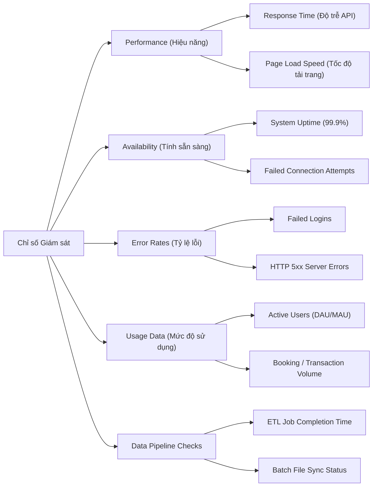

# Giám sát và Cảnh báo: Theo dõi cái gì và Tại sao? (Monitoring and Alerting: What to Track and Why)

> **Mục tiêu bài học:**  
> - Phân biệt bản chất giữa **Monitoring (Giám sát)** và **Alerting (Cảnh báo)** sau khi triển khai hệ thống (Post-Deployment).  
> - Nhận diện 5 nhóm chỉ số (metrics) sức khỏe hệ thống cần theo dõi và mức độ ưu tiên.  
> - Phân loại cảnh báo theo mức độ nghiêm trọng (Severity Levels) để phản ứng nhanh và tránh "ngợp cảnh báo" (Alert Fatigue).  
> - Hiểu vai trò của **Systems Professional** trong việc kết nối chỉ số kỹ thuật với tác động kinh doanh.

---

## 1. Bản chất: Monitoring vs. Alerting

- **Monitoring (Giám sát):** Là quá trình theo dõi liên tục các chỉ số đo lường sức khỏe hệ thống (thời gian hoạt động, tốc độ phản hồi, tỷ lệ lỗi, hành vi người dùng).  
  *Trả lời câu hỏi:* Hệ thống có đang khỏe mạnh không? Người dùng có gặp khó khăn gì không? Mọi thứ có chạy đúng dự kiến không?
- **Alerting (Cảnh báo):** Là lớp chủ động (proactive layer) đóng vai trò như **chuông báo động kỹ thuật số**. Khi một chỉ số vượt qua ngưỡng giới hạn (threshold), cảnh báo sẽ gửi thông báo ngay lập tức đến đội ngũ phụ trách để can thiệp kịp thời.

---

## 2. 5 Nhóm Chỉ số Giám sát Cốt lõi (Key Monitoring Categories)

1. **Performance (Hiệu năng):** Thời gian phản hồi API, tốc độ tải trang giao diện.
2. **Availability (Tính sẵn sàng):** Tỷ lệ uptime máy chủ (99.9%), số kết nối thất bại.
3. **Error Rates (Tỷ lệ lỗi):** Lỗi đăng nhập, lỗi 500 internal server error, lỗi cổng thanh toán.
4. **Usage Data (Dữ liệu sử dụng):** Số lượng người dùng hoạt động, tần suất sử dụng tính năng, số giao dịch/giờ (ví dụ: số vé đặt/giờ đột ngột giảm là dấu hiệu có lỗi luồng đặt vé).
5. **Data Pipeline Checks (Kiểm tra đường ống dữ liệu):** Các batch job import/export tệp dữ liệu có hoàn thành đúng hạn không.

---

## 3. Phân cấp Cảnh báo theo Mức độ Nghiêm trọng (Alert Severities)

Để tránh tình trạng quá tải thông báo (**Alert Fatigue**), các cảnh báo được phân loại rõ ràng:

| Mức độ Cảnh báo | Định nghĩa & Hành động yêu cầu | Ví dụ thực tế |
| :--- | :--- | :--- |
| **🔴 Critical (Khẩn cấp)** | Cần hành động khắc phục ngay lập tức (24/7). Tác động trực tiếp đến doanh thu và trải nghiệm cốt lõi. | Cổng thanh toán tê liệt, hệ thống đăng nhập sập hoàn toàn. |
| **🟡 Warning (Cảnh báo)** | Cần điều tra trong thời gian sớm; hệ thống chưa sập nhưng đang có dấu hiệu bất thường. | Tỷ lệ thành công của API bên thứ 3 giảm, CPU server duy trì > 85% trong 15 phút. |
| **🔵 Informational (Thông tin)** | Ghi nhận log phục vụ phân tích xu hướng hoặc bảo trì định kỳ trong tương lai. | Hoàn thành sao lưu dữ liệu đêm, cập nhật chứng chỉ SSL thành công. |

---

## 4. Ma trận Giám sát & Cảnh báo (Monitoring and Alerting Matrix)

Systems Professional là người chủ trì lập và bảo trì bảng Ma trận này để liên kết giữa Kỹ thuật và Nghiệp vụ:

| Metric (Chỉ số) | Business Meaning (Ý nghĩa nghiệp vụ) | Threshold (Ngưỡng cảnh báo) | Severity | Owner (Phụ trách) | Action (Hành động) |
| :--- | :--- | :--- | :---: | :--- | :--- |
| **Payment Success Rate** | Doanh thu trực tiếp của nền tảng | $< 95\%$ trong 5 phút | 🔴 Critical | DevOps / On-call Eng | Kích hoạt kênh thanh toán dự phòng, rollback nếu do release |
| **User Registration Failure** | Mất khách hàng mới | $> 5\%$ trong 10 phút | 🟡 Warning | Backend Lead | Kiểm tra dịch vụ gửi OTP / Email xác thực |
| **Database Disk Usage** | Nguy cơ tràn đĩa làm treo hệ thống | $> 80\%$ dung lượng | 🟡 Warning | DBA / Cloud Ops | Dọn dẹp log cũ, tăng dung lượng ổ cứng tự động |
| **Daily Batch Report Sync** | Chậm báo cáo kinh doanh cho ban điều hành | Trễ $> 30$ phút so với lịch 06:00 AM | 🔵 Info | Data Analyst | Khởi động lại ETL job, kiểm tra nguồn cấp dữ liệu |

---

## 5. Vai trò của Systems Professional
1. **Dịch chuyển Yêu cầu Kinh doanh thành Ngưỡng Kỹ thuật:** Giúp đội Dev hiểu giá trị ngưỡng nào là có ý nghĩa kinh doanh (ví dụ: lỗi đăng ký $> 5\%$ là mất khách hàng nghiêm trọng).
2. **Tinh chỉnh Hệ thống Giám sát theo thời gian (Fine-tuning):** Loại bỏ các cảnh báo nhiễu, nâng cao độ chính xác để đội ngũ không bị "nhờn" cảnh báo.
3. **Phát hiện Quy luật để Đề xuất Bảo trì:** Nếu hiệu năng giảm dần đều theo tuần, đề xuất lịch bảo trì định kỳ trước khi hệ thống gặp sự cố.
4. **Xây dựng Báo cáo Minh bạch cho Stakeholders:** Lập báo cáo Uptime, SLA và thời gian xử lý sự cố (MTTR) để củng cố niềm tin của khách hàng và ban lãnh đạo.
