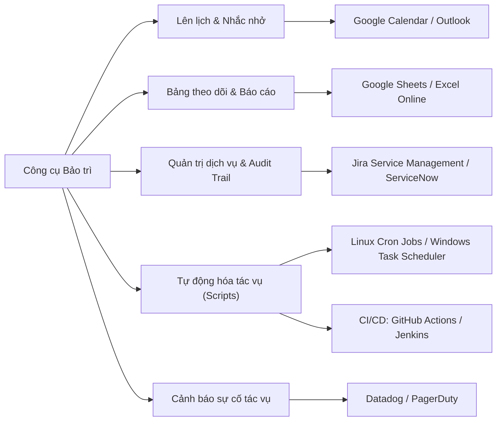

# Xây dựng Lịch Bảo trì Hệ thống (Creating a Maintenance Calendar)

> **Mục tiêu bài học:**  
> - Hiểu định nghĩa và vai trò sống còn của **Maintenance Calendar (Lịch bảo trì)** sau khi hệ thống Go-Live.  
> - Nhận diện các thành phần cấu thành chuẩn của một bảng lịch bảo trì.  
> - Nắm rõ các công cụ hỗ trợ xây dựng và tự động hóa bảo trì.  
> - Hiểu vai trò của **Systems Professional** trong việc thiết lập trách nhiệm giải trình (Accountability) và lập kế hoạch bảo trì phòng ngừa.

---

## 1. Maintenance Calendar là gì? & Tại sao cần thiết?

- **Khái niệm:** Là một lịch trình có cấu trúc liệt kê các tác vụ định kỳ cần thực hiện sau khi hệ thống đi vào vận hành thực tế (Post Go-Live).
- **Hậu quả nếu KHÔNG có lịch bảo trì:**
  - Sao lưu dữ liệu (backup) thất bại âm thầm mà không ai biết.
  - Chứng chỉ SSL/TLS hết hạn gây sập trang web đột ngột (**outages**).
  - Không vá lỗi bảo mật (security patches) dẫn đến nguy cơ bị xâm nhập.
  - Vi phạm các tiêu chuẩn tuân thủ (compliance violations).

---

## 2. 5 Thành phần Cốt lõi của Lịch Bảo trì

Một bảng lịch bảo trì chuẩn luôn bao gồm 5 thông tin:
1. **Task (Tác vụ):** Tên công việc bảo trì cụ thể.
2. **Frequency (Tần suất):** Hàng tuần (Weekly), Hàng tháng (Monthly), Hàng quý (Quarterly), hoặc Hàng năm (Annually).
3. **Owner / Responsible Role (Người chịu trách nhiệm):** Phân định người/vai trò phụ trách trực tiếp.
4. **Next Due Date (Hạn chót tiếp theo):** Ngày cụ thể cần hoàn thành.
5. **Notes (Ghi chú / Quy trình tham chiếu):** Hướng dẫn thực hiện hoặc điều kiện lưu ý.

### Bảng minh họa Lịch Bảo trì mẫu:

| Task (Tác vụ) | Frequency (Tần suất) | Owner (Phụ trách) | Next Due Date | Notes (Ghi chú) |
| :--- | :--- | :--- | :--- | :--- |
| **Sao lưu toàn bộ CSDL (Full DB Backup)** | Weekly (Hàng tuần) | DevOps / DBA | 24/10/2026 | Kiểm tra tính toàn vẹn của bản sao lưu |
| **Rà soát Error Logs & Tinh chỉnh Alert** | Monthly (Hàng tháng) | Systems Professional | 01/11/2026 | Lọc bỏ các alert nhiễu, kiểm tra lỗi lạ |
| **Kiểm thử kết nối API bên thứ 3** | Quarterly (Hàng quý) | QA / Backend Lead | 15/12/2026 | Kiểm tra deprecation warning của API đối tác |
| **Chạy kiểm thử tải (Load Testing)** | Annually (Tháng 10 hàng năm)| QA Lead / DevOps | 15/10/2027 | Chuẩn bị trước mùa cao điểm cuối năm |
| **Gia hạn & Cập nhật SSL Certificate** | Annually (Hàng năm) | Cloud Architect | 05/01/2027 | Đảm bảo HTTPS không bị gián đoạn |
| **Lưu trữ dữ liệu cũ (Data Archiving > 5 năm)**| Annually (Tháng 1 hàng năm) | Data Engineer | 10/01/2027 | Giảm tải database chính, tối ưu truy vấn |

---

## 3. Hệ sinh thái Công cụ Xây dựng Lịch Bảo trì

---

## 4. Tình huống Thực tế: Nền tảng Quyên góp Từ thiện (Non-Profit Case Study)

- **Vấn đề:** Nền tảng quản lý nhà hảo tâm bị nghẽn mạng nghiêm trọng vào mùa cao điểm quyên góp cuối năm (Giving Season).
- **Giải pháp của Systems Professional:** Bổ sung các tác vụ phòng ngừa định kỳ vào Lịch Bảo trì:
  - *Tháng 10 hàng năm:* Chạy kiểm thử tải (Load Testing) để dự đoán và tăng dung lượng server trước mùa cao điểm.
  - *Tháng 1 hàng năm:* Lưu trữ (archive) các khoản quyên góp cũ hơn 5 năm vào cold storage để giải phóng dung lượng DB.
  - *Hàng quý:* Kiểm tra và xác thực lại dịch vụ gửi email để đảm bảo email cảm ơn/biên lai không bị rơi vào hòm spam.

---

## 5. Vai trò của Systems Professional trong Bảo trì
1. **Thiết lập Trách nhiệm Giải trình (Accountability):** Không trực tiếp làm hết mọi việc kỹ thuật, nhưng đảm bảo mọi task đều có **chủ sở hữu (owner)** và phương thức theo dõi tiến độ.
2. **Phân loại Ưu tiên (Prioritization):** Ưu tiên cao cho các tác vụ rủi ro lớn (đổi mật khẩu quản trị, gia hạn chứng chỉ, kiểm thử backup); linh hoạt cho các task thứ yếu (cập nhật tài liệu).
3. **Cầu nối Truyền thông (Communication):** Cung cấp tài liệu tham chiếu chung giữa IT, Đơn vị vận hành và Nhà cung cấp bên ngoài (Vendors), báo cáo tiến độ bảo trì định kỳ cho ban lãnh đạo.
