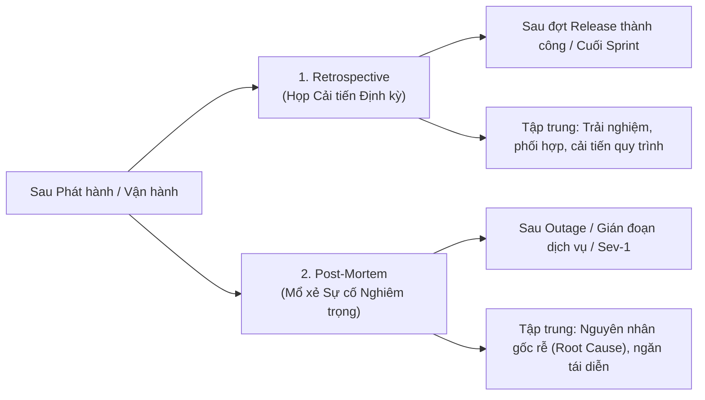

# Biểu mẫu Retrospective và Post-Mortem (Retrospectives and Post-Mortem Templates)

> **Mục tiêu bài đọc:**  
> - Phân biệt mục đích giữa **Retrospective** (Cải tiến quy trình sau release) và **Post-Mortem** (Mổ xẻ nguyên nhân gốc rễ sau sự cố).  
> - Hiểu vai trò của **Solutions Architect** trong việc điều phối các buổi phản hồi liên chức năng (Cross-functional Feedback).  
> - Nắm vững cấu trúc chuẩn và cách ghi chép vấn đề, tác động, bài học kinh nghiệm và kế hoạch hành động tiếp theo.  
> - Tạo dựng văn hóa không đổ lỗi (**Blame-Free Culture**) và cam kết hành động có người phụ trách (Owner) cùng thời hạn cụ thể.

---

## 1. Phân biệt Retrospective vs. Post-Mortem

---

## 2. Biểu mẫu 1: Tóm tắt Retrospective (Retrospective Summary)

*Tình huống minh họa:* Phát hành Dashboard theo dõi xe theo thời gian thực của hãng vận tải **SkyFleet Logistics**.

| Mục (Section) | Nội dung ghi nhận (Entry) | Nhận xét & Hướng dẫn của Architect |
| :--- | :--- | :--- |
| **Sự kiện & Ngày** | Ra mắt Real-Time Vehicle Tracking Dashboard (03/08/2025) | Ghi rõ thời gian và bối cảnh. |
| **Người điều phối** | Solutions Architect | Cần giữ vai trò khách quan, liên kết các bộ phận. |
| **Thành phần tham dự**| Product Owner, QA Lead, DevOps Manager, Chăm sóc khách hàng (CS) | Đảm bảo đủ góc nhìn kỹ thuật, vận hành và khách hàng. |
| **Điều gì làm tốt? (What went well?)** | - Dữ liệu cập nhật real-time rất chính xác. - Tài liệu đào tạo người dùng được đón nhận tốt. | Rất tốt khi làm nổi bật cả thành công kỹ thuật lẫn trải nghiệm người dùng. |
| **Điều gì chưa tốt? (What didn't go well?)** | - Thông báo bị trễ do độ trễ (latency) của backend. - Dữ liệu định vị chập chờn ở 2 khu vực. | Cần chuyển những vấn đề này thành các hành động cụ thể để truy vết. |
| **Cần cải thiện gì? (What can we improve?)** | - Phối hợp sớm hơn với nhóm hạ tầng (Infra). - Đưa đội QA khu vực tham gia vào UAT. | Luôn gán người chịu trách nhiệm (Owner) cho từng điểm cải tiến. |
| **Hành động tiếp theo (Action items)** | 1. Test lại module tracking với tập dữ liệu mới (`Owner: QA`) 2. Bổ sung log khu vực vào hệ thống cảnh báo (`Owner: DevOps`) | **Bắt buộc** phải có Owner và Deadline rõ ràng. |
| **Kỳ họp tiếp theo** | 31/08/2025 | Duy trì văn hóa phản hồi liên tục, không phải sự kiện làm một lần rồi thôi. |

---

## 3. Biểu mẫu 2: Đánh giá Sau Sự cố (Post-Mortem Review)

*Tình huống minh họa:* Sự cố sập hệ thống định vị xe kéo dài 3 giờ tại Khu vực Miền Đông (SkyFleet Logistics).

| Mục (Section) | Nội dung ghi nhận (Entry) | Nhận xét & Hướng dẫn của Architect |
| :--- | :--- | :--- |
| **Tóm tắt sự cố (Incident summary)** | Dữ liệu định vị xe không thể truy cập từ 11:00 đến 14:00 tại Khu vực Miền Đông. | Ngắn gọn, súc tích và hoàn toàn dựa trên sự thật khách quan (Factual). |
| **Nguyên nhân gốc rễ (Root cause)** | Thiếu Index trên bảng `location` dẫn đến nghẽn truy vấn nghiêm trọng khi tải đạt đỉnh. | Nguyên nhân kỹ thuật rõ ràng; cần lưu ý thêm thời gian phát hiện lỗi. |
| **Mức độ tác động (Impact)** | 4 khách hàng lớn bị trễ điều phối xe; 12 ticket khiếu nại gửi về CS. | Định lượng hóa tác động (số liệu cụ thể) giúp nhóm kinh doanh nắm được thiệt hại. |
| **Dòng thời gian (Timeline: Detection & Response)** | - Phát hiện: 11:20 AM - Khôi phục một phần: 1:30 PM - Khôi phục hoàn toàn: 2:00 PM | Mốc thời gian là sống còn để đo lường hiệu quả giám sát (MTTD & MTTR). |
| **Bài học rút ra (Lessons learned)** | - Chiến lược lập chỉ mục (Indexing) cần được rà soát lại. - Ngưỡng cảnh báo (Alert thresholds) đã bỏ lỡ các dấu hiệu cảnh báo sớm. | Architect đưa các bài học này vào checklist kiểm tra trước các đợt release sau. |
| **Hành động khắc phục (Follow-up actions)** | 1. Thêm cảnh báo tự động cho truy vấn chậm (`Owner: DevOps`) 2. Rà soát chuẩn thiết kế Index CSDL (`Owner: DBA`) | Mọi hành động phải có Người phụ trách và Hạn chót hoàn thành. |

---

## 4. Hướng dẫn Thực hành Tốt nhất (Best Practices for Architects)

1. **Văn hóa không đổ lỗi (Blame-Free Culture):**  
   Post-mortem tập trung vào **"Quy trình hoặc hệ thống nào đã hỏng?"** chứ không phải *"Ai đã làm sai?"*. Điều này khuyến khích sự trung thực và minh bạch.
2. **Khép kín vòng lặp phản hồi (Closing the Feedback Loop):**  
   Mọi cuộc họp Retrospective hoặc Post-Mortem sẽ vô nghĩa nếu các Action Items không có người chịu trách nhiệm (Owner) và không được kiểm tra tiến độ vào phiên tiếp theo.
3. **Biến bài học thành Checklist & Tự động hóa:**  
   Sau mỗi sự cố, bổ sung ngay các quy tắc kiểm tra mới vào CI/CD pipeline hoặc Release Checklist để đảm bảo **lỗi đó không bao giờ lặp lại lần thứ hai**.
