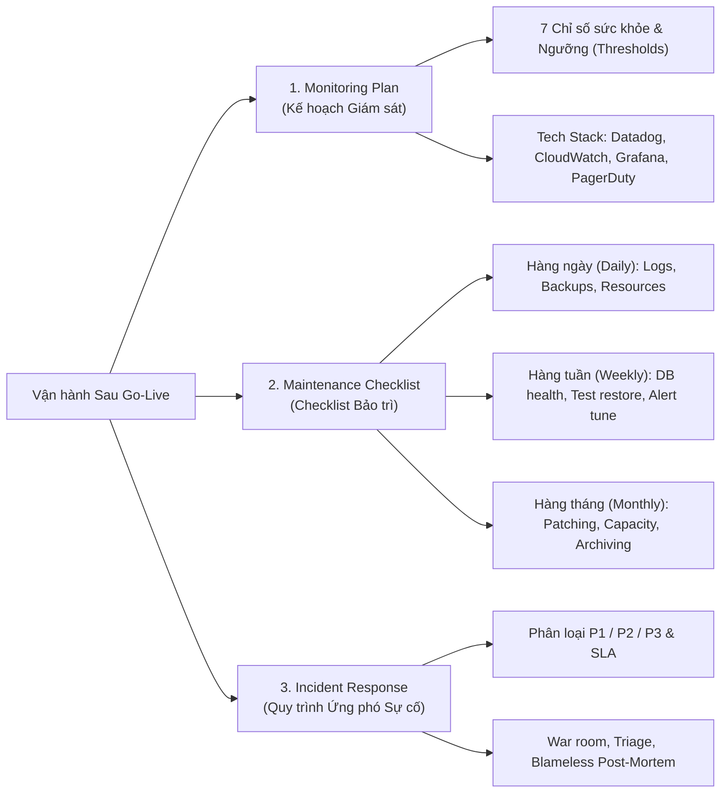

# Tóm tắt Lab: Thiết kế Kế hoạch Giám sát và Checklist Bảo trì (Design a Monitoring Plan and Maintenance Checklist)

> **Khóa học:** IBM System Design - Strategies to Test, Deploy, and Maintain Software  
> **Dự án giả định:** Nền tảng thương mại điện tử **QuickKart** (xử lý đơn hàng, thanh toán, kho hàng real-time).  
> **Vai trò:** Systems Professional / Solutions Architect.  
> **File bài nộp chuẩn:** [`Monitoring-Maintenance-Checklist.md`](file:///D:/Study/Coursera/IBM%20System%20Design/08.%20Strategies%20to%20Test,%20Deploy,%20and%20Maintain%20Software/Module%202%20-%20Software%20Deployment,%20Release,%20and%20Maintenance%20Strategies/Monitoring-Maintenance-Checklist.md)

---

## 📌 Tổng quan 3 Trụ cột Thực hành

---

## 1. Kế hoạch Giám sát (Monitoring Plan)

### 7 Chỉ số cốt lõi cho Sàn E-Commerce QuickKart:
1. **System Uptime / Availability:** Mục tiêu $\ge 99.95\%$. Báo động đỏ khi $< 99.5\%$.
2. **API Response Time (p95):** Mục tiêu $< 300\text{ ms}$. Báo động đỏ khi $> 1500\text{ ms}$ (nguy cơ bỏ giỏ hàng).
3. **HTTP 5xx Error Rate:** Mục tiêu $< 0.5\%$. Báo động đỏ khi $\ge 3\%$ tổng request.
4. **Payment Gateway Success Rate:** Mục tiêu $\ge 98\%$. Cực kỳ nguy hiểm khi $< 90\%$ (mất doanh thu ngay lập tức).
5. **CPU / Memory Usage:** Bình thường $40\% - 65\%$. Báo động đỏ khi $> 90\%$ kéo dài trên 5 phút (nguy cơ sập container OOM).
6. **Database Connection Pool:** Ngưỡng cảnh báo $> 75\%$, ngưỡng đỏ $> 88\%$ (tránh nghẽn hàng đợi DB).
7. **Failed Background Jobs (Queue):** Kiểm soát luồng gửi email xác nhận đơn và đồng bộ tồn kho.

---

## 2. Lịch Bảo trì Định kỳ (Maintenance Schedule)

- **Hàng ngày (Daily):**
  - Rà soát log lỗi nghiêm trọng trên Datadog / Grafana.
  - Kiểm tra trạng thái bản snapshot tự động của Database (AWS RDS backup).
  - Giám sát mức tải đỉnh điểm (Peak CPU/RAM/Disk).
- **Hàng tuần (Weekly):**
  - Kiểm tra dung lượng và độ phân mảnh chỉ mục (index fragmentation) của CSDL.
  - **Tập trận phục hồi sao lưu (Backup Restoration Drill):** Dựng DB test từ bản snapshot để kiểm tra tính toàn vẹn.
  - Tinh chỉnh ngưỡng alert trên PagerDuty/Slack để tránh mệt mỏi vì cảnh báo rác.
- **Hàng tháng (Monthly):**
  - Cập nhật vá lỗi hệ điều hành và bảo mật container (Security Patching).
  - Phân tích xu hướng tăng trưởng tải và dự báo dung lượng (Capacity Planning).
  - Lưu trữ dữ liệu đơn hàng và logs cũ hơn 90 ngày vào kho lạnh (S3 Glacier).

---

## 3. Quy trình Xử lý Sự cố & Leo thang (Incident Response & Escalation)

- **Phân loại độ nghiêm trọng (Severity):**
  - **P1 - Critical (Khẩn cấp):** Sập chức năng chính (Checkout, Thanh toán) $\rightarrow$ **SLA phản hồi: 5 phút**; gửi cảnh báo qua PagerDuty gọi điện trực tiếp cho On-Call SRE.
  - **P2 - Major (Trung bình):** Tính năng phụ lỗi (Bộ lọc tìm kiếm, gợi ý sản phẩm) $\rightarrow$ **SLA phản hồi: 30 phút**; thông báo kênh Slack nhóm tính năng.
  - **P3 - Minor (Thấp):** Lỗi giao diện nhỏ, chậm báo cáo nội bộ $\rightarrow$ Tạo ticket Jira xử lý trong sprint tiếp theo.
- **Văn hóa cải tiến liên tục:**
  - Bắt buộc tổ chức họp **Blameless Post-Mortem** trong vòng 48 giờ sau sự cố P1.
  - Tìm nguyên nhân gốc rễ (5 Whys), đo lường thời gian phát hiện (MTTD) và thời gian khắc phục (MTTR).
  - Bổ sung ngay bài test hoặc rule giám sát mới để lỗi không bao giờ tái diễn.
