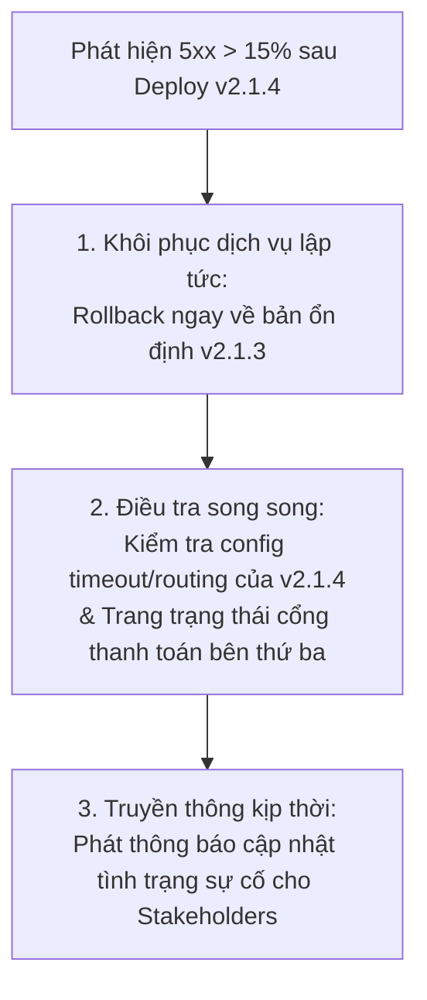

# Tóm tắt Role Play: Ứng phó Sự cố Sau Triển khai (Post-Deployment Incident Response)

> **Hoạt động:** Activity: Role Play Scenario: Post Deployment Incident Response  
> **Nhân vật tương tác:** Ravi Patel (DevOps Lead) & Bạn (Systems Professional / Incident Commander)  
> **Bối cảnh:** Nhận cảnh báo sự cố nghiêm trọng ảnh hưởng đến **Payment API của sàn TMĐT QuickKart** ngay sau khi triển khai phiên bản mới.  
> **Mục tiêu chính:** Tiếp nhận alert, xác định tác động kinh doanh, triển khai hành động sơ cứu khẩn cấp (First Responder Actions), soạn thông báo truyền thông, lập kế hoạch leo thang & thành phần họp Post-Mortem, và hoàn thiện biên bản Post-Mortem chuẩn hóa.

---

## 1. Tiếp nhận Cảnh báo & Đánh giá Tác động Nghiệp vụ (Review Alert & Impact)

- **Số liệu giám sát từ hệ thống:**
  - **Prometheus Alert:** Tỷ lệ lỗi Payment API $> 15\%$ liên tục trong 5 phút.
  - **Grafana Metrics:** Lỗi HTTP 5xx tăng vọt trên endpoint `/process-payment`.
  - **Lịch sử triển khai:** Bản phát hành `v2.1.4` vừa deploy cách đây 12 phút.
  - **Logs:** Xuất hiện hàng loạt ngoại lệ `ConnectionTimeoutException` khi gọi dịch vụ Payment Gateway bên thứ ba.
- **Tác động nghiệp vụ:** Người dùng không thể hoàn tất giao dịch thanh toán trong giỏ hàng $\rightarrow$ Giao dịch thất bại, khách hàng rời bỏ sàn, thất thoát doanh thu trực tiếp.

---

## 2. Hành động Sơ cứu Khẩn cấp (First Responder Actions)



> **Nguyên tắc vàng:** Ưu tiên số một trong ứng phó sự cố nghiêm trọng là **khôi phục độ ổn định của dịch vụ (Restore Service First)** thông qua Rollback, sau đó mới đi sâu điều tra nguyên nhân gốc rễ.

---

## 3. Bản tin Truyền thông cho Các Bên Liên quan (Stakeholder Communication)

- **Tiêu đề:** `[SEV-2 Incident Update] Sự cố Giảm sút Hiệu năng Xử lý Thanh toán QuickKart`
- **Tác động:** Một số khách hàng gặp lỗi hoặc bị chậm trễ khi thực hiện bước thanh toán đơn hàng.
- **Hành động hiện tại:** Đội ngũ kỹ thuật đã xác định nguyên nhân bắt nguồn từ bản cập nhật gần nhất và đang tiến hành rollback về phiên bản ổn định trước đó (`v2.1.3`).
- **Bước tiếp theo:** Tiếp tục theo dõi quá trình hồi phục chỉ số; bản tin cập nhật tiếp theo sẽ gửi trong vòng 15 phút hoặc ngay khi dịch vụ hoạt động bình thường trở lại.

---

## 4. Phân cấp Sự cố & Thành phần Họp Post-Mortem

- **Cấp độ sự cố:** **SEV-2 (Major Incident)**  
  *Lý do:* Chức năng sinh doanh thu cốt lõi (Checkout/Payment) bị gián đoạn cục bộ ($> 15\%$ lỗi), ảnh hưởng trực tiếp đến người dùng cuối nhưng được xử lý nhanh chóng bằng rollback.
- **Thành phần tham dự họp Post-Mortem:**
  1. **Payment API Engineering Team:** Các lập trình viên phát triển `v2.1.4` để rà soát diff mã nguồn/cấu hình timeout.
  2. **DevOps / SRE Team:** Đánh giá pipeline CI/CD, cơ chế rollback tự động và chiến lược Canary Release.
  3. **QA Lead:** Rà soát lỗ hổng trong kịch bản kiểm thử tích hợp (Integration Tests) trên Staging.
  4. **Product Manager (Checkout/Payment):** Đánh giá mức độ thất thoát doanh thu và trải nghiệm người dùng.
  5. **Customer Support Lead:** Nắm bắt số lượng ticket khiếu nại và hỗ trợ người mua bị ảnh hưởng.

---

## 5. Biên bản Đánh giá Sau Sự cố Chuẩn (Incident Post-Mortem Summary)

```markdown
# Incident Post-Mortem Summary: QuickKart Payment API Degradation

## 1. Tổng quan Sự cố (Overview)
- Mức độ nghiêm trọng: SEV-2
- Tác động: Tỷ lệ lỗi 5xx tăng vọt (> 15%) trên endpoint /process-payment, làm gián đoạn thanh toán trong khoảng 15 phút.
- Trạng thái: Đã khắc phục hoàn toàn (Resolved).

## 2. Nguyên nhân Gốc rễ (Root Cause)
Sau khi triển khai phiên bản v2.1.4, dịch vụ Payment API liên tục gặp lỗi ConnectionTimeoutException khi kết nối tới Payment Gateway đối tác. Nguyên nhân do thiết lập tham số kết nối/timeout hoặc định tuyến mạng bị sai lệch trong bản build mới, dẫn đến nghẽn các yêu cầu thanh toán tiếp theo.

## 3. Biện pháp Khắc phục Tức thì (Immediate Resolution)
Thực hiện rollback ngay lập tức từ v2.1.4 về phiên bản ổn định v2.1.3. Các chỉ số dịch vụ và tỷ lệ lỗi đã quay về mức an toàn trong vòng vài phút sau khi rollback hoàn tất, khôi phục 100% luồng thanh toán.

## 4. Các Hành động Cải tiến & Phòng ngừa (Action Items & Preventive Improvements)
1. Triển khai phân phối lũy tiến (Canary Release): Áp dụng chiến lược canary rollout kèm health check tự động, chỉ điều hướng 5-10% lưu lượng ban đầu để phát hiện lỗi hồi quy sớm.
2. Tự động hóa Rollback trong CI/CD: Cấu hình pipeline tự động kích hoạt rollback khi alert tỷ lệ lỗi trên Prometheus vượt ngưỡng cho phép.
3. Áp dụng Mẫu thiết kế Chống chịu (Resiliency Patterns): Tích hợp Circuit Breaker và cơ chế retry với exponential backoff cho các lệnh gọi cổng thanh toán bên thứ ba để tránh block luồng xử lý.
4. Tăng cường Kiểm thử Tích hợp Trước Phát hành: Bổ sung các bài test tự động giả lập (Synthetic/Integration tests) kết nối tới endpoint của đối tác thanh toán trong giai đoạn staging.
```

---

## 📝 Nhận xét & Đánh giá từ Khóa học (Feedback Highlights)
- **Điểm xuất sắc:**
  - Nhận diện chính xác tác động doanh thu từ dữ liệu giám sát kỹ thuật.
  - Tư duy xử lý quyết đoán: **Rollback để cứu dịch vụ trước** thay vì mất thời gian debug trực tiếp trên Live.
  - Phân loại cấp độ sự cố (SEV-2) và lựa chọn đúng các bên liên quan từ Kỹ thuật đến Chăm sóc khách hàng.
  - Soạn thảo thông báo chuyên nghiệp, loại bỏ thuật ngữ kỹ thuật phức tạp đối với nhóm kinh doanh.
  - Biên bản Post-Mortem toàn diện, đề xuất được các giải pháp kiến trúc dài hạn (Canary, Circuit Breaker, Auto-rollback).
