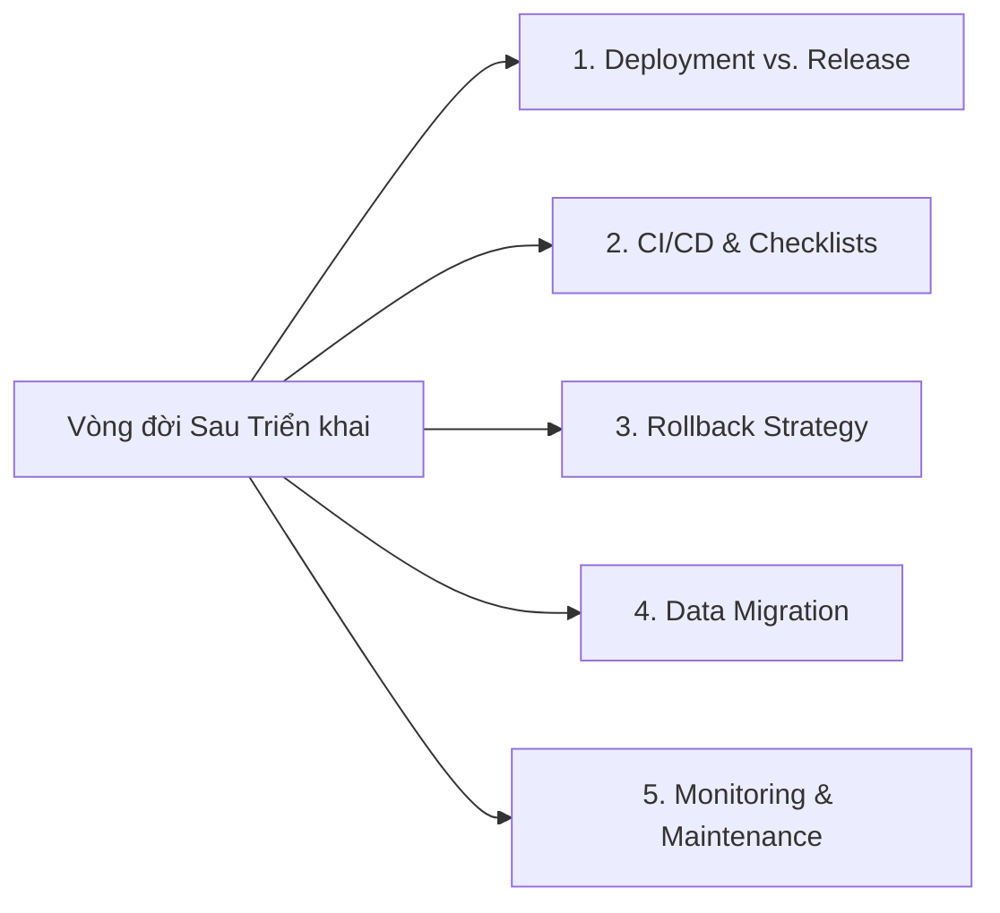

# Tóm tắt Podcast: Chiến lược Triển khai, Phát hành và Bảo trì Phần mềm (Strategies for Software Deployment, Release and Maintenance)

> **Thời lượng:** 3 phút 36 giây  
> **Người dẫn chương trình:** Jack (Host) & Emma (Systems Professional)  
> **Chủ đề:** Toàn cảnh bức tranh vòng đời sau phát triển phần mềm (Post-Development Lifecycle).

---

## 📌 Các Chủ đề Thảo luận Cốt lõi

---

### 1. Phân biệt: Deployment (Triển khai) vs. Release (Phát hành)
- **Deployment (Triển khai):** Hành động kỹ thuật đưa code vào môi trường chạy thực tế (Live environment).
- **Release (Phát hành):** Thời điểm tính năng thực sự được mở (bật quyền truy cập) cho người dùng cuối trải nghiệm.
- *Ý nghĩa:* Một tính năng có thể đã được **deploy** lên production từ trước (ví dụ dùng Feature Flag/Dark Launching), nhưng chờ đến thời điểm kinh doanh phù hợp mới chính thức được **release**.

---

### 2. Tự động hóa CI/CD & Vai trò của Systems Professional
- **CI/CD (Continuous Integration & Continuous Delivery):** Tự động hóa các bước build, test và deploy giúp phần mềm ra mắt nhanh chóng và đáng tin cậy.
- **Vai trò của Systems Professional:**
  - Định hình đường ống triển khai (pipeline) bám sát mục tiêu nghiệp vụ.
  - Xác định rõ các chốt chặn phê duyệt (who needs to approve what).
  - Đảm bảo tính truy vết (Traceability) từ yêu cầu kinh doanh ban đầu đến code chạy trên production.
- **Release Checklist:** Công cụ chống bỏ sót nhiệm vụ, quy định rõ từng bước, ai là người phụ trách (Owner) và ai là người ký duyệt (Sign-off).

---

### 3. Kế hoạch Hoàn tác (Rollback Strategy)
- Rollback chính là **"lưới an toàn" (Safety Net)** của toàn bộ quá trình phát hành.
- Nếu bản release gây lỗi hoặc gián đoạn dịch vụ, đội ngũ bắt buộc phải có quy trình revert nhanh chóng về phiên bản ổn định trước đó.

---

### 4. Chuyển đổi Dữ liệu (Data Migration)
- **Nỗi sợ thường gặp:** Rất dễ xảy ra lỗi thất thoát hoặc sai lệch dữ liệu khi chuyển từ hệ thống cũ (legacy) sang hệ thống mới.
- **Biện pháp kiểm soát:**
  - Lập **Data Mapping Template** để đối chiếu từng trường dữ liệu và quy tắc chuyển đổi.
  - Thực hiện các phương pháp xác thực: So khớp số lượng bản ghi (**Record Counts**), kiểm tra mã kiểm tra (**Checksums**).
  - Sử dụng **Data Migration Readiness Checklist** (kiểm tra backup, mapping, test dry-run) trước khi bấm nút chuyển đổi chính thức.

---

### 5. Giám sát & Lịch Bảo trì (Monitoring & Maintenance)
- **Monitoring & Alerting:** Chuyên viên hệ thống lựa chọn các chỉ số đo lường thực sự có ý nghĩa đối với doanh nghiệp (sức khỏe hệ thống, hoạt động người dùng) để khi có lỗi xảy ra, đội ngũ nắm được lý do và cách sửa chữa ngay lập tức.
- **Maintenance Calendar (Lịch bảo trì):** Lập lịch định kỳ cho các công việc nâng cấp, vá bảo mật, sao lưu và dọn dẹp để hệ thống luôn an toàn và ổn định lâu dài.
