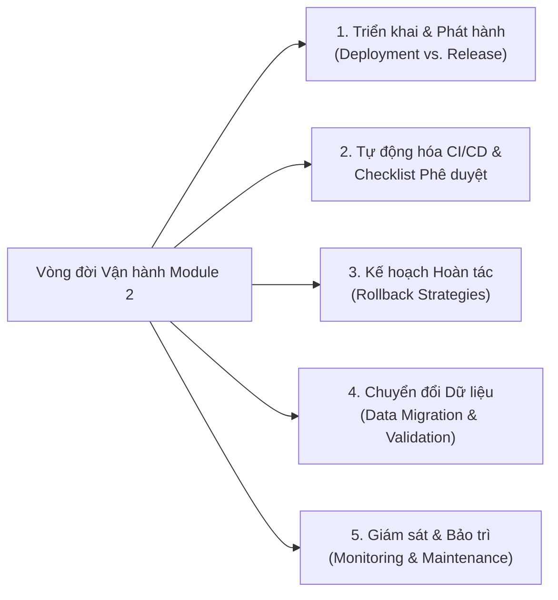

# Tóm tắt và Điểm nổi bật: Chiến lược Triển khai, Phát hành và Bảo trì (Summary and Highlights: Deployment, Release, and Maintenance Strategies)

> **Khóa học:** IBM System Design - Strategies to Test, Deploy, and Maintain Software  
> **Module 2:** Module 2 - Software Deployment, Release, and Maintenance Strategies  
> **Mục tiêu:** Tổng hợp toàn bộ kiến thức trọng tâm của Module 2 về vòng đời phần mềm từ khâu đưa code lên production đến khâu vận hành và bảo trì dài hạn.

---

## 🗺️ Bức tranh Toàn cảnh Module 2

---

## 1. Triển khai vs. Phát hành (Deployment versus Release)
- **Deployment (Triển khai):** Đưa code/build vào môi trường Production (mặt kỹ thuật).
- **Release (Phát hành):** Mở quyền truy cập cho người dùng cuối sử dụng tính năng mới (mặt kinh doanh).
- **Lợi ích việc tách biệt:** Cho phép kiểm thử an toàn trên Live (Dark Launching/Feature Flags), chủ động thời điểm ra mắt và giảm thiểu rủi ro kinh doanh.
- **Vai trò Systems Professional:** Quản lý checklist, xác nhận phê duyệt, lên kế hoạch rollback và điều phối nhịp độ giữa các team.

---

## 2. CI/CD & Checklist Phát hành (Release Checklists)
- **CI (Tích hợp liên tục):** Gộp code thường xuyên vào repository chung kèm test tự động để bắt lỗi sớm.
- **CD (Phân phối/Triển khai liên tục):** Tự động đóng gói và chuyển giao mã nguồn đã kiểm thử đến môi trường đích.
- **Checklist Phát hành:**
  - Quy định rõ ràng các bước: **Pre-Release**, **Release Day**, và **Post-Release**.
  - Bắt buộc phải có **Owner (Người phụ trách)**, **Sign-off (Chữ ký duyệt)** và liên kết với kế hoạch Rollback.
  - Được quản lý bởi **Release Coordinator** để bảo đảm tính nhất quán và trách nhiệm giải trình.

---

## 3. Chiến lược Hoàn tác (Rollback Strategies)
- **Mục đích:** Khôi phục hệ thống về trạng thái ổn định ngay khi bản release gặp sự cố nghiêm trọng.
- **2 Loại Rollback chính:**
  - *Application Rollback:* Revert mã nguồn/phiên bản container về bản trước.
  - *Data Rollback:* Phục hồi trạng thái cơ sở dữ liệu qua bản sao lưu hoặc script rollback đã kiểm thử.
- **Nhiệm vụ cốt lõi:** Xác định rõ **Điểm kích hoạt Rollback (Triggers)**, quy trình thực hiện, người nắm quyền quyết định và tổ chức họp Post-Mortem rút kinh nghiệm.

---

## 4. Chuyển đổi và Xác thực Dữ liệu (Data Migration & Validation)
- **Mục tiêu:** Di chuyển dữ liệu từ hệ thống cũ (Legacy) sang hệ thống mới trọn vẹn, chính xác và giữ nguyên giá trị nghiệp vụ.
- **Data Mapping Template:** Bản mẫu đối chiếu trường nguồn, trường đích và các quy tắc biến đổi dữ liệu (Transformation Rules).
- **4 Kỹ thuật Xác thực (Validation):**
  1. *Record Count Comparison:* So khớp số lượng bản ghi (phát hiện mất/trùng lặp).
  2. *Sample Verification:* Kiểm tra chi tiết trên mẫu ngẫu nhiên và tài khoản VIP.
  3. *Format Checks:* Chuẩn hóa định dạng ngày tháng, tiền tệ, số điện thoại.
  4. *Business Rule Validation:* Kiểm tra ràng buộc logic kinh doanh (ví dụ: không có số dư âm).
- **Validation Summary:** Báo cáo nghiệm thu chính thức có chữ ký phê duyệt từ Business Stakeholders để cấp phép Go-Live.

---

## 5. Giám sát Sau Triển khai & Lịch Bảo trì (Monitoring & Maintenance)
- **Monitoring & Alerting:**
  - Giám sát các chỉ số sức khỏe: Uptime, Độ trễ (Latency p95), Tỷ lệ lỗi 5xx, Lưu lượng giao dịch.
  - Phân cấp cảnh báo: **Critical (Khẩn cấp)**, **Warning (Cảnh báo)**, **Informational (Thông tin)**.
  - Lập Ma trận Giám sát (Monitoring Matrix) gắn chặt chỉ số kỹ thuật với tác động kinh doanh.
- **Maintenance Calendar (Lịch bảo trì):**
  - Lên lịch định kỳ: Hàng ngày (check logs, backup), Hàng tuần (kiểm thử phục hồi dữ liệu, dọn dẹp dung lượng), Hàng tháng (vá lỗi bảo mật, capacity planning).
  - Sử dụng các công cụ linh hoạt: Spreadsheet, Lịch nhóm, Jira Service Management, Cron Jobs.

---

## 💡 Thông điệp Kết thúc Khóa học (Module Conclusion)
Toàn bộ các thực hành trên cấu thành một **Khung Quản trị Vòng đời Hệ thống Toàn diện (System Lifecycle Framework)**. Bằng việc làm chủ:
$$\text{CI/CD} \longrightarrow \text{Release Management} \longrightarrow \text{Rollback} \longrightarrow \text{Data Migration} \longrightarrow \text{Monitoring \& Maintenance}$$
Chuyên viên Hệ thống (Systems Professional) chính là mắt xích sống còn giúp tổ chức xây dựng và vận hành những hệ thống phần mềm **ổn định, bảo mật, hiệu năng cao và thích ứng an toàn với mọi thay đổi**.
