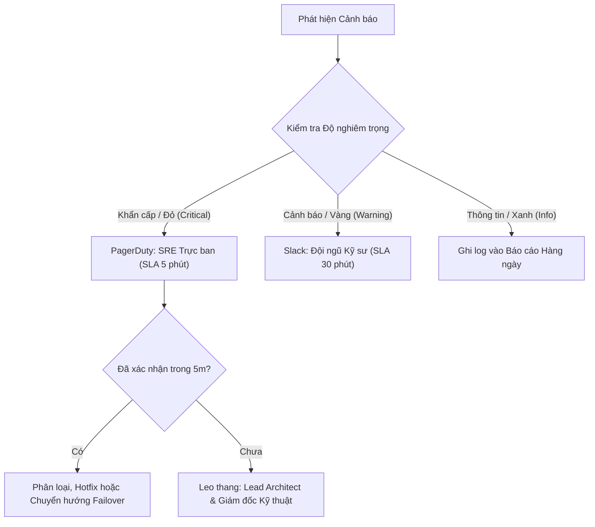

# Nền tảng QuickKart: Kế hoạch Giám sát và Bảng kiểm tra Bảo trì (Monitoring Plan and Maintenance Checklist)

**Tên tài liệu:** `Monitoring-Maintenance-Checklist.md` *(Hoặc `Monitoring-Maintenance-Checklist.docx`)*  
**Vai trò:** Chuyên viên Hệ thống (Systems Professional) / Kiến trúc sư Giải pháp (Solutions Architect)  
**Nền tảng:** Sàn Thương mại Điện tử QuickKart (Xử lý đơn hàng, thanh toán và tồn kho theo thời gian thực)  
**Đối tượng sử dụng:** Đội ngũ DevOps, Kỹ sư Vận hành Tin cậy Hệ thống (SRE), Kỹ sư Phần mềm và Các bên liên quan (Product Stakeholders)  

---

## PHẦN 1: KẾ HOẠCH GIÁM SÁT (MONITORING PLAN)

### 1.1 Mục tiêu
Thiết lập khả năng giám sát theo thời gian thực đối với tình trạng sức khỏe, tính sẵn sàng, hiệu năng và tính toàn vẹn vận hành của nền tảng thương mại điện tử QuickKart. Mục tiêu là phát hiện và xử lý sớm các bất thường trước khi người dùng cuối gặp sự cố khi thanh toán hoặc đặt hàng.

### 1.2 Các Chỉ số Trọng yếu & Ngưỡng Cảnh báo (Metrics & Thresholds)

| Chỉ số (Metric) | Phạm vi Bình thường / Mục tiêu | Ngưỡng Cảnh báo Vàng (🟡) | Ngưỡng Báo động Đỏ (🔴) | Tác động Nghiệp vụ (Business Impact) |
| :--- | :--- | :--- | :--- | :--- |
| **Tính sẵn sàng / Uptime Hệ thống** | $\ge 99.95\%$ | $< 99.9\%$ trong 15 phút | $< 99.5\%$ hoặc sập hoàn toàn | Gián đoạn toàn bộ storefront, mất doanh thu trực tiếp. |
| **Thời gian Phản hồi API (p95 Latency)** | $< 300\text{ ms}$ | $> 500\text{ ms}$ trong 5 phút | $> 1500\text{ ms}$ trong 3 phút | Trải nghiệm thanh toán chậm chạp, người dùng bỏ giỏ hàng. |
| **Tỷ lệ Lỗi HTTP 5xx** | $< 0.5\%$ | $\ge 1.0\%$ tổng request | $\ge 3.0\%$ tổng request | Giao dịch thất bại, đứt gãy luồng người dùng. |
| **Tỷ lệ Thành công của Cổng Thanh toán** | $\ge 98.0\%$ | $< 95.0\%$ trong 10 phút | $< 90.0\%$ trong 5 phút | Thanh toán thất bại hàng loạt, thất thoát đơn hàng. |
| **Mức sử dụng CPU & Bộ nhớ (RAM)** | $40\% - 65\%$ | $> 75\%$ liên tục 10 phút | $> 90\%$ liên tục 5 phút | Hệ thống suy giảm hiệu năng, container bị OOM kill. |
| **Mức sử dụng Database Connection Pool** | $< 60\%$ | $> 75\%$ dung lượng pool | $> 88\%$ dung lượng pool | Nghẽn luồng xử lý (thread blocking), cascade timeout CSDL. |
| **Số Tác vụ Nền bị Thất bại (Failed Jobs Queue)**| $0\text{ lỗi}$ | $> 10$ job lỗi trong hàng đợi | $> 50$ job lỗi trong hàng đợi | Chậm gửi email xác nhận đơn, lệch số liệu tồn kho. |

### 1.3 Công nghệ Giám sát & Cơ chế Kích hoạt Cảnh báo (Stack & Alerting Logic)
- **Giám sát Hạ tầng & Đo kiểm Từ xa (Telemetry):** **AWS CloudWatch** & **Datadog APM** (truy vết phân tán real-time, chỉ số container và application spans).
- **Thu thập Log & Hiển thị Dashboard:** **Grafana** + Elasticsearch/Loki phục vụ truy vấn log tập trung và hiển thị KPI kinh doanh.
- **Kênh Phân phối Cảnh báo:**
  - **Khẩn cấp - Đỏ (🔴):** Kích hoạt lập tức qua **PagerDuty** (gọi điện thoại tự động / SMS / push notification) tới Kỹ sư SRE trực ban (On-Call SRE) và tự động ping vào kênh Slack `#quickkart-incidents`.
  - **Cảnh báo - Vàng (🟡):** Gửi webhook tới kênh Slack `#quickkart-alerts-warning` và tự động tạo ticket trên Jira Service Management.
  - **Thông tin - Xanh (🔵):** Ghi nhận âm thầm vào bảng điều khiển Grafana và gửi báo cáo sức khỏe hàng ngày (Daily Health Digest).

### 1.4 Quy trình Leo thang Sự cố (Incident Escalation Protocol)

---

## PHẦN 2: BẢNG KIỂM TRA BẢO TRÌ ĐỊNH KỲ (MAINTENANCE CHECKLIST)

### 2.1 Lịch trình Bảo trì Hệ thống

| Tần suất (Cadence) | Tác vụ Bảo trì Chi tiết (Task Description) | Vai trò Phụ trách (Owner) | Phương pháp Xác minh (Verification Method) |
| :--- | :--- | :--- | :--- |
| **Hàng ngày (Daily)** | Rà soát log lỗi mức độ cao & các biệt lệ chưa được xử lý | DevOps Trực ban | Kiểm tra Datadog Log Explorer; xác nhận 0 lỗi Sev-1 tồn đọng. |
| **Hàng ngày (Daily)** | Xác nhận trạng thái hoàn thành của bản snapshot sao lưu CSDL tự động | Cloud Engineer | Kiểm tra AWS RDS Console: Snapshot có trạng thái `Available` và thời gian < 24h. |
| **Hàng ngày (Daily)** | Giám sát mức sử dụng tài nguyên (CPU, RAM, Ổ cứng) trong giờ cao điểm | SRE | Đánh giá biểu đồ đỉnh tải trên Grafana 24h; đảm bảo dung lượng đĩa trống $> 25\%$. |
| **Hàng tuần (Weekly)**| Kiểm tra dung lượng lưu trữ CSDL & độ phân mảnh chỉ mục (Index Fragmentation) | Chuyên viên DBA | Rà soát bảng phình to (bloat), log truy vấn chậm ($> 1\text{ s}$) và tốc độ tăng trưởng đĩa. |
| **Hàng tuần (Weekly)**| Đánh giá lịch sử cảnh báo và tinh chỉnh ngưỡng báo động giả (False-positive) | Systems Professional | Rà soát cảnh báo nhiễu trên Slack/PagerDuty; điều chỉnh luật để tránh mệt mỏi cảnh báo. |
| **Hàng tuần (Weekly)**| Diễn tập phục hồi dữ liệu từ bản sao lưu (Backup Restoration Drill) | DevOps / DBA | Dựng CSDL thử nghiệm trên Staging từ bản snapshot tuần; chạy truy vấn đối soát dữ liệu. |
| **Hàng tháng (Monthly)**| Cập nhật bản vá bảo mật cho Hệ điều hành, Container và Dependencies | Cloud Engineer | Triển khai base image Docker/AMI mới trong khung giờ bảo trì định kỳ (Maintenance Window). |
| **Hàng tháng (Monthly)**| Đánh giá năng lực tải tổng thể và dự báo xu hướng tăng trưởng lưu lượng | Lead Architect | Phân tích số lượng đơn hàng tháng so với chi phí hạ tầng và ngưỡng tự động mở rộng (Auto-scaling). |
| **Hàng tháng (Monthly)**| Lưu trữ dữ liệu cũ (Cold Storage Archiving) & Xoay vòng (Rotate) log | Data Engineer | Di chuyển đơn hàng và audit log cũ hơn 90 ngày vào kho lạnh lưu trữ dài hạn (AWS S3 Glacier). |

---

## PHẦN 3: QUY TRÌNH ỨNG PHÓ VÀ LEO THANG SỰ CỐ (INCIDENT RESPONSE WORKFLOW)

### 3.1 Phân cấp Mức độ Nghiêm trọng & Cam kết Thời gian (SLA)

| Cấp độ Nghiêm trọng | Định nghĩa Sự cố | SLA Phản hồi | Mục tiêu Khắc phục | Tuyến đường Leo thang (Escalation Path) |
| :--- | :--- | :---: | :---: | :--- |
| **P1 - Khẩn cấp (Critical)** | Dịch vụ cốt lõi bị tê liệt (Thanh toán, Đặt hàng, Xem sản phẩm lỗi $> 5\%$ người dùng). | **5 phút** | $< 1\text{ giờ}$ | SRE Trực ban $\rightarrow$ Dev Lead $\rightarrow$ Giám đốc Kỹ thuật (VP Eng). |
| **P2 - Nghiêm trọng (Major)** | Tính năng phụ bị lỗi (Bộ lọc tìm kiếm, đề xuất sản phẩm bị chậm hoặc lỗi). | **30 phút** | $< 4\text{ giờ}$ | Nhóm phụ trách tính năng $\rightarrow$ Trưởng phòng Kỹ thuật. |
| **P3 - Nhẹ (Minor)** | Lỗi giao diện nhỏ, chậm báo cáo nội bộ, lỗi không chặn thao tác người dùng. | **Ngày làm việc tiếp theo** | Kỳ Release tiếp theo | Đưa vào backlog Jira để lên kế hoạch trong Sprint tới. |

### 3.2 Các Bước Xử lý Sự cố Chuẩn
1. **Phát hiện & Phân loại (Detection & Triage):** Sự cố được kích hoạt qua hệ thống cảnh báo tự động hoặc báo cáo CS $\rightarrow$ Chỉ huy Sự cố (On-Call SRE) tiếp nhận trong thời hạn SLA và mở phòng họp khẩn cấp (Kênh Slack `#incident-war-room`).
2. **Cô lập Sự cố (Containment):** Nếu sự cố phát sinh do bản release gần nhất, lập tức tắt Feature Flag hoặc kích hoạt quy trình Rollback. Nếu do đột biến tải hạ tầng, kích hoạt mở rộng ngang (Horizontal Auto-scaling).
3. **Truyền thông (Communication):** Cập nhật tình trạng cho các bên liên quan nội bộ mỗi 20 phút/lần; cập nhật trang trạng thái công khai (Status Page) nếu sự cố ảnh hưởng người dùng $> 10$ phút.
4. **Khắc phục & Đóng sự cố (Resolution):** Khôi phục hoạt động bình thường của hệ thống, theo dõi các chỉ số duy trì trạng thái ổn định liên tục trong 15 phút trước khi giải tán War Room.
5. **Đánh giá Sau sự cố (Blameless Post-Mortem):**
   - Bắt buộc tổ chức họp phân tích không đổ lỗi trong vòng 48 giờ đối với mọi sự cố P1.
   - Tài liệu hóa nguyên nhân gốc rễ (phương pháp 5 Whys), dòng thời gian (thời gian phát hiện MTTD / thời gian khắc phục MTTR) và các việc cần làm tiếp theo (Action Items) trên Confluence.
   - Bổ sung ngay các bài kiểm thử hồi quy tự động hoặc luật cảnh báo mới để ngăn chặn sự cố tương tự tái diễn.

