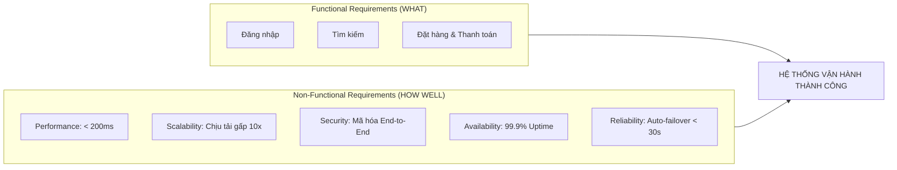
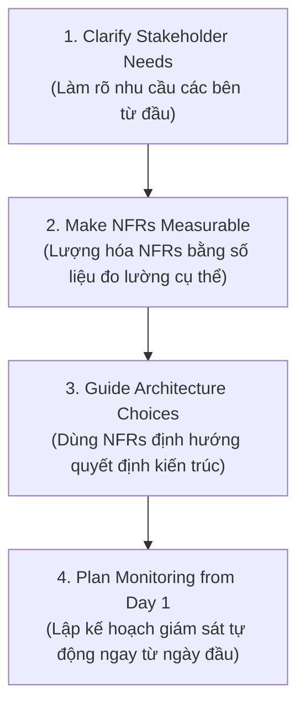

# 01. What are Non-Functional Requirements? – Tóm tắt

**Khóa học:** Strategies to Test, Deploy, and Maintain Software  
**Module 3:** Non-Functional Requirements (Yêu cầu phi chức năng)  
**Thời lượng video:** 6 phút 55 giây  
**Ngày lưu:** 2026-10-18  

---

## 🎯 Mục tiêu bài học
- Định nghĩa rõ ràng **Non-Functional Requirements (NFRs - Yêu cầu phi chức năng)** và phân biệt chuẩn xác với **Functional Requirements (FRs - Yêu cầu chức năng)**.
- Phân tích 6 nhóm danh mục NFRs phổ biến nhất: **Performance, Scalability, Security, Availability, Reliability, và Usability**.
- Hiểu được tại sao một hệ thống hoàn thành 100% chức năng vẫn có thể thất bại trong thực tế nếu thiếu NFRs.
- Nắm vững 4 bước thực hành đưa NFRs vào quy trình làm việc hằng ngày của một kỹ sư hệ thống / kiến trúc sư.
- Khảo sát các ví dụ thực tế đo lường được (Measurable NFRs) qua các ngành: E-commerce, ERP, Y tế (Healthcare), Sàn giao dịch tài chính (Trading), CRM, và Quản lý tài liệu.

---

## ⚖️ So sánh Functional Requirements (FR) vs Non-Functional Requirements (NFR)

> *"Functional requirements keep your system alive, but non-functional requirements keep it thriving."*  
> *(Yêu cầu chức năng giữ cho hệ thống hoạt động, nhưng yêu cầu phi chức năng giúp hệ thống phát triển thịnh vượng.)*

| Tiêu chí so sánh | Functional Requirements (FR) | Non-Functional Requirements (NFR) |
| :--- | :--- | :--- |
| **Bản chất câu hỏi** | **WHAT** the system does (Hệ thống làm được gì?) | **HOW WELL** it does it (Hệ thống thực hiện tốt đến mức nào?) |
| **Định nghĩa** | Các tính năng, hành vi nghiệp vụ cụ thể mà phần mềm cung cấp cho người dùng. | Các thuộc tính chất lượng (Quality Attributes), tiêu chuẩn vận hành và ràng buộc hệ thống. |
| **Ví dụ minh họa** | - Người dùng có thể đăng nhập. - Tìm kiếm sản phẩm theo tên. - Thực hiện thanh toán đơn hàng. | - API đăng nhập phản hồi trong vòng `< 500ms`. - Tìm kiếm trả kết quả trong `< 1.5s` với 10.000 user đồng thời. - Dữ liệu thanh toán mã hóa AES-256. |
| **Ẩn dụ chiếc xe hơi** | Xe có thể chạy từ điểm A đến điểm B, có phanh, có vô lăng, có còi. | Xe có tiết kiệm nhiên liệu không? Có hay hỏng vặt không? Đi êm và an toàn không? |
| **Hệ quả nếu bỏ qua** | Hệ thống thiếu tính năng, không đáp ứng luồng nghiệp vụ cơ bản. | Hệ thống đủ tính năng nhưng bị sập khi đông khách, rò rỉ dữ liệu hoặc load quá chậm khiến người dùng rời bỏ. |

---

## 🏛️ 6 Nhóm Non-Functional Requirements (NFRs) cốt lõi

1. **Hiệu năng (Performance):**
   - Tốc độ xử lý và thời gian phản hồi của hệ thống. Tác động trực tiếp tới trải nghiệm người dùng và doanh thu.
   - *Ví dụ định lượng:* Customer Search API phải phản hồi trong vòng **dưới 200ms cho 95% số lượt request (p95 < 200ms)**.

2. **Khả năng mở rộng (Scalability):**
   - Khả năng hệ thống thích ứng và mở rộng tài nguyên khi khối lượng công việc, dữ liệu hoặc số lượng người dùng tăng cao.
   - *Ví dụ định lượng:* Hệ thống phải chịu tải gấp **10 lần tải thông thường** trong ngày hội mua sắm Black Friday mà không bị nghẽn.

3. **Bảo mật (Security):**
   - Bảo vệ hệ thống và dữ liệu trước các mối đe dọa không gian mạng, tuân thủ pháp lý và quyền riêng tư.
   - *Ví dụ định lượng:* Toàn bộ dữ liệu khách hàng phải được **mã hóa ở trạng thái lưu trữ (at rest) và khi truyền tải (in transit)**.

4. **Độ khả dụng (Availability):**
   - Tỷ lệ thời gian hệ thống hoạt động bình thường và người dùng có thể truy cập được.
   - *Lưu ý quan trọng về Uptime:* Mục tiêu **99% uptime** nghe có vẻ cao nhưng thực tế vẫn cho phép **downtime tới 8.76 giờ/năm** — gây thiệt hại doanh thu và uy tín. Hệ thống quan trọng thường yêu cầu từ 99.9% đến 99.999% ("Five Nines").

5. **Độ tin cậy & Khả năng phục hồi (Reliability & Resilience):**
   - Khả năng hệ thống tự phục hồi hoặc duy trì tính toàn vẹn khi có sự cố phần cứng hoặc mạng xảy ra.
   - *Ví dụ định lượng:* Tự động khôi phục sau sự cố sập server trong vòng **dưới 30 giây mà không làm mất dữ liệu giao dịch**.

6. **Khả năng sử dụng (Usability):**
   - Mức độ dễ dàng, thuận tiện và trực quan để người dùng hoàn thành tác vụ.
   - *Ví dụ định lượng:* Người dùng mới có thể hoàn tất quy trình thiết lập tài khoản trong vòng **3 phút**.

---

## 🛠️ Quy trình 4 bước làm việc với NFRs (Best Practices)

Để NFRs trở thành một phần tự nhiên trong quy trình kỹ thuật hàng ngày thay vì chỉ là suy nghĩ bổ sung (afterthought):

1. **Clarify Stakeholder Needs from the Start (Làm rõ nhu cầu từ đầu):**
   - Đặt câu hỏi đúng: Có bao nhiêu user hoạt động đồng thời? Thời gian gián đoạn (downtime) tối đa chấp nhận được là bao lâu? Cần tuân thủ quy chuẩn bảo mật/pháp lý nào? Hệ thống cần phản hồi nhanh đến mức nào?
2. **Make NFRs Measurable (Lượng hóa tiêu chí đo lường):**
   - Tuyệt đối không dùng cụm từ mơ hồ như *"hệ thống phải chạy nhanh"*. Phải quy đổi thành chỉ số cụ thể: *"API phản hồi dưới 200ms cho 95% request"*.
3. **Guide Architecture Choices (Định hướng kiến trúc):**
   - Quyết định lựa chọn giữa Monolith vs Microservices, Serverless vs Container, SQL vs NoSQL dựa trên các yêu cầu về khả năng mở rộng (Scalability), độ sẵn sàng (Availability) và tính bảo trì (Maintainability).
4. **Plan Monitoring from Day One (Giám sát ngay từ ngày đầu):**
   - Tích hợp công cụ giám sát tự động để theo dõi hiệu năng (APM), an ninh và tuân thủ theo thời gian thực (Real-time).

---

## 🏢 Các ví dụ thực tế theo từng lĩnh vực (Industry Use Cases)

| Lĩnh vực | NFR chính | Chỉ số định lượng cụ thể (Measurable Criteria) |
| :--- | :--- | :--- |
| **E-commerce (Thương mại điện tử)** | Performance & Scalability | - Tìm kiếm tải dưới **1.5 giây**; Thanh toán (Checkout) hoàn tất mượt mà trong **30 giây**. - Chịu tải **10,000 người dùng đồng thời**, danh mục **50,000 sản phẩm**, giữ tìm kiếm dưới **1 giây** trong giờ cao điểm. |
| **Enterprise ERP (Quản trị doanh nghiệp)** | Usability | - Nhân viên mới có thể nắm bắt cách sử dụng cơ bản trong **dưới 4 giờ**. - Tác vụ hàng ngày chỉ cần tối đa **5 lượt click chuột**. |
| **Healthcare (Y tế số)** | Security & Compliance | - Tuân thủ nghiêm ngặt chuẩn **HIPAA**, mã hóa đầu cuối (End-to-end encryption). - Toàn bộ nhật ký truy cập (Access logs) phải được lưu trữ và có thể kiểm toán trong tối thiểu **7 năm**. |
| **Trading Platforms (Sàn giao dịch tài chính)** | Reliability & Data Integrity | - Xử lý **100,000 giao dịch/ngày** với độ chính xác đạt **99.999%**. - Transaction logs phải bất biến (Immutable) và chống giả mạo (Tamper-proof). |
| **CRM Systems (Quản lý khách hàng)** | Integration | - Tích hợp với ít nhất **15 ứng dụng bên thứ 3** thông qua REST API. - Đồng bộ hóa dữ liệu hoàn tất trong vòng **15 phút**. |
| **Document Management (Quản lý tài liệu)** | Performance & UX | - Upload file dung lượng lên tới **2GB** phải có thanh tiến trình (progress indicator) rõ ràng. - Tìm kiếm toàn văn (Full-text search) trên **10 triệu tài liệu** phải trả kết quả trong **dưới 3 giây**. |

---

## 📌 Điểm mấu chốt cần ghi nhớ (Key Takeaways)
1. **Khác biệt cốt lõi:** FR xác định *hệ thống làm gì (What)*; NFR xác định *hệ thống làm tốt như thế nào (How well)*.
2. **NFRs không phải lý thuyết:** Chúng quyết định trực tiếp tới doanh thu, độ tin cậy của khách hàng và sự tồn vong của doanh nghiệp.
3. **Phải luôn đo lường được (Measurable):** NFRs chỉ có giá trị khi gắn liền với các số liệu kiểm chứng được (SLA/SLO: response time, uptime %, transaction throughput).
4. **Đối với kỹ sư hệ thống:** NFRs không phải là việc phát sinh sau khi viết code xong, mà chính là kim chỉ nam định hình kiến trúc và giám sát ngay từ vạch xuất phát.
