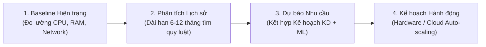

# 02. Capacity Planning Essentials – Tóm tắt

**Khóa học:** Strategies to Test, Deploy, and Maintain Software  
**Module 3:** Non-Functional Requirements (NFRs)  
**Thời lượng:** 6 phút 25 giây  

---

## 🎯 Bản chất & Mục đích cốt lõi
- **Capacity Planning:** Cân bằng giữa **Cung tài nguyên (Supply)** và **Cầu khối lượng công việc (Demand)** nhằm dự báo nhu cầu tương lai.
- **Mục đích kép:** Vừa là **tấm lưới an toàn (safety net)** ngăn sập server khi nghẽn tải, vừa là **công cụ tối ưu chi phí (cost optimizer)** tránh lãng phí tiền cloud cho tài nguyên nhàn rỗi.
- **3 Trụ cột:** Đo lường mức sử dụng hiện tại $\rightarrow$ Ước tính nhu cầu sắp tới $\rightarrow$ Dự đoán xu hướng tăng trưởng theo thời gian.

---

## ⚖️ 3 Chiến lược Capacity Planning hiện đại

| Chiến lược | Cơ chế | Ưu điểm | Nhược điểm / Rủi ro | Ví dụ thực tế |
| :--- | :--- | :--- | :--- | :--- |
| **Lead Strategy** *(Đi trước)* | Bổ sung tài nguyên **trước khi** nhu cầu tăng. | Không lo sập hệ thống, chịu tải đỉnh tốt. | Chi phí đầu tư ban đầu cao, dễ lãng phí nếu không dùng hết. | Amazon tăng từ 10k lên 50k server trước Prime Day nhiều tuần. |
| **Lag Strategy** *(Theo sau)* | Chỉ bổ sung tài nguyên **sau khi** nhu cầu đã tăng thực tế. | Tiết kiệm chi phí tối đa, không đầu tư dư thừa. | Nguy cơ quá tải hoặc gián đoạn dịch vụ trong lúc chờ nâng cấp. | Kho Amazon ban đầu dùng công nhân, khi lượng đơn tăng vọt mới đầu tư robot tự động hóa. |
| **Match Strategy** *(Song hành)* | Tăng tài nguyên từng bước nhỏ (**small increments**) theo nhu cầu thực tế. | Cân bằng hoàn hảo giữa hiệu năng và chi phí. | Cần hệ thống giám sát và tự động hóa (Auto-scaling) cực nhạy. | Tự động thêm instance dựa trên chỉ số hiệu năng thời gian thực. |

---

## 📊 Chỉ số đo lường then chốt (Key Metrics)

- **Resource Utilization Rate (Tỷ lệ sử dụng tài nguyên):** Đo lường CPU, RAM, Disk I/O, Network.
  - **Ngưỡng vàng lý tưởng: 70% – 80%** (đủ tối ưu chi phí nhưng vẫn có khoảng đệm an toàn để chịu tải đột biến).
- **Performance vs. Projected Capacity:** So sánh hiệu năng thực tế với năng lực dự phóng để phát hiện điểm nghẽn.
- **Cost per Transaction:** Cân đối giữa hiệu năng đạt được và chi phí trên từng giao dịch.

---

## 🔄 Quy trình 4 bước triển khai chuẩn

1. **Baseline Current State:** Đo lường hiện trạng tài nguyên (dùng công cụ như SolarWinds cảnh báo ngưỡng Warning/Critical).
2. **Analyze Historical Patterns:** Ngắn hạn (phát hiện lỗi dị thường) & Dài hạn 6 - 12 tháng (nhận diện quy luật định kỳ/mùa vụ).
3. **Forecast Future Needs:** Kết hợp xu hướng quá khứ với kế hoạch ra mắt/mở rộng, ứng dụng Machine Learning để tăng độ chính xác.
4. **Create Actionable Strategies:** Lập kế hoạch hành động linh hoạt (nâng cấp máy chủ, tối ưu phần mềm hoặc cấu hình Auto-scaling).

---

## 🏢 5 Case Studies thực tế

- **Amazon:** Scale từ 10.000 lên 50.000 EC2 trước Prime Day; rule tự động thêm tới 1.000 instances/phút khi có traffic đột biến (*Lead Strategy*).
- **Major Bank:** Scale Oracle RAC từ 8 lên 16 nodes kỳ chốt sổ tháng; giữ **30% dung lượng đệm (buffer)** cho báo cáo quy định.
- **Spotify:** Dùng K8s Auto-scaling, khi hàng đợi gợi ý bài hát vượt **10.000 requests** $\rightarrow$ tự động scale từ 100 lên 500 pods trong vài phút (*Match Strategy*).
- **YouTube:** Đẩy video hot ra server biên (Edge CDN) trước; tăng năng lực Edge Server lên **300%** trong vài giờ khi diễn ra sự kiện lớn.
- **Dropbox:** Tốc độ tăng dung lượng 25%/quý $\rightarrow$ cấp phát trước storage 6 tháng; tự động phân tầng dữ liệu: **Hot – Warm – Cold**.
