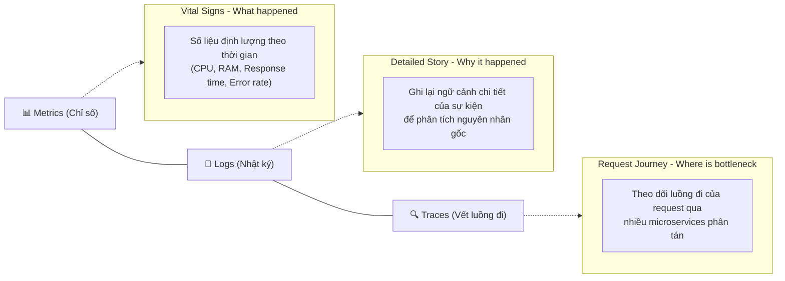
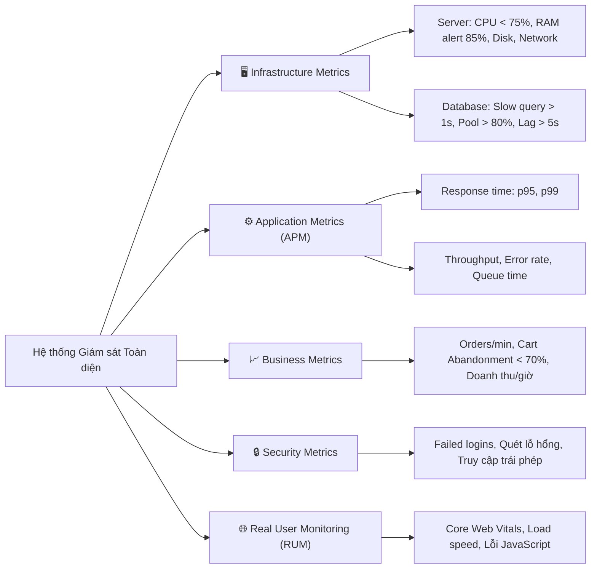

# 03. Metrics and Monitoring Basics – Tóm tắt

**Khóa học:** Strategies to Test, Deploy, and Maintain Software  
**Module 3:** Non-Functional Requirements (NFRs)  
**Thời lượng:** 6 phút 38 giây  

---

## 🎯 Mục tiêu bài học
- Nắm vững **3 trụ cột của Observability (Tính năng quan sát)**: Metrics, Logs, và Traces.
- Phân tích **4 Golden Signals** theo chuẩn Google SRE: Latency, Traffic, Errors, Saturation.
- Phân loại các nhóm chỉ số cần theo dõi: Hạ tầng (Infrastructure), Ứng dụng (Application), Kinh doanh (Business), và Bảo mật (Security).
- Khảo sát case study thực tế từ kiến trúc **TechGear Store** (E-commerce trên Kubernetes + AWS).

---

## 🏛️ 3 Trụ cột của Observability (Three Pillars)

- **Metrics (Chỉ số - What):** Dữ liệu định lượng (nhịp tim, huyết áp của hệ thống) như CPU, RAM, tỷ lệ lỗi thu thập theo chuỗi thời gian $\rightarrow$ Cho biết hệ thống khỏe hay yếu.
- **Logs (Nhật ký - Why):** Ghi lại chi tiết sự kiện kèm ngữ cảnh (context) $\rightarrow$ Giải thích nguyên nhân tại sao sự cố xảy ra.
- **Traces (Dấu vết - Where):** Theo dõi hành trình của một request xuyên suốt các microservices $\rightarrow$ Cực kỳ quan trọng để định vị điểm nghẽn (bottleneck) trong hệ thống phân tán phức tạp.

---

## 🌟 4 Golden Signals của Google SRE

| Tín hiệu (Signal) | Định nghĩa & Ý nghĩa | Ví dụ đo lường |
| :--- | :--- | :--- |
| **Latency (Độ trễ)** | Thời gian cần để xử lý một request (cần theo dõi cả request thành công lẫn thất bại vì lỗi nhanh có thể che giấu hệ thống đang chậm). | Response time p95, p99 (ms). |
| **Traffic (Lưu lượng tải)** | Mức độ nhu cầu/tải đặt lên hệ thống. | Requests per second (RPS), Transactions/min, Active users. |
| **Errors (Lỗi)** | Tỷ lệ request bị thất bại (bao gồm lỗi rõ ràng như HTTP 500 hoặc lỗi ngầm như HTTP 200 nhưng nội dung sai). | Error rate (%), số lượng 5xx/4xx. |
| **Saturation (Độ bão hòa)** | Mức độ đầy/tải của các tài nguyên hệ thống (tập trung vào tài nguyên dễ gây nghẽn nhất). | % CPU, % Memory, Disk I/O queue, Connection pool. |

---

## 📂 Các nhóm Metrics cần quản lý

1. **Infrastructure Metrics:** Giám sát Server (CPU, RAM, Disk, Network) và Database (thời gian chạy truy vấn, Connection Pool, Khóa Lock, Replication lag).
2. **Application Metrics (APM):** Đo lường Response time (p95, p99), Throughput, Tỷ lệ lỗi, Hàng đợi request.
3. **Business Metrics:** Gắn liền kỹ thuật với kinh doanh: Đơn hàng/phút, Tỷ lệ bỏ giỏ hàng (Cart abandonment), Doanh thu/giờ.
4. **Security Metrics:** Phát hiện brute-force đăng nhập sai liên tiếp, lưu lượng mạng bất thường, cảnh báo quét lỗ hổng.
5. **Real User Monitoring (RUM):** Đo trải nghiệm người dùng thực tế: Core Web Vitals, tốc độ tải trang theo vị trí địa lý, lỗi JavaScript trên browser.

---

## 🏢 Case Study: TechGear Store (Hạ tầng E-commerce thực tế)

- **Kiến trúc:** React Frontend $\rightarrow$ API Gateway $\rightarrow$ Microservices (Users, Products, Orders, Payments) $\rightarrow$ DB (PostgreSQL, Redis, Elasticsearch) trên **Kubernetes & AWS**.
- **Ngưỡng giám sát hạ tầng:** CPU trung bình `< 75%` (peak `< 90%`), Cảnh báo Memory khi chạm `85%`.
- **SLA / SLO cho Application:**
  - *Product API:* p95 `< 200ms` (cảnh báo khi `> 500ms`).
  - *Search API:* p95 `< 100ms` (cảnh báo khi `> 300ms`).
  - *Checkout API:* p95 `< 1s` (cảnh báo khi `> 2s`).
  - *Payment API:* Error rate `< 0.1%` (cảnh báo khẩn cấp khi `> 1%`).
- **Ngưỡng Database cảnh báo:** Slow queries `> 1s`, Connection Pool `> 80%`, Replication lag `> 5s`, Lock waits `> 30s`.
- **Business Dashboard:** Bình thường 50 - 100 đơn/phút (Sale > 500 đơn/phút), Cart Abandonment `< 70%`, Doanh thu chuẩn $5,000 - $15,000/giờ (Sale nhảy lên $50,000/giờ).

---

## 📌 Điểm mấu chốt (Key Takeaways)
1. **3 Trụ cột Observability:** Metrics (cho biết *Cái gì*), Logs (giải thích *Tại sao*), Traces (chỉ ra *Ở đâu*).
2. **4 Golden Signals của Google SRE:** Latency, Traffic, Errors, Saturation – bộ khung chuẩn để đánh giá sức khỏe mọi hệ thống.
3. **Quan sát đa tầng:** Phải kết hợp cả Hạ tầng, Ứng dụng, Người dùng thực (RUM) và Kinh doanh để có bức tranh toàn cảnh, không để hệ thống thành một "hộp đen" (black box).
