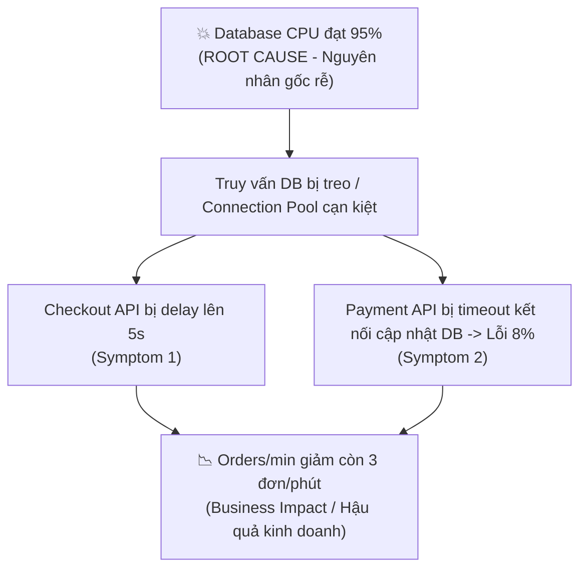

# 04. Lab - Identify and Create Metrics for an E-commerce Application – Tóm tắt & Bài giải

**Khóa học:** Strategies to Test, Deploy, and Maintain Software  
**Module 3:** Non-Functional Requirements (Yêu cầu phi chức năng)  
**Thời lượng thực hành:** 45 phút  
**Kịch bản (Scenario):** Nền tảng bán sách trực tuyến **"BookNest"** thường gặp sự cố hiệu năng trong các đợt phát hành sách mới (Book Launch) và đợt giảm giá cuối tuần.  
**Kiến trúc BookNest:** Web Frontend $\rightarrow$ API Layer (chứa business logic) $\rightarrow$ Database (Khách hàng, Đơn hàng, Tồn kho) $\rightarrow$ Payment Gateway (Cổng thanh toán).

---

## 🎯 Mục tiêu bài Lab
- Xác định và áp dụng **4 Golden Signals** (Latency, Traffic, Errors, Saturation) cho nền tảng thương mại điện tử.
- Phân loại và thiết lập ngưỡng cảnh báo (SLO & Thresholds) cho 4 nhóm: **Infrastructure, Application, Business, và Security**.
- Xây dựng phương án điều chỉnh ngưỡng giám sát trong mùa cao điểm nghỉ lễ (**Holiday Shopping 10x traffic**).
- Thực hành phân tích nguyên nhân gốc rễ (**Root Cause Analysis - RCA**) khi nhận nhiều cảnh báo sự cố đồng thời.

---

## 🌟 Exercise 1: 4 Golden Signals cho BookNest

| Golden Signal | Metric Name | How to Measure | Business Impact |
| :--- | :--- | :--- | :--- |
| **Latency** *(Độ trễ)* | **Checkout API Response Time (p95)** | Thời gian phản hồi tính bằng mili-giây (ms) | Trang thanh toán chậm khiến khách hàng nản lòng, tỷ lệ bỏ rơi giỏ hàng tăng cao, sụt giảm doanh thu trực tiếp. |
| **Traffic** *(Lưu lượng)* | **Active Concurrent Users & Requests/sec (RPS)** | Số lượng người dùng hoạt động đồng thời và tổng số request gửi đến API mỗi giây | Nắm bắt nhu cầu thực tế của khách hàng trong sự kiện ra mắt sách để chủ động scale tài nguyên, tránh quá tải. |
| **Errors** *(Tỷ lệ lỗi)* | **Payment & Checkout HTTP Error Rate** | Tỷ lệ % số request trả về mã lỗi `5xx` hoặc lỗi giao dịch thất bại so với tổng request | Khách hàng không thể thanh toán; gây mất uy tín thương hiệu và mất doanh thu ngay tại bước mua hàng cuối cùng. |
| **Saturation** *(Độ bão hòa)* | **Database Connection Pool & CPU Utilization** | Tỷ lệ % kết nối DB đang bận và % CPU sử dụng của DB cluster | Khi kết nối DB chạm 100%, toàn bộ các luồng tìm kiếm, thêm giỏ hàng và đặt sách sẽ bị nghẽn (hang) và sập chuỗi. |

---

## 📂 Exercise 2: Phân loại Metrics theo 4 Domains

### Task A: Infrastructure Metrics (Hạ tầng máy chủ & Cơ sở dữ liệu)

| Metric Name | Target Value | Alert Threshold | Why Monitor (Lý do nghiệp vụ) |
| :--- | :--- | :--- | :--- |
| **Database CPU Utilization** | `< 70%` average | `> 85%` trong 5 phút | CPU DB cao làm nghẽn các câu truy vấn đọc/ghi, gây treo giỏ hàng và thanh toán. |
| **Database Connection Pool Usage** | `< 75%` | `> 90%` | Tránh cạn kiệt connection khiến các request API mới bị từ chối kết nối. |
| **Database Slow Queries** | `< 0.1%` queries `> 1s` | `> 5` queries/phút `> 2s` | Kịp thời phát hiện query thiếu index hoặc bị lock bảng gây nghẽn hệ thống. |
| **API Server Memory (RAM) Usage** | `< 70%` | `> 85%` | Ngăn chặn hiện tượng Out-Of-Memory (OOM) làm crash container/pod API đột ngột. |
| **Network Throughput & Packet Loss** | Packet loss `0%` | Loss `> 0.5%` hoặc Băng thông `> 90%` | Đảm bảo mạng thông suốt giữa App servers, DB và Cổng thanh toán bên thứ ba. |

---

### Task B: Application Performance Metrics (APM cho các Service trọng yếu)

> **Nguyên tắc:** Checkout & Payment API nắm giữ dòng tiền nên có tiêu chuẩn SLO và Alert khắt khe hơn Search & Cart API!

| Service | Metric | Target SLO | Alert Threshold | Reasoning (Giải thích) |
| :--- | :--- | :--- | :--- | :--- |
| **Search API** | Response Time (p95) | `< 150 ms` | `> 400 ms` | Tìm kiếm chậm làm giảm trải nghiệm duyệt sách của khách. |
| **Search API** | Error Rate | `< 0.5%` | `> 2.0%` | Tìm kiếm lỗi khiến khách không thấy sách để đặt mua. |
| **Cart API** | Response Time (p95) | `< 200 ms` | `> 500 ms` | Thêm vào giỏ hàng phải mượt mà để giữ chân người mua. |
| **Cart API** | Error Rate | `< 0.2%` | `> 1.0%` | Giỏ hàng lỗi khiến quy trình mua sắm bị đứt đoạn. |
| **Checkout API** | Response Time (p95) | `< 500 ms` | `> 1500 ms` | Khâu chốt đơn nhạy cảm, trễ cao làm khách phân vân bỏ đơn. |
| **Checkout API** | Error Rate | `< 0.1%` | `> 0.5%` | Lỗi đặt hàng gây mất trực tiếp doanh thu của BookNest. |
| **Payment API** | Response Time (p95) | `< 800 ms` | `> 2000 ms` | Giao dịch cổng thanh toán cần xử lý nhanh và tin cậy. |
| **Payment API** | Error Rate | `< 0.05%` | `> 0.5%` | Lỗi thanh toán là lỗi nghiêm trọng nhất, ảnh hưởng dòng tiền. |

---

### Task C: Business Metrics (Chỉ số nghiệp vụ & Doanh thu)

| Business Metric | Normal Range | Peak Range (Book Launch) | Critical Threshold | Ý nghĩa nghiệp vụ |
| :--- | :--- | :--- | :--- | :--- |
| **Orders completed per min** | 10 – 25 | 100 – 200 | `< 5` đơn/phút | Lượng đơn tụt dốc bất thường báo hiệu hệ thống thanh toán đang lỗi. |
| **Revenue per hour** | $2,000 – $5,000 | $20,000 – $50,000 | Giảm `> 50%` so với dự phóng | Theo dõi sát sao sức khỏe doanh thu trong sự kiện mở bán. |
| **Cart Abandonment Rate** | 60% – 70% | 65% – 75% | `> 85%` | Bỏ giỏ hàng tăng vọt thường do web lag hoặc bước checkout bị lỗi. |
| **Search-to-Purchase Conversion** | 3% – 5% | 8% – 15% | `< 2%` | Đo lường tỷ lệ khách tìm được sách và chuyển đổi thành đơn hàng. |
| **Out-of-Stock Rate (Bestsellers)**| `< 2%` | `< 5%` | `> 15%` | Đảm bảo lượng sách trong kho đủ cung ứng cho đợt cao điểm. |

---

### Task D: Security Metrics (An toàn & Phòng chống gian lận)

| Security Metric | What to Monitor | Alert Condition | Response Action |
| :--- | :--- | :--- | :--- |
| **Brute Force / Failed Logins** | Lượng đăng nhập sai từ cùng một IP/Account | `> 10` lần thất bại trong 5 phút | Khóa IP tạm thời (Rate Limiting/WAF), gửi OTP xác thực. |
| **API Rate Limit Violations** | Request bất thường từ tool/crawler quét giá | `> 200` requests/phút từ 1 client | Block client IP qua API Gateway, chặn bot crawler. |
| **Payment Fraud Indicators** | Giao dịch thẻ liên tiếp bị từ chối từ 1 user | `> 3` lần declined trong 10 phút | Tạm giữ đơn hàng, khóa phiên thanh toán, báo cho đội Risk. |
| **Sensitive Data Export** | Lượng bản ghi khách hàng được truy vấn/xuất | `> 500` records/lần từ account nội bộ | Kích hoạt cảnh báo Data Leak, đóng session, yêu cầu xác thực 2FA. |

---

## 🚀 Challenge 1: Điều chỉnh ngưỡng mùa lễ hội (Holiday 10x Traffic)

Khi lượng traffic tăng 10 lần, nếu giữ nguyên các ngưỡng cảnh báo thông thường thì hệ sinh thái cảnh báo (Alert system) sẽ bị "bão hòa âm thanh" (Alert Fatigue).

| Metric | Normal Alert Threshold | Holiday Alert Threshold | Reasoning (Lý do điều chỉnh) |
| :--- | :--- | :--- | :--- |
| **Database CPU Utilization** | `> 85%` | `> 95%` | Chấp nhận hệ thống vận hành ở công suất cao tối đa trong mùa mua sắm. |
| **Active Concurrent Users / Traffic**| `> 5,000` users | `> 30,000` users | Lượng truy cập đông là mục tiêu kinh doanh, nâng ngưỡng để tránh cảnh báo rác. |
| **Cart API Response Time (p95)** | `> 500 ms` | `> 800 ms` | Tải cao chấp nhận độ trễ tăng nhẹ tạm thời mà không ảnh hưởng lớn đến UX. |
| **Payment API Error Rate** | `> 0.5%` | **Giữ nguyên: > 0.5%** | **Tuyệt đối không nới lỏng lỗi thanh toán**; tiền của khách vẫn phải chuẩn xác 100%. |
| **Orders Completed per Minute** | Min alert `< 10` | Min alert `< 50` | Với traffic gấp 10x, nếu số đơn `< 50` chứng tỏ đã có nghẽn tắc quy trình mua hàng. |

---

## 🔍 Challenge 2: Phân tích nguyên nhân gốc rễ (Root Cause Analysis - RCA)

### Kịch bản sự cố lúc 2:00 PM Thứ Bảy:
- `Checkout API response time`: **5s** *(Ngưỡng: > 2s)* $\rightarrow$ 🔴 **Chậm nghiêm trọng**
- `Database CPU`: **95%** *(Ngưỡng: > 90%)* $\rightarrow$ 🔴 **Quá tải tài nguyên**
- `Orders per minute`: **3 đơn/phút** *(Bình thường: 20-30)* $\rightarrow$ 🔴 **Doanh số sụt giảm**
- `Payment API error rate`: **8%** *(Ngưỡng: > 1%)* $\rightarrow$ 🔴 **Lỗi giao dịch tăng vọt**

### 1. Phân biệt Root Cause vs. Symptoms:
- **Root Cause (Nguyên nhân gốc rễ):** **Database CPU chạm 95%**. Khả năng cao do câu truy vấn lock bảng hoặc thiếu index khi lượng đơn đổ vào, làm cạn kiệt kết nối DB.
- **Symptoms (Triệu chứng kéo theo):**
  - Checkout API phải đợi DB phản hồi $\rightarrow$ thời gian tăng vọt lên 5 giây.
  - Payment API gọi callback cập nhật trạng thái đơn vào DB bị timeout $\rightarrow$ gây lỗi 8%.
  - Khách hàng không thể thanh toán $\rightarrow$ số đơn chốt thành công tụt dốc còn 3 đơn/phút.

### 2. Bước kiểm tra kế tiếp (Next Observability Checks):
- **Traces:** Xem Distributed Traces của luồng Checkout xem phần lớn thời gian (5 giây) đang bị tiêu tốn ở bước nào (chắc chắn là đoạn gọi sang PostgreSQL).
- **Database Metrics & Logs:** Kiểm tra câu truy vấn nào chạy chậm nhất (`pg_stat_statements`), kiểm tra `Deadlocks`, `Row Locks` và tình trạng `Active Connection Pool`.

### 3. Kế hoạch khắc phục (Remediation Plan):
- **Khắc phục tức thời (Immediate Action):**
  - Kill ngay các truy vấn chậm (slow queries) đang lock bảng DB.
  - Scale tăng tài nguyên DB (tăng vCPU/RAM hoặc mở thêm Read Replicas để gánh tải đọc).
  - Tăng tạm thời Connection Pool cho Database.
- **Giải pháp dài hạn (Long-term Prevention):**
  - Tối ưu hóa câu truy vấn, đánh thêm Index thích hợp.
  - Tách luồng ghi đơn hàng sang hàng đợi bất đồng bộ (**Message Queue / Kafka**) để giảm tải ghi tức thời cho DB.
