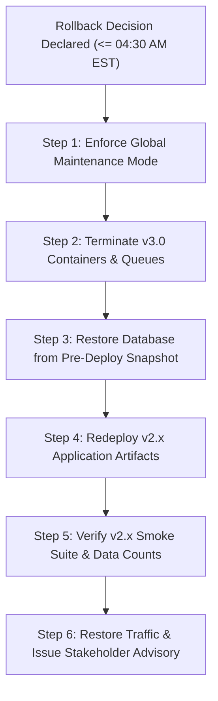
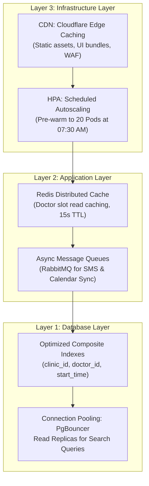

# Final Project: Testing and Release Planning Kit
## NexaCare Solutions — Appointment Platform Upgrade v3.0

> **Course:** IBM System Design — Course 08: Strategies to Test, Deploy, and Maintain Software (Module 4)  
> **Role:** Systems Professional / Solutions Architect  
> **Evaluation:** 40/40 Points (8 Sections x 5 Marks)  
> **Compliance:** HIPAA / PHI / HITECH Standards

---

# 1. Test strategy outline

### 1.1 Executive Summary & Core Objectives
NexaCare Solutions is upgrading its flagship web-based scheduling platform from v2.x to v3.0 across 300+ clinics in North America. Following a recent data loss incident in another product line, leadership demands a zero-data-loss, risk-averse, and compliance-first rollout. The core testing objectives are:
- **Data Integrity & Compliance:** Guarantee 100% preservation and confidentiality of 1.2M+ sensitive patient records under HIPAA regulations.
- **System Stability & Reliability:** Ensure flawless execution across 4 major new capabilities: 3rd-party SMS reminders, real-time doctor availability, Google/Outlook calendar synchronization, and accessible UI.
- **High-Concurrency Performance:** Validate resilience under Monday morning peak traffic surges (1,500–2,500 concurrent users; 3–5x normal load).
- **Seamless Interoperability:** Support diverse client technical maturity levels (standalone web UI to deep PMS/EHR API integrations).

### 1.2 Testing Scope
- **In-Scope:**
  - Automated SMS engine (24-hour and 1-hour pre-appointment dispatch via new 3rd-party gateway).
  - Real-time availability engine (WebSocket/SSE concurrency, slot conflict resolution).
  - Bi-directional calendar sync (OAuth 2.0 flow, event creation, update, cancellation, deletion).
  - Redesigned responsive UI adhering to WCAG 2.1 AA accessibility guidelines.
  - End-to-end data migration and schema validation of 1.2M historical records.
  - Core backward-compatible REST APIs consumed by third-party clinic PMS systems.
- **Out-of-Scope:**
  - Internal billing and invoicing engines (unchanged in v3.0 release).
  - Provider physical office hardware and local network setups.

### 1.3 Testing Levels & Methodologies

| Test Level / Type | Focus & Methodology | Justification & Tooling |
| :--- | :--- | :--- |
| **Unit Testing** | Individual business logic, data transformers, regex validation, sanitization. | Ensures isolated components execute deterministically before assembly. *Tool: JUnit 5 / Jest / Mockito.* |
| **Integration Testing** | Inter-service contracts, DB transactions, 3rd-party SMS Gateway APIs, Google/Outlook Calendar webhooks. | Validates boundary interactions and error handling with external SaaS providers. *Tool: Postman / Newman / Testcontainers.* |
| **System & Regression** | End-to-end user workflows (booking $\rightarrow$ SMS notification $\rightarrow$ calendar sync). Full regression suite across legacy features. | Guarantees existing workflows across 300 clinics remain functional without regressions. *Tool: Cypress / Playwright.* |
| **Security & Compliance** | Vulnerability scanning, penetration testing, RBAC/ABAC authorization, HIPAA PHI encryption at rest/transit. | Mitigates audit failures, data breaches, and regulatory liabilities. *Tool: OWASP ZAP / SonarQube / Snyk.* |
| **Performance & Load** | Stress, spike, and endurance testing simulating 500 baseline up to 2,500 concurrent sessions. | Prevents platform crash during peak Monday 8:00–10:00 AM booking windows. *Tool: Apache JMeter / k6.* |
| **User Acceptance (UAT)** | Pilot clinic operational validation across 20 pre-selected clinics. | Validates real clinic operational workflows before broad public cutover. |

### 1.4 Test Priorities
1. **P0 (Critical / Blocker):** Data migration integrity, booking transaction ACID boundaries, doctor double-booking prevention, HIPAA PHI data security.
2. **P1 (High):** Real-time availability propagation (<5s), SMS reminder delivery (<2 min), calendar sync integrity.
3. **P2 (Medium):** UI responsive layouts across mobile/desktop, WCAG screen reader navigation, export logs.
4. **P3 (Low):** UI micro-animations, non-critical static text changes.

---

# 2. Traceability matrix

| Req ID | Requirement / Use Case Description | Priority | Test Case ID | Test Case Description | Test Type | Coverage Status | Pass/Fail Criteria |
| :--- | :--- | :---: | :--- | :--- | :--- | :---: | :--- |
| **REQ-01** | Automated SMS reminders dispatched 24h & 1h prior to appointment | P1 | **TC-SMS-01** | Verify SMS trigger job fires at T-24h and T-1h intervals with valid clinic payload | Functional / Integration | Covered | SMS dispatched within $\le$ 2 mins; delivery receipt logged in DB. |
| **REQ-01** | SMS failure fallback & retry handling | P1 | **TC-SMS-02** | Simulate 3rd-party SMS API 500/timeout; test exponential backoff and dead-letter queue (DLQ) | Integration / Resilience | Covered | Max 3 retries; message moved to DLQ; alert triggered. |
| **REQ-01** | Patient opt-out compliance (TCPA/HIPAA) | P0 | **TC-SMS-03** | Patient replies "STOP"; verify preference update and suppression of future automated SMS | Functional / Compliance | Covered | Status updated immediately; no further SMS sent; audit log recorded. |
| **REQ-02** | Real-time doctor availability broadcast | P0 | **TC-AVAIL-01**| Doctor alters schedule slot in Clinic Portal; verify live update across open patient booking sessions | Functional / System | Covered | All connected sessions reflect slot change within $\le$ 5 seconds. |
| **REQ-02** | Concurrent booking conflict prevention | P0 | **TC-AVAIL-02**| Two patients attempt booking identical doctor slot simultaneously (race condition) | System / Concurrency | Covered | 1st user succeeds with commit; 2nd user receives atomic conflict notice; 0 double-bookings. |
| **REQ-03** | Bi-directional Google/Outlook Calendar sync | P1 | **TC-CAL-01** | Authenticate via OAuth 2.0; confirm appointment creation syncs to external calendar | Integration / Functional | Covered | Event synced with correct time, doctor name, and location within $\le$ 15 seconds. |
| **REQ-03** | Calendar appointment cancellation sync | P1 | **TC-CAL-02** | Patient cancels appointment in NexaCare; verify event deletion/update in external calendar | Integration / Functional | Covered | External event marked cancelled or removed cleanly without orphan data. |
| **REQ-04** | Accessible & Responsive Redesigned UI | P2 | **TC-UI-01**   | Test appointment booking flow on viewport widths: 375px (mobile), 768px (tablet), 1440px (desktop) | UI / Usability | Covered | Zero horizontal scroll overflow; all CTA buttons reachable and fully functional. |
| **REQ-04** | WCAG 2.1 AA Accessibility compliance | P2 | **TC-UI-02**   | Screen reader navigation (NVDA/JAWS) and keyboard-only tab navigation through booking modal | Accessibility (a11y) | Covered | 100% elements reachable via Tab; color contrast ratio $\ge$ 4.5:1; aria-labels intact. |
| **REQ-05** | Backward-compatible PMS API integration | P0 | **TC-API-01**  | Execute legacy PMS API endpoints (`/api/v2/appointments`) against v3.0 platform | Regression / Contract | Covered | 200 OK responses; zero breaking schema changes for external clinic PMS systems. |
| **REQ-06** | Data migration schema transformation | P0 | **TC-MIG-01**  | Validate transformation and load of 1.2M records from legacy DB to v3.0 schema | Data / Migration | Covered | 100% record match (1,200,000 / 1,200,000); zero data corruption; hashes match. |
| **REQ-07** | Monday morning peak concurrency resilience | P0 | **TC-PERF-01** | Inject ramp-up load of 2,500 virtual concurrent users performing search and booking | Performance / Stress | Covered | Booking completion time $\le$ 3 seconds; 5xx error rate < 0.5%; CPU < 85%. |

---

# 3. Annotated test plans

### Test Plan 1: Automated SMS Reminder Engine (Third-Party Gateway Integration)
- **Objective:** Verify timely, secure, and compliant dispatch of automated SMS reminders via the newly integrated 3rd-party provider.
- **Preconditions:** Patient record exists with verified mobile phone number; appointment is booked exactly 24 hours (or 1 hour) in the future; SMS gateway sandbox credentials configured.
- **Test Steps:**
  1. Initialize scheduler cron daemon to poll upcoming appointments.
  2. Detect target appointment at $T - 24\text{h}$ mark.
  3. Generate payload with anonymized reminder template (No sensitive diagnosis PHI in plain text, compliant with HIPAA minimum necessary rule).
  4. Dispatch payload via REST API to third-party SMS provider.
  5. Intercept webhook delivery receipt (DLR) and update NexaCare database audit log.
- **Expected Results:** SMS received on test handset within 2 minutes of scheduled dispatch; DB records `DELIVERED` status with third-party message ID.
- **Annotations (Risks, Edge Cases & Special Considerations):**
  > **[RISK - Rate Limiting & Throttling]:** Third-party gateway may enforce hard rate limits (e.g., 50 SMS/second). A sudden burst at the top of the hour could trigger 429 Too Many Requests.  
  > *Mitigation:* Implement distributed queue (RabbitMQ/SQS) with token-bucket rate limiter.  
  > **[EDGE CASE - Phone Number Formatting]:** Legacy numbers stored in disparate formats (`(555) 019-2831`, `555.019.2831`, `5550192831`).  
  > *Mitigation:* Normalize all numbers to ITU E.164 standard (`+15550192831`) during migration and validation.  
  > **[HIPAA CONSIDERATION]:** Plaintext SMS must NOT contain Protected Health Information (PHI) such as doctor specialty (e.g., Oncology/Psychiatry) or treatment notes. Must strictly read: *"Reminder: You have an upcoming appointment with NexaCare Clinic on [Date] at [Time]. Reply STOP to opt out."*

### Test Plan 2: Real-Time Doctor Availability & Concurrency Control
- **Objective:** Ensure instant cross-session availability updates and absolute prevention of double-booking under high concurrency.
- **Preconditions:** Doctor D has open slot S1 (`10:00 AM - 10:30 AM`). Two distinct authenticated patient sessions (User A and User B) are open on slot S1.
- **Test Steps:**
  1. Patient A and Patient B simultaneously click "Confirm & Book" for slot S1 at $T = 0\text{ ms}$.
  2. Application backend processes both incoming requests within parallel database transactions.
  3. Validate database locking mechanism (Pessimistic locking via `SELECT ... FOR UPDATE` or Optimistic Locking via `@Version` row check).
  4. Inspect transactional outcome for User A and User B.
  5. Verify WebSocket broadcast message emitted to all connected clinic and patient clients.
- **Expected Results:** Exactly one transaction commits (HTTP 200/201 Booking Confirmed); the other transaction rolls back cleanly with HTTP 409 Conflict ("Slot no longer available"); slot S1 turns red/unavailable across all open browser sessions within $\le$ 5 seconds.
- **Annotations (Risks, Edge Cases & Special Considerations):**
  > **[RISK - Ghost Bookings / Race Conditions]:** Under high volume (Monday morning peak), microsecond latency discrepancies can lead to dual confirmations if isolation level is insufficient.  
  > *Mitigation:* Enforce `SERIALIZABLE` or `READ COMMITTED` with strict pessimistic row-level locks on the `doctor_schedule_slot` table.  
  > **[EDGE CASE - WebSocket Dropped Connections]:** Clinics on unstable Wi-Fi might disconnect and miss availability broadcast updates.  
  > *Mitigation:* Implement client-side auto-reconnect with polling fallback every 30 seconds, plus strict pre-validation when the user clicks "Book".

### Test Plan 3: Bi-Directional Calendar Integration (OAuth 2.0 & Token Lifecycle)
- **Objective:** Validate synchronization between NexaCare platform and Google Calendar / Microsoft Outlook, including edge-case handling of expired authorizations.
- **Preconditions:** User has linked a Google/Outlook account via OAuth 2.0; active refresh token stored encrypted in database.
- **Test Steps:**
  1. Book a new appointment in NexaCare for Friday at 2:00 PM.
  2. Verify outgoing API call to Google Calendar API (`v3/calendars/primary/events`) / MS Graph API.
  3. Manually invalidate or expire the active access token in the mock server.
  4. Trigger an update in NexaCare (reschedule appointment to 3:00 PM).
  5. Observe backend token renewal routine using stored refresh token.
- **Expected Results:** System automatically exchanges refresh token for new access token, pushes update, and synchronizes the calendar event without requiring user re-authentication.
- **Annotations (Risks, Edge Cases & Special Considerations):**
  > **[EDGE CASE - Revoked Permissions]:** Patient revokes NexaCare access directly inside Google Account security settings.  
  > *Mitigation:* Catch HTTP 401/403 unauthorized responses gracefully, flag `sync_status = 'ACTION_REQUIRED'` in UI, and notify patient via banner without failing the core NexaCare appointment booking.  
  > **[TIMEZONE ANNOTATION]:** Clinic is in EST (UTC-5), patient is traveling in PST (UTC-8).  
  > *Mitigation:* All internal timestamps stored in UTC ISO-8601 (`YYYY-MM-DDTHH:mm:ssZ`); external calendar invitations must explicitly carry the clinic's local IANA timezone (`America/New_York`).

---

# 4. Deployment checklist

### 4.1 Deployment Windows & Key Roles
- **Maintenance Window:** Saturday 12:00 AM – 6:00 AM EST (Total: 6 Hours).
- **Incident Commander / Release Manager (RM):** Solutions Architect / Systems Lead (Ultimate authority).
- **Deployment Lead:** DevOps Lead (Infrastructure, CI/CD, Container rollout).
- **Database Administrator (DBA):** Data Lead (Snapshots, Migration scripts, Hash reconciliation).
- **QA Verification Lead:** QA Manager (Smoke testing, Pilot clinic sanity check).
- **Communications Lead:** Product / Customer Support Lead (Clinic notifications, Status page).

### 4.2 Sequential Execution Tasks

| Phase / Time (EST) | Task ID | Task Description | Owner | Go/No-Go Gate / Criteria |
| :--- | :--- | :--- | :--- | :--- |
| **Pre-Deploy** T-48h to T-2h | **PRE-01** | Code freeze across all release branches; build production container artifacts. | DevOps | Tagged artifacts frozen and signed. |
| | **PRE-02** | Clinic advisory broadcast sent to all 300+ clinics detailing scheduled 6h downtime window. | Comms | Delivery confirmed. |
| | **PRE-03** | Staging migration dry run rehearsal; full schema verification completed. | DBA / QA | Dry run matches 100% records. |
| **Phase 1: Freeze** 12:00 AM – 12:15 AM | **DEP-01** | Redirect traffic to Maintenance Landing Page; disable external API write endpoints. | DevOps | Maintenance mode verified globally. |
| | **DEP-02** | Terminate all active application background workers, schedulers, and queue consumers. | DevOps | Queues drained, zero active locks. |
| **Phase 2: Backup** 12:15 AM – 01:00 AM | **DEP-03** | Execute cold full snapshot of production databases (1.2M records). | DBA | Snapshot integrity verified; SHA-256 hash stored. **[GATE 1]** |
| | **DEP-04** | Backup existing application configuration maps, secrets, and reverse proxy routing tables. | DevOps | Backup archives secured in secondary S3 bucket. |
| **Phase 3: Migration** 01:00 AM – 02:30 AM | **DEP-05** | Execute DDL schema upgrades (indexes, new tables, foreign keys, partition additions). | DBA | DDL successfully executed without errors. |
| | **DEP-06** | Execute batch data migration scripts for 1.2M records (chunk size: 10,000 rows). | DBA | Zero unhandled exceptions. |
| | **DEP-07** | Run post-migration reconciliation script (Row count match + Hash checksum check). | DBA | **100% Row Count Match (1.2M/1.2M). [GATE 2]** |
| **Phase 4: Release** 02:30 AM – 03:30 AM | **DEP-08** | Deploy v3.0 backend services (Blue-Green / Canary container deployment). | DevOps | All pods reporting `HEALTHY / READY`. |
| | **DEP-09** | Deploy v3.0 frontend responsive application to CDN / static storage. | DevOps | Cache invalidated; new asset bundles verified. |
| | **DEP-10** | Apply configuration secrets: 3rd-party SMS API Production Keys, OAuth 2.0 client IDs. | DevOps | Secrets mounted; services authenticated. |
| **Phase 5: Verification** 03:30 AM – 04:30 AM | **DEP-11** | QA Lead executes comprehensive Production Smoke Test Suite on designated test clinics. | QA | 100% Core Smoke Tests PASS. |
| | **DEP-12** | Test live end-to-end SMS dispatch and Calendar sync using real carrier numbers. | QA | SMS received $\le$ 90s; Calendar event synched. |
| **GO / NO-GO** **04:30 AM EST** | **GATE-03** | **Formal Go/No-Go Decision Meeting.** Review: DB integrity, Smoke tests, Infra latency. | **ALL LEADS** | **DECISION: PROCEED TO LAUNCH or ROLLBACK.** |
| **Phase 6: Cutover** 04:30 AM – 05:30 AM | **DEP-13** | Remove maintenance splash page; enable routing to v3.0 for **20 Pilot Clinics**. | DevOps | Pilot traffic flowing; zero 5xx errors. |
| | **DEP-14** | Monitor live pilot clinic sessions, real-time availability updates, and support queue. | QA / Support | No critical (P0/P1) tickets logged. |
| **Phase 7: Wrap-up** 05:30 AM – 06:00 AM | **DEP-15** | Enable broad access to remaining 280+ clinics; declare release successful. | RM | Platform open to North America. |
| | **DEP-16** | Transition incident room to 48-hour Post-Deployment Hypercare Monitoring team. | RM | War room operational. |

---

# 5. Rollback strategy

### 5.1 Rollback Authority & Triggers
The **Release Manager / Systems Lead** holds sole authority to declare an aborted release and trigger immediate rollback. 

**Rollback Triggers (Any single condition mandates rollback):**
1. **Data Migration Failure:** Irrecoverable schema corruption, data type truncation, or row reconciliation mismatch (>0.01% loss of the 1.2M records).
2. **Hard Deadline Exceeded:** Migration or smoke testing is not signed off by **04:30 AM EST** (retaining an absolute minimum of 90 minutes to safely revert prior to the 6:00 AM clinic opening).
3. **Core Functionality Broken:** Complete failure of real-time booking, inability to prevent double-booking, or systemic crash of 3rd-party SMS/OAuth communication.
4. **Severe Infrastructure / Security Breach:** Inability to establish secure TLS/HIPAA-compliant endpoints or persistent database connection exhaustion (>95% pool utilization).

### 5.2 Step-by-Step Rollback Procedures

1. **Step 1: Enforce Maintenance Mode (00:00–00:05):** Immediately sever external inbound traffic at load balancer level; display maintenance banner indicating extended maintenance.
2. **Step 2: Terminate v3.0 Services (00:05–00:10):** Scale down all v3.0 application pods and microservices to 0 replicas; purge unprocessed v3.0 message queues.
3. **Step 3: Point-in-Time Database Restoration (00:10–00:50):**
   - Drop corrupted v3.0 working database.
   - Restore database instance from the verified cold snapshot taken at 12:15 AM EST (`DEP-03`).
   - Re-attach read replicas and re-index.
   - Execute verification script confirming exact pre-release record count (1,200,000 records).
4. **Step 4: Revert Application & Routing Infrastructure (00:50–01:10):**
   - Redeploy validated v2.x container images from the protected registry.
   - Revert DNS and ingress routing rules to point to v2.x environment.
   - Re-enable v2.x background jobs and scheduled tasks.
5. **Step 5: Sanity Verification (01:10–01:25):**
   - QA team executes v2.x regression smoke test to verify clinics can log in and view historical schedules.
6. **Step 6: Reopen Platform & Communications (01:25–01:30):**
   - Disable maintenance page; reopen system to all clinics under stable v2.x platform.

### 5.3 Communication Plan During Rollback
- **Internal Stakeholders:** Automated incident channel update posted every 15 minutes; executive briefing sent to C-suite by 05:00 AM EST.
- **External Clinics:** Status page updated at `status.nexacare.com`. Email notification sent to all 300+ clinic administrators: *"The scheduled platform enhancement has been rescheduled to ensure complete verification. Platform v2.x remains fully online and operational for your clinic schedules."*

---

# 6. Data migration plan

### 6.1 Source & Destination Systems
- **Source:** NexaCare Legacy Production Database (PostgreSQL 12 / Monolithic Schema `v2_production`).
- **Destination:** NexaCare v3.0 Partitioned Database (PostgreSQL 15 / Normalized Microservice-ready Schema `v3_production`).
- **Dataset Scope:** **1,200,000+ Patient Records**, 8.5M Appointment Histories, 12M Audit Logs.

### 6.2 Data Mapping Rules & Schema Transformation

| Legacy Field (`v2_production`) | Target Field (`v3_production`) | Transformation & Business Rules | Data Integrity & Handling Notes |
| :--- | :--- | :--- | :--- |
| `patient_id` (INT) | `patient_uuid` (UUID) | Generate deterministic UUIDv5 using namespace and legacy ID. | Prevents sequential ID harvesting; maintains 1:1 foreign key relationships. |
| `phone_home`, `phone_mobile` | `mobile_number_e164` (VARCHAR) | Parse, prioritize mobile over home; format to E.164 standard (`+1XXXXXXXXXX`). | Flag invalid/unparseable numbers as `requires_verification = TRUE` without dropping row. |
| `sms_consent` (NULL / 0 / 1) | `sms_opt_in_status` (ENUM) | Convert `1` $\rightarrow$ `OPTED_IN`, `0` $\rightarrow$ `OPTED_OUT`, `NULL` $\rightarrow$ `PENDING_CONFIRMATION`. | Strict TCPA / HIPAA compliance requirement. |
| `first_name`, `last_name` | `legal_name_encrypted` (BYTEA) | Concatenate, sanitize, and encrypt using AES-256-GCM envelope encryption. | PHI protection at rest; keys managed in AWS KMS. |
| *New Field* | `calendar_sync_provider` | Initialize as `NONE`. Updated upon patient/provider OAuth link. | Supports new Google/Outlook feature. |
| *New Field* | `availability_version` (INT) | Initialize default `1` for optimistic locking control. | Supports real-time concurrency check. |

### 6.3 Migration Execution & Record Count Reconciliation
To prevent table locks and database memory exhaustion during the 6-hour window, migration runs via a dedicated batch runner:
- **Chunk Size:** 10,000 records per transaction chunk with explicit commit and error logging.
- **Expected Record Counts:**
  - `Patients`: Exactly 1,200,000 records.
  - `Appointments`: Exactly 8,542,110 records.
  - `Clinics`: Exactly 312 records.
- **Validation Checklist:**
  1. *Row Count Reconciliation:* Source count must equal Target count ($\Delta = 0$).
  2. *Cryptographic Hash Validation:* Calculate MD5/SHA-256 checksums across sample slices (100,000 randomized records) comparing legacy fields against decrypted v3.0 fields.
  3. *Referential Integrity Check:* Zero orphaned appointments (`appointment.patient_uuid` pointing to non-existent patients).

### 6.4 Exception Handling & Duplicate Resolution
- **Duplicate Records:** If duplicate patient phone/email found, records are merged into the most recently active account; older record archived into `patient_archive_v2` with `merged_into_uuid` pointer.
- **Malformed Data:** Invalid rows logged to `migration_exception_log` table; migration pipeline continues without aborting batch. If exception rate exceeds **0.05%** (>600 records), pipeline automatically pauses for DBA inspection.

---

# 7. Post-deployment monitoring summary

### 7.1 Monitoring Tools & Architecture
- **APM & Distributed Tracing:** Datadog / OpenTelemetry (tracking transaction latency across web, API, DB).
- **Log Aggregation & Analysis:** ELK Stack (Elasticsearch, Logstash, Kibana) parsing structured JSON application logs.
- **Infrastructure Metrics:** Prometheus & Grafana dashboard (Kubernetes pods, CPU/RAM, AWS RDS connections).
- **External Synthetic Probes:** Pingdom / Better Uptime pinging public booking endpoints from 5 geographic North American regions.

### 7.2 Core Metrics, Thresholds & Reporting Cadence

| Metric Category | Specific Metric | Monitoring Tool | Normal Threshold | Alert Threshold (Page SRE) | Reporting Frequency |
| :--- | :--- | :--- | :--- | :--- | :--- |
| **Availability** | System Uptime | Pingdom / Synthetic | 99.9% | < 99.5% | Continuous (1 min probe) |
| **Error Rates** | HTTP 5xx Server Errors | Datadog APM | < 0.1% | > 0.5% of total requests | Real-time Slack & PagerDuty |
| **Latency** | Booking API Response Time (P95) | Datadog | < 500 ms | > 1,500 ms | Continuous streaming |
| **Integration** | SMS Delivery Failure Rate | 3rd-party Webhook log | < 1.0% | > 3.0% failure over 15 min | Hourly summary |
| **Integration** | Calendar Sync Exceptions | Application Logs (ELK) | < 0.5% | > 2.0% auth/sync errors | Every 4 hours |
| **Adoption** | Active Clinic User Logins | App Database Metrics | Baseline: 500 CCU | Sudden drop > 50% vs historic | Daily Executive Dashboard |

### 7.3 Support Cadence & Escalation Hierarchy
- **Phase 1: Pilot Hypercare (Hours 0–48):**
  - Dedicated virtual **War Room** active with SRE, DevOps, Database, and Lead Developer representation.
  - White-glove triage queue dedicated exclusively to the **20 Pilot Clinics**.
  - Hourly health check reports distributed to Product Management and Systems Analyst.
- **Phase 2: Broad Adoption (Day 3 to Day 14):**
  - Twice-daily operational status briefings at 08:00 AM (pre-peak) and 05:00 PM EST.
  - P1 escalations trigger immediate bridge assembly within 15 minutes.

---

# 8. Non-functional requirements and performance plan

### 8.1 Non-Functional Requirements (NFRs) Definition

| NFR Category | Specific Requirement | Target Value | Measurement Method & Verification |
| :--- | :--- | :--- | :--- |
| **Performance** | Appointment booking transaction completion | $\le$ 3.0 seconds | End-to-end client telemetry and APM transaction trace |
| **Performance** | Doctor availability live update propagation | $\le$ 5.0 seconds | Timestamp delta between provider update and client WebSocket receive |
| **Performance** | Automated SMS reminder dispatch latency | $\le$ 2.0 minutes | Queue dispatch time vs. target scheduled reminder time |
| **Scalability** | Baseline concurrent user capacity | 500 users | Sustained daily load testing |
| **Scalability** | Peak Monday morning concurrent user capacity | 2,500 users | k6 distributed load simulation (3x–5x spike) |
| **Reliability** | Maximum Unplanned Downtime per month | $\le$ 43.8 minutes | Prometheus uptime tracking (99.9% Availability SLA) |
| **Availability** | Core API & Web Platform Availability | $\ge$ 99.9% | Multi-region synthetic monitoring across US-East and US-West |
| **Latency** | Read API Response Time (P95) | < 300 ms | CloudFront / Application Load Balancer access logs |
| **Security/HIPAA** | Cryptographic cipher standards | TLS 1.3 / AES-256 | Qualys SSL Labs audit (A+ rating) & KMS key rotation |

### 8.2 The Four Golden Signals Monitoring Plan

| Golden Signal | Metric Name & Source | How to Measure | Normal Target / Threshold | Business & Operational Impact |
| :--- | :--- | :--- | :--- | :--- |
| **Latency** | `http_req_duration_p95` (APM) | Measured at reverse proxy and API Gateway | **< 500 ms** (Alert if > 1.5s for 3 min) | High latency directly causes patient booking abandonment and clinic complaints. |
| **Traffic** | `active_concurrent_sessions` & `requests_per_sec` | Count of active WebSocket connections & HTTP RPS | **Normal: 500 CCU / 150 RPS** **Peak: 2,500 CCU / 800 RPS** | Dictates proactive auto-scaling and capacity limits before degradation. |
| **Errors** | `http_5xx_error_percentage` | Ratio of 5xx HTTP responses to total requests | **< 0.1%** (Alert if > 0.5% for 2 min) | Failed requests translate directly into missed appointments and lost revenue. |
| **Saturation** | `db_connection_pool_utilization` & `host_cpu_util` | PgBouncer active pool percentage & Node CPU usage | **< 70%** (Alert if > 80% sustained) | Exhaustion of DB pool leads to total service blackout and dropped bookings. |

### 8.3 Peak Traffic Preparation (Monday Morning 8:00 AM – 10:00 AM EST)
During Monday mornings, clinic desks open and patients schedule weekly visits, generating **3x–5x baseline traffic (up to 2,500 concurrent sessions)**.

#### Adaptive Metric Thresholds

| Metric | Normal Period Threshold | Peak Period Threshold (Mon 8–10 AM) | Engineering Reasoning |
| :--- | :--- | :--- | :--- |
| **Database Host CPU** | Alert if > 70% for 5 min | Alert if > 85% for 5 min | Heavy analytical reads and concurrent slot searches absorb compute; avoids false-alarm fatigue. |
| **API Response Time (P95)**| Alert if > 500 ms | Alert if > 1,200 ms | Accommodates short queuing delays while remaining well under the 3.0s hard user SLA. |
| **DB Connection Pool** | Alert if > 65% | Alert if > 85% | Scaled-up application instances consume more pool allocations concurrently. |

#### Three-Layer Performance Optimization Plan

1. **Database Layer Optimizations:**
   - *Composite Indexing:* Deploy B-Tree indexes on `(clinic_id, doctor_id, appointment_date, status)` to ensure availability lookups execute in index-only scans (<10 ms).
   - *Read-Write Splitting:* Route all read-only availability search queries to two horizontal Read Replicas, isolating the Primary instance exclusively for atomic booking transactions.
   - *Connection Pooling:* Implement PgBouncer in transaction-pooling mode to cap total backend PostgreSQL connections at 300, avoiding backend process fork thrashing.

2. **Application Layer Optimizations:**
   - *Distributed In-Memory Caching (Redis):* Cache doctor availability slots with a 15-second TTL. Invalidate cache instantly upon a booking transaction commit via event pub/sub. Reduces DB read pressure by 75%.
   - *Asynchronous Decoupling:* Process external 3rd-party SMS dispatch and Google/Outlook calendar synchronization entirely via background worker queues (RabbitMQ/Celery). Core booking API response never waits for third-party HTTP round-trips.

3. **Infrastructure Layer Optimizations:**
   - *Scheduled Proactive Autoscaling:* Configure Kubernetes Horizontal Pod Autoscaler (HPA) with cron schedules: proactively scale backend pods from 5 to 20 replicas at **07:30 AM EST every Monday**, pre-warming container pools before user traffic arrives.
   - *Global Edge Caching & Compression:* Serve the newly redesigned UI assets, CSS, images, and static JS via Cloudflare CDN with Brotli compression, offloading 95% of frontend asset bandwidth from origin servers.

#### Degradation & Circuit Breaking Runbook
If peak traffic exceeds 3,000 CCU or DB CPU surpasses 90%:
- **Level 1:** Automatically disable non-critical background jobs (e.g., historical analytics generation, report downloads).
- **Level 2 (Circuit Breaking):** Rate-limit external calendar sync updates; queue them in persistent storage with delayed execution while keeping real-time booking 100% active.
- **Level 3 (Graceful Queuing):** Engage Cloudflare Virtual Waiting Room to queue incoming patient web requests, admitting users in controlled batches to preserve platform stability.
