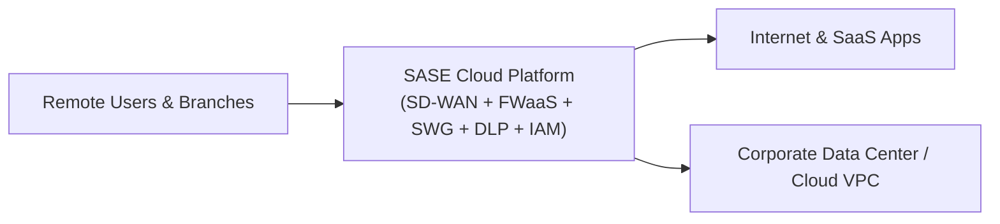

# Network Security Architecture

> **Khóa học**: Cybersecurity Architecture (IBM)  
> **Module 3**: Network, Application, and Data Security  
> **Bài học**: Network Security (Thời lượng: ~27 phút)

---

## 📌 Tổng Quan (Overview)
Trong kiến trúc an ninh mạng, sau Identity & Access Management (IAM) và Endpoint Security, **Network Security** (Bảo mật mạng) là tầng phòng thủ trọng yếu kế tiếp. 

Bài học tập trung vào 4 trụ cột công nghệ cốt lõi:
1. **Firewalls (Tường lửa)**: Cơ chế lọc gói tin, kiểm tra trạng thái và vai trò của proxy, NAT.
2. **Network Segmentation (Phân đoạn mạng)**: Từ Bastion Host cổ điển đến các mô hình DMZ bảo đảm nguyên lý Defense in Depth.
3. **Virtual Private Networks - VPN (Mạng riêng ảo)**: Đường hầm mã hóa bảo mật trên mạng không tin cậy và sự dịch chuyển từ Network-level sang Application-level VPN.
4. **SASE (Secure Access Service Edge)**: Hội tụ giữa hạ tầng mạng diện rộng (SD-WAN) và an ninh mạng đám mây theo triết lý Zero Trust.

---

## 1. Firewalls (Tường lửa) & Các cơ chế lọc

Khái niệm tường lửa bắt nguồn từ thế giới vật lý: ngăn chặn hoặc làm chậm sự lây lan của đám cháy giữa các tòa nhà/căn hộ liền kề, tạo vùng cách ly và bảo vệ. Trong mạng máy tính, tường lửa kiểm soát và hạn chế luồng dữ liệu giữa các vùng mạng khác nhau.

```
[Workstation / Client] ---> [Firewall 1 (External)] ---> [Web Server (DMZ)] ---> [Firewall 2 (Internal)] ---> [Database]
```

### 1.1. Packet Filtering (Lọc gói tin không trạng thái)
- **Nguyên lý**: Phân tích thông tin nằm ở phần **Header** của gói tin (ví dụ phong bì thư: chỉ xem địa chỉ người gửi và người nhận, không mở ruột thư).
- **Các tiêu chí kiểm tra phổ biến**:
  - **Source Address (Địa chỉ nguồn)**: Xác minh dải mạng hợp lệ; ngăn chặn IP Spoofing (kẻ tấn công từ ngoài giả mạo IP nội bộ).
  - **Destination Address (Địa chỉ đích)**: Bắt buộc chỉ được trỏ tới máy chủ công khai (Web Server), cấm truy cập thẳng vào Database hay mạng lõi.
  - **Port / Protocol**: Cho phép các cổng chuẩn như Port 80 (HTTP unencrypted), Port 443 (HTTPS/TLS encrypted).
- **Đặc điểm**: Nhanh, nhẹ nhưng không kiểm tra được nội dung dữ liệu bên trong payload và không ghi nhớ trạng thái phiên kết nối.

### 1.2. Stateful Packet Inspection (SPI - Kiểm tra gói tin có trạng thái)
- Kiểm tra toàn bộ gói tin bao gồm cả **Payload** (nội dung gói tin) và ngữ cảnh/trạng thái của kết nối.
- Giữ bảng trạng thái phiên (State Table) để xác định xem gói tin gửi đến có thuộc một phiên giao tiếp hợp lệ được khởi tạo trước đó hay không (ví dụ: cấm nhận gói phản hồi khi chưa có yêu cầu gửi đi).
- **Application Firewalls / WAF**: Đào sâu hơn vào tầng ứng dụng để phát hiện mã độc, tấn công khai thác payload (SQL Injection, XSS,...).

### 1.3. Proxies (Máy chủ ủy quyền)
- **Cơ chế**: Đóng vai trò trung gian "đứng giữa" (Man-in-the-Middle có chủ đích hợp pháp). Bẻ gãy phiên kết nối trực tiếp đầu-cuối:
  - Client kết nối với Proxy (Session 1).
  - Proxy xử lý, kiểm tra, rồi đại diện kết nối tới Web Server (Session 2).
- **Lợi ích**:
  - **Security & Inspection**: Quét virus, mã độc, kiểm soát và thực thi chính sách bảo mật trước khi cho phép vào mạng nội bộ.
  - **Privacy**: Ẩn danh tính và cấu trúc mạng thực tế của người dùng/hệ thống phía sau.

### 1.4. Network Address Translation (NAT)
- **Bối cảnh**: Chuẩn Internet quy định các dải IP riêng (Private IP, không thể định tuyến trên Internet) như `10.0.0.0/8`, `192.168.0.0/16`.
- **Cơ chế**: Router/NAT Firewall lưu bảng ánh xạ, chuyển đổi các địa chỉ IP private nội bộ thành một (hoặc vài) IP public duy nhất có thể định tuyến được trên Internet.
- **Vai trò bảo mật**:
  - **Bảo tồn địa chỉ IPv4**: Hàng trăm thiết bị nội bộ dùng chung 1 IP ngoài Internet.
  - **Bảo vệ chặn chiều vào (Inbound Protection)**: Kẻ tấn công ngoài Internet không thể gửi gói tin trực tiếp tới IP private bên trong, hạn chế tối đa việc bị thăm dò và tấn công trực diện từ bên ngoài.

---

## 2. Network Segmentation (Phân đoạn mạng & DMZ)

Phân đoạn mạng là cách tổ chức tường lửa thành các kiến trúc phòng thủ nhiều lớp:

```
[Untrusted (Red)] ===> [Semi-trusted / DMZ (Yellow)] ===> [Trusted / Internal (Green)]
```

### 2.1. Bastion Host (Cổ điển - Không khuyến nghị)
- Đặt trực tiếp Web Server ra ngoài Internet với 1 firewall duy nhất bảo vệ mạng nội bộ phía sau.
- **Nhược điểm**: Rủi ro rất cao, máy chủ biên đóng vai trò chốt chặn cuối cùng nhưng cực kỳ dễ tổn thương.

### 2.2. Tri-homed Network (Tường lửa 3 chân / 3 NICs)
- Sử dụng **một** firewall vật lý duy nhất nhưng gắn 3 card mạng (Network Interface Cards - NICs):
  1. Card nối Internet (Untrusted - Red).
  2. Card nối DMZ chứa Web Server (Semi-trusted - Yellow).
  3. Card nối Intranet nội bộ (Trusted - Green).
- **Ưu điểm**: Chi phí thấp, cấu hình tập trung, thường ứng dụng trong mạng gia đình / SOHO.
- **Hạn chế**: **Single Point of Failure (SPOF)** — nếu firewall này bị xâm nhập hoặc lỗi cấu hình, toàn bộ hệ thống đều bị đe dọa.

### 2.3. Basic DMZ (Hai tường lửa - Two Firewalls)
- Sử dụng 2 tường lửa riêng biệt: Firewall 1 (biên ngoài) và Firewall 2 (biên trong).
- Giữa 2 firewall là vùng đệm **DMZ (Demilitarized Zone)** chứa các dịch vụ công khai (Web Server).
- **Lợi thế kiến trúc**:
  - Đảm bảo nguyên lý **Defense in Depth (Phòng thủ theo chiều sâu)**: Kẻ tấn công vượt qua firewall 1 vẫn bị chặn bởi firewall 2 (luật firewall 2 chỉ chấp nhận source IP từ Web server DMZ, cấm IP Internet trực tiếp).
  - Không có điểm lỗi đơn lẻ; khả năng mở rộng tốt hơn.

### 2.4. Multi-tiered DMZ (DMZ đa tầng)
- Tách riêng biệt từng tầng ứng dụng: **Web Server Zone** $\rightarrow$ **Application Server Zone** $\rightarrow$ **Database Zone**, ngăn cách bởi 3 tầng firewall độc lập.
- **Ưu điểm**:
  - Cực kỳ chi tiết về mặt phân quyền (Granular Control).
  - Khả năng phòng thủ vượt trội: Kẻ tấn công phải phá vỡ 3 rào chắn độc lập mới chạm tới dữ liệu lõi.
- **Hạn chế**: Tốn kém chi phí phần cứng/bản quyền và độ phức tạp quản trị chính sách rất cao.

---

## 3. Virtual Private Networks (VPN)

### 3.1. Mục tiêu & Nguyên lý
- **Định nghĩa**: Tạo một kênh truyền bảo mật (Secure Channel / Tunnel / Pipe) đi qua mạng công cộng không tin cậy (Internet).
- **Cơ chế**: Sử dụng **Mã hóa (Encryption)** để đảm bảo tính bí mật (**Confidentiality**) và toàn vẹn dữ liệu.

> [!WARNING] Thách thức của VPN: Limited Inspection Capability
> Kênh mã hóa giúp bảo vệ dữ liệu người dùng hợp pháp khỏi bị nghe lén, nhưng cũng là con dao hai lưỡi: kẻ tấn công có thể lợi dụng VPN tunnel để truyền tải mã độc hoặc phát động tấn công mà các thiết bị giám sát mạng thông thường không giải mã để kiểm tra được payload.

### 3.2. VPN theo các tầng của mô hình OSI
Security ở tầng thấp sẽ được kế thừa tự động bởi các tầng cao hơn:

| Tầng OSI | Công nghệ / Giao thức | Đặc điểm |
| :--- | :--- | :--- |
| **Layer 7 (Application)** | **SSH**, Secure FTP | Mã hóa cho phiên/ứng dụng cụ thể (Console, File transfer). Quản trị chi tiết, granular. |
| **Layer 4 (Transport)** | **SSL / TLS** | Rất phổ biến (biểu tượng ổ khóa HTTPS trên trình duyệt), mã hóa lưu lượng giữa web client và web server. |
| **Layer 3 (Network)** | **IPsec** | Mã hóa mọi lưu lượng giữa 2 địa chỉ IP mạng. Đơn giản, bao quát toàn bộ ứng dụng (catch-all). |
| **Layer 2 (Data Link)** | **PPTP**, **L2TP** | Tạo đường hầm ở tầng liên kết dữ liệu. |

### 3.3. Xu hướng: Chuyển dịch từ Network VPN sang Application-specific VPN
- **Broad / Network-based VPN (như IPsec)**: Cấp quyền truy cập vào nguyên cả dải mạng (All-or-Nothing). Thiếu tính chi tiết, tiềm ẩn rủi ro lây lan ngang (lateral movement).
- **Application-specific VPN**: Chỉ cấp quyền truy cập vào đúng ứng dụng cần thiết (ví dụ: VPN riêng cho email, VPN riêng cho file sharing, SSH riêng cho server). Cho phép kiểm soát chặt chẽ, dễ dàng cô lập hoặc thu hồi quyền truy cập từng dịch vụ theo chuẩn Zero Trust.

---

## 4. SASE (Secure Access Service Edge)

### 4.1. Khái niệm & Bối cảnh
- **SASE** là mô hình kiến trúc an ninh mạng hiện đại kết hợp giữa khả năng kết nối mạng diện rộng thế hệ mới và các chức năng an ninh mạng toàn diện, được cung cấp trực tiếp từ **Đám mây (Cloud)** tới biên mạng (Edge).
- Gắn liền với triết lý **Zero Trust** và **Micro-segmentation** (chia nhỏ mạng nội bộ thành các phân vùng cực nhỏ).

### 4.2. Công thức cấu thành SASE
$$\text{SASE} = \text{Network Security} + \text{WAN (SD-WAN)} \xrightarrow{\text{Delivered via}} \text{Cloud}$$

- **Network Security (NETSEC)**:
  - **Firewall as a Service (FWaaS)**
  - **Secure Web Gateway (SWG)**: Kiểm soát duyệt web, lọc nội dung tầng ứng dụng.
  - **Data Loss Prevention (DLP)**: Ngăn chặn thất thoát dữ liệu nhạy cảm.
  - **Identity & Access Management (IAM)**: Tích hợp xác thực (Authentication) & phân quyền (Authorization).
- **SD-WAN (Software-Defined WAN)**:
  - Khả năng định tuyến động, quản trị mạng diện rộng linh hoạt theo phần mềm, mở rộng nhanh chóng.
- **Cloud-delivered**:
  - Khả năng co giãn linh hoạt (Elasticity & Scalability), giảm thiểu sự phụ thuộc vào các thiết bị phần cứng cồng kềnh (appliances) đặt tại từng chi nhánh vật lý.



---

## 🧠 Tóm tắt cốt lõi cho Kiến trúc sư An ninh mạng (Architect Takeaways)
1. **Lớp bảo vệ kết hợp**: Không có một giải pháp đơn lẻ nào giải quyết được toàn bộ an ninh mạng. Luôn kết hợp Packet Filtering + Stateful Inspection + Proxy + NAT.
2. **Tuân thủ Defense in Depth**: Luôn ưu tiên kiến trúc Multi-tiered DMZ hoặc Basic DMZ thay vì phụ thuộc vào một thiết bị duy nhất (Tri-homed / Bastion Host).
3. **Giảm thiểu bề mặt tấn công qua VPN**: Ưu tiên các giải pháp Application-level VPN hoặc Zero Trust Network Access (ZTNA) thay vì cấp Full-network IPsec VPN cho người dùng từ xa.
4. **Hiện đại hóa với SASE**: Hợp nhất hạ tầng mạng và bảo mật trên nền tảng Cloud Native để đáp ứng môi trường làm việc phân tán và kiến trúc đa đám mây (Multi-cloud).
