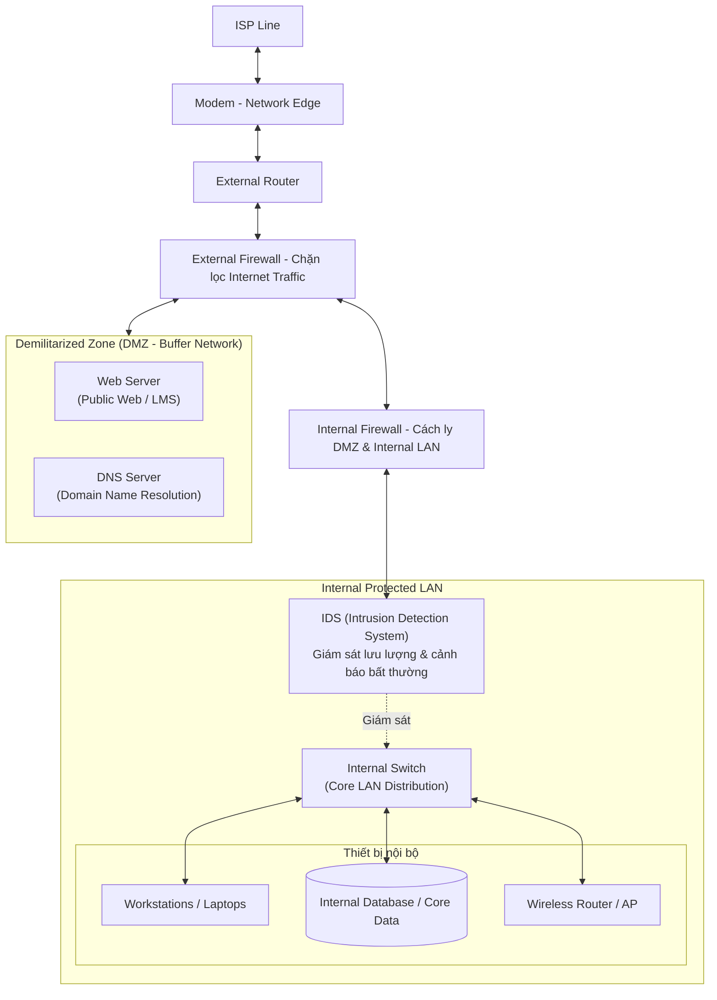

# Hands-on Lab: Secure Network Diagram (Llobex Corporation)

> **Khóa học**: Cybersecurity Architecture (IBM)  
> **Module 3**: Network, Application, and Data Security  
> **Thực hành**: Hands-on Lab: Secure Network Diagram (Thời lượng: ~15 phút)  
> **Tác giả**: Dee Dee Collette (IBM)

---

## 🏢 Tình huống nghiệp vụ (Scenario)
- **Tổ chức**: Llobex Corporation — một startup trong lĩnh vực EdTech đang tăng trưởng mạnh về doanh thu và người dùng.
- **Vấn đề cốt lõi**: Hạ tầng mạng không được nâng cấp trong hơn 3 năm qua.
- **Hậu quả**: Vừa trải qua một vụ rò rỉ dữ liệu nghiêm trọng (**significant data breach**), làm mất thông tin nhạy cảm của khách hàng và dẫn tới sụt giảm khách hàng.
- **Nhiệm vụ của Chuyên viên An ninh mạng**: Ban giám đốc giao trách nhiệm đại tu và nâng cấp toàn bộ kiến trúc mạng của Llobex nhằm ngăn chặn các sự cố trong tương lai bằng một sơ đồ mạng an toàn (**Secure Network Architecture Diagram**).

---

## 🔍 Phân tích Hiện trạng Hạ tầng Mạng Cũ (Legacy Network)
Sơ đồ hiện tại của Llobex bao gồm các thành phần cơ bản nhưng **hoàn toàn thiếu các chốt chặn an ninh**:
- **ISP Line** $\rightarrow$ **Modem** $\rightarrow$ **External Router** $\rightarrow$ **Internal Switch** $\rightarrow$ **LAN (Workstations, Servers, Wireless Router)**.
- **Lỗ hổng chết người**:
  1. Không có **Tường lửa (Firewall)**: Không có cơ chế lọc gói tin giữa Internet và mạng nội bộ.
  2. Không có **DMZ (Demilitarized Zone)**: Các máy chủ hướng ra bên ngoài (Web server, DNS) đặt chung với máy trạm nội bộ, khiến hacker khi tấn công được Web server sẽ lập tức di chuyển ngang (**Lateral Movement**) chiếm đoạt toàn bộ database và mạng nội bộ.
  3. Không có **Hệ thống phát hiện xâm nhập (IDS)**: Thiếu khả năng giám sát, phân tích lưu lượng và cảnh báo khi có tấn công đang diễn ra.

---

## 🛡️ Thiết kế Kiến trúc Mạng An toàn Mới (Secure Target Architecture)

Để khắc phục hoàn toàn các điểm yếu trên, kiến trúc mới được thiết kế bổ sung theo mô hình phòng thủ chiều sâu (**Defense in Depth**):

---

## 🛠️ Các bước thực hiện Nâng cấp (Step-by-Step Lab Execution)

### Bước 1: Thiết lập công cụ vẽ sơ đồ
- Sử dụng **Visual Paradigm Online** (`https://online.visual-paradigm.com/`).
- Tải file thiết kế cũ `Llobex network.vpd` và Import vào công cụ qua menu `Create New` $\rightarrow$ `Import/Open` $\rightarrow$ `Device`.

### Bước 2: Bổ sung Vùng Đệm DMZ (Demilitarized Zone)
- **Hành động**: Tạo một phân vùng mạng DMZ độc lập tách rời hoàn toàn khỏi mạng LAN nội bộ.
- **Thành phần đưa vào DMZ**:
  - **Web Server**: Cung cấp giao diện khóa học và cổng thông tin trực tuyến cho học viên qua Internet.
  - **DNS Server**: Phân giải tên miền cho các yêu cầu từ bên ngoài vào hệ thống.
- **Mục đích**: Cô lập các dịch vụ trực diện Internet, giảm thiểu tối đa rủi ro nếu Web Server bị tấn công thì kẻ tấn công vẫn không thể xâm nhập trực tiếp vào hệ thống lõi.

### Bước 3: Triển khai Mô hình 2 Tường Lửa (Two Firewalls)
- **Firewall 1 (External Firewall)**:
  - **Vị trí**: Đặt giữa External Router và phân vùng DMZ / Firewall 2.
  - **Nhiệm vụ**: Lọc gói tin (Packet filtering), chặn các kết nối độc hại từ Internet, chỉ mở các port dịch vụ công khai (HTTP/HTTPS, DNS).
- **Firewall 2 (Internal Firewall)**:
  - **Vị trí**: Đặt giữa phân vùng DMZ và mạng LAN nội bộ.
  - **Nhiệm vụ**: Ngăn cách hoàn toàn DMZ với Intranet. Chỉ cho phép các luồng truy vấn được xác thực nghiêm ngặt từ Web Server vào Database nội bộ (chặn toàn bộ chiều ngược lại hoặc kết nối trực tiếp từ Internet).

### Bước 4: Tích hợp Hệ thống Phát hiện Xâm nhập (IDS - Intrusion Detection System)
- **Vị trí**: Đặt **sau Internal Firewall và trước Internal Switch**.
- **Nhiệm vụ**:
  - Giám sát toàn bộ luồng lưu lượng đã đi qua firewall để đi vào các thiết bị nội bộ.
  - Phát hiện các hành vi bất thường, chữ ký tấn công (attack signatures) hoặc mã độc mà firewall có thể vô tình bỏ lọt.
  - Tự động phát cảnh báo (alerts) cho đội ngũ SOC/Security Admin để kịp thời phản ứng.

---

## 📊 Bảng so sánh Trước và Sau khi Nâng cấp (Before vs. After)

| Tiêu chí | Trước khi cải tiến (Legacy) | Sau khi nâng cấp (Secure Target) | Lợi ích an ninh |
| :--- | :--- | :--- | :--- |
| **Kiểm soát biên (Perimeter Control)** | Chỉ có Router thông thường | Router + External Firewall | Lọc chặn port & gói tin độc hại ngay cửa ngõ |
| **Phân vùng dịch vụ công khai** | Nằm chung mạng với Workstation nội bộ | Đưa vào DMZ độc lập (Web Server, DNS) | Triệt tiêu nguy cơ thâm nhập ngang (Lateral Movement) |
| **Bảo vệ dữ liệu lõi** | Không có rào chắn nội bộ | Bổ sung Internal Firewall | Tạo cấu trúc Defense in Depth 2 lớp vững chắc |
| **Khả năng giám sát (Visibility)** | Mù mờ, không có cảnh báo | Tích hợp IDS trước Switch | Phát hiện sớm xâm nhập và cảnh báo cho quản trị viên |
| **Tuân thủ & Niềm tin** | Vi phạm bảo mật, khách hàng rời bỏ | Đạt tiêu chuẩn kiến trúc an toàn | Ngăn ngừa rò rỉ dữ liệu, khôi phục niềm tin khách hàng |
