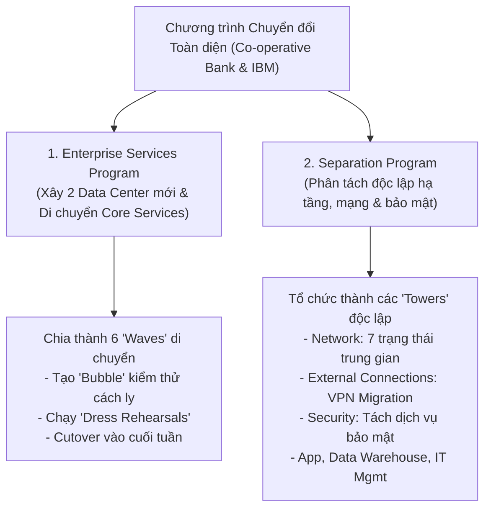

# Case Study: Network Architecture Powered by IBM (The Co-operative Bank)

> **Khóa học**: Cybersecurity Architecture (IBM)  
> **Module 3**: Network, Application, and Data Security  
> **Tài liệu**: Reading: Case Study: Network Architecture Powered by IBM (~10 phút)  
> **Tác giả**: Dee Dee Collette (IBM)

---

## 🏛️ Bối cảnh & Thách thức Nghiệp vụ (Business Context & Challenges)

- **Tổ chức**: The Co-operative Bank (Ngân hàng bán lẻ & doanh nghiệp tại Anh).
- **Vấn đề cốt lõi**: Trước đây là một phần của The Co-op Group (tập đoàn bán lẻ, bảo hiểm đa ngành). Hệ thống CNTT và mạng của ngân hàng đan xen, gắn chặt và phụ thuộc nặng nề vào hạ tầng chung của tập đoàn.
- **Yêu cầu chuyển đổi**: Khi ngân hàng tách ra thành một pháp nhân độc lập, họ phải tự kiểm soát toàn bộ hệ thống CNTT của mình, giảm thiểu hoàn toàn sự phụ thuộc vào hạ tầng tập đoàn mẹ.
- **Thách thức cực lớn**:
  - **Sự giám sát chặt chẽ từ cơ quan quản lý (Regulatory Scrutiny)**: Ngành ngân hàng tại Anh vừa trải qua nhiều sự cố CNTT chấn động; mọi bước chuyển đổi phải tuyệt đối chính xác.
  - **Quy mô khổng lồ**: Di dời tới môi trường hoàn toàn mới (Trung tâm dữ liệu mới, máy chủ mới, mạng lưới mới, mô hình vận hành mới) cho hàng trăm ngàn khách hàng với dữ liệu tài chính nhạy cảm.
  - **Mục tiêu tối thượng**: **Zero-Disruption Migration** — chuyển đổi không gián đoạn, không làm ảnh hưởng tới trải nghiệm giao dịch hàng ngày của khách hàng.

---

## 🤝 Giải pháp Hợp tác cùng IBM Consulting

Ngân hàng hợp tác với các kiến trúc sư trưởng (Executive Architects) từ IBM Consulting để thiết kế bản thiết kế chi tiết (Blueprint) và lộ trình (Roadmap), chia thành 2 chương trình chiến lược:

---

## 🏗️ Chi tiết 2 Chương trình Trọng điểm

### 1. Enterprise Services Program (Hạ tầng & Dịch vụ Trọng yếu)
- **Hạ tầng mới**: Thiết lập **2 Trung tâm dữ liệu (Data Centers)** tối tân đạt chuẩn cao nhất về tính liên tục trong kinh doanh (Business Continuity) và khắc phục thảm họa (Disaster Recovery - DR).
- **Chiến lược "6 Waves"**: Phân tách các ứng dụng ngân hàng lõi (Core banking), kho bạc (Treasury) và tài chính thành 6 đợt di chuyển tuần tự:
  - Áp dụng phương pháp luận trong **IBM Garage™ Method for Cloud** (tiền thân là *IBM Cloud® Innovate*).
  - **Mô hình "Bubble" (Bong bóng bảo vệ)**: Dựng môi trường hạ tầng mới $\rightarrow$ triển khai bản sao ứng dụng và dữ liệu vào "bong bóng" $\rightarrow$ chạy kiểm thử nghiêm ngặt phần cứng, OS, ứng dụng, batch jobs.
  - **Chạy diễn tập (Dress Rehearsals)**: Diễn tập quá trình chuyển đổi để tính toán chính xác khung thời gian.
  - **Cutover cuối tuần**: Thực hiện bàn giao chính thức vào các ngày cuối tuần để triệt tiêu ảnh hưởng đến giao dịch của khách hàng.
- **Nguồn lực**: Đội ngũ chuyên trách 700 người (hơn 300 chuyên gia từ IBM) vận hành xuyên suốt cả 6 đợt.

### 2. Separation Program (Tách rời Công nghệ & Mạng lưới)
Dự án được tổ chức thành các **"Tháp" (Towers)** chuyên biệt:

| Tower (Tháp chuyên môn) | Phạm vi & Nhiệm vụ cốt lõi |
| :--- | :--- |
| **Network (Mạng)** | Tách rời mạng của ngân hàng khỏi mạng của Co-op Group. **Tránh tuyệt đối phương pháp "Big Bang"** (cắt đột ngột), mà chuyển đổi dần qua **7 trạng thái trung gian** để triệt tiêu rủi ro. |
| **External Connections (Kết nối ngoại vi)** | Di chuyển nhiều kết nối **Virtual Private Network (VPN)** của các bên thứ ba sang hạ tầng mạng đích an toàn. |
| **Security (Bảo mật)** | Tách và loại bỏ dần các dịch vụ an ninh mạng mà ngân hàng từng chia sẻ/cung cấp chung cho cả tập đoàn Co-op Group. |
| **Application Migration & Modification** | Di chuyển hoặc giải thể hơn 100 ứng dụng; hiện đại hóa các ứng dụng lớn trước khi chuyển sang Data Center mới (xử lý ứng dụng có tới hơn 100 luồng cấp dữ liệu bên thứ 3). |
| **Data Warehousing** | Hợp nhất môi trường phân tích SAS phân mảnh thành một phiên bản SAS duy nhất độc quyền của ngân hàng. |
| **IT Management Services** | Phân tách các dịch vụ chia sẻ chung (ví dụ: tách User Directory / Active Directory thành các phiên bản độc lập). |
| **Legacy** | Tiếp quản và hỗ trợ mạng/hạ tầng của các dịch vụ không chiến lược cũ trước khi được thay thế hoàn toàn. |

---

## 🏆 Kết quả Đạt được (Key Achievements & Impact)

- **Zero-Disruption Migration (Di chuyển không gián đoạn)**:
  - Đợt chuyển đổi ứng dụng ngân hàng lõi (Core banking wave) — quy mô lớn và phức tạp nhất — hoàn tất **trước hạn hơn 4 giờ**.
  - Không phát sinh bất kỳ sự cố nghiêm trọng mức 1 (Severity-1) nào sau kỳ nghỉ cuối tuần bàn giao. Thứ Hai kế tiếp được ghi nhận là *"ngày thứ Hai yên ắng nhất trong nhiều tháng"*.
  - Kết thúc toàn bộ quá trình tách rời, không xảy ra sự cố Severity-1 hay Severity-2 nào.
- **Quy mô thành công tuyệt đối (100% Success Rate)**:
  - Di chuyển thành công hơn **250 ứng dụng** chạy trên hơn **800 máy chủ**.
- **Giải quyết lỗi sâu trong hệ thống**: Khi gặp lỗi một ứng dụng chạy tốt ở môi trường cũ nhưng lỗi trong "bong bóng" môi trường mới, chuyên gia IBM (Distinguished Engineer) đã bắt tay cùng đội ngũ ngân hàng truy lùng tận gốc rễ lỗi tiềm ẩn sâu trong hệ điều hành (OS-level issue) và xử lý triệt để.
- **Giá trị dài hạn cho Kiến trúc Doanh nghiệp**:
  - Sở hữu 2 Data Center đẳng cấp thế giới cùng năng lực Disaster Recovery vượt trội.
  - Xóa bỏ nợ kỹ thuật (Technical Debt) thông qua hiện đại hóa ứng dụng.
  - Nắm quyền tự chủ hoàn toàn về chiến lược công nghệ và kiến trúc độc lập, sẵn sàng mở rộng các dịch vụ ngân hàng số và Cloud trong tương lai.

---

## 💡 Bài học Kiến trúc cho Chuyên viên An ninh & Hệ thống (Architectural Lessons)
1. **Tránh tiếp cận "Big Bang" đối với hạ tầng mạng**: Thay vì chuyển đổi một lần duy nhất đầy rủi ro, hãy chia nhỏ hành trình thành các trạng thái trung gian có kiểm soát (7 intermediate states).
2. **Kỹ thuật kiểm thử "Bubble" & "Dress Rehearsals"**: Tạo môi trường cách ly an toàn để kiểm thử tải, tính tương thích của OS, mạng và batch jobs trước khi thực hiện cutover thực tế.
3. **Phân tách ranh giới an ninh rõ ràng (Clear Security Boundaries)**: Việc tách doanh nghiệp đòi hỏi phân chia rạch ròi từ tầng vật lý, mạng, User Directory (IAM), đến các đường hầm VPN kết nối bên thứ 3.
