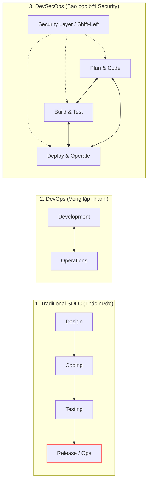

# Application Security Architecture & DevSecOps

> **Khóa học**: Cybersecurity Architecture (IBM)  
> **Module 3**: Network, Application, and Data Security  
> **Bài học**: Application Security (Thời lượng: ~16 phút)

---

## 📌 Tổng Quan (Overview)
Trong chuỗi phòng thủ an ninh mạng, sau IAM, Endpoint và Network Security, **Application Security (AppSec)** là tầng bảo vệ cực kỳ trọng yếu. 

Thực tế cốt lõi:
- **Tất cả phần mềm đều có lỗi (bugs)**: Không ai viết phần mềm có độ phức tạp cao mà hoàn toàn không có lỗi.
- **Tỷ lệ lỗ hổng**: Một tỷ lệ phần trăm nhất định của các lỗi đó chính là **lỗ hổng bảo mật (security vulnerabilities)**.
- **Hệ quả tất yếu**: Về bản chất, mọi phần mềm đều tiềm ẩn nguy cơ bảo mật. Nhiệm vụ của kiến trúc sư là giảm thiểu tối đa lỗ hổng và phát hiện chúng càng sớm càng tốt.

---

## 1. Đường Cong Chi Phí Khắc Phục Lỗ Hổng (Cost of Bug Fixes)

Biểu đồ chi phí và thời điểm phát hiện lỗi trong vòng đời phần mềm:

| Giai đoạn vòng đời | Tỷ lệ tiêm nhiễm lỗi (Introduced) | Khả năng phát hiện (Found) | Chi phí khắc phục tương đối |
| :--- | :--- | :--- | :--- |
| **Coding (Viết mã)** | Cao nhất (Đa số lỗi phát sinh ở đây) | Thấp (chưa phát hiện) | **$1\times$** (Chuẩn gốc) |
| **Unit Test** | Thấp dần | Bắt đầu phát hiện | $3\times - 5\times$ |
| **Functional / System Test** | Rất ít lỗi mới | Phát hiện nhiều nhất | $10\times - 15\times$ |
| **Production / Release (Vận hành)** | Không tiêm nhiễm | Bị hacker/người dùng tìm ra | **Lên tới $640\times$** |

> [!CAUTION] Hệ số chi phí khổng lồ ($640\times$)
> Sửa chữa một lỗ hổng bảo mật khi hệ thống đã đưa vào vận hành thực tế (Production) tốn kém gấp hàng trăm lần (chi phí điều tra sự cố, bồi thường, mất khách hàng, vá nóng hệ thống) so với việc bắt được lỗi ngay từ lúc viết mã (Coding).

---

## 2. Sự Tiến Hóa của Vòng Đời Phần Mềm (SDLC $\rightarrow$ DevOps $\rightarrow$ DevSecOps)

### 2.1. Traditional SDLC (Mô hình Tuyến tính truyền thống)
- Quá trình chia rẽ: **Design $\rightarrow$ Coding $\rightarrow$ Testing $\rightarrow$ Release/Operations**.
- Phân cách nặng nề giữa **Dev** và **Ops** với tư duy "ném qua tường" (*throw it over the wall*): Dev viết xong mã rồi quăng sang cho Ops vận hành.
- **Nhược điểm chí mạng**: An ninh mạng bị coi là một phần bổ sung chắp vá (**bolt-on**) ở cuối quy trình, phát hiện lỗi muộn và cực kỳ tốn kém.

### 2.2. DevOps
- Xóa bỏ ranh giới Dev và Ops, chuyển sang chu trình khép kín, cải tiến liên tục, nhanh và linh hoạt (Agility).
- Tuy nhiên, an ninh mạng vẫn chưa được nhúng sâu vào chu trình nếu chỉ làm DevOps thuần túy.

### 2.3. DevSecOps & Tư Duy "Shift-Left"
- **Bao bọc toàn bộ chu trình bằng an ninh**: An ninh mạng không phải là bước chốt cuối, mà là yếu tố hiện diện tại **từng bước** của vòng đời.
- **Shift-Left Thinking**: Đẩy công tác an ninh sang bên trái của timeline — ngay từ khâu thiết kế (Security by Design) và lập trình.
- **Văn hóa hợp tác**: Gắn kết 3 bộ phận Dev, Sec và Ops thay vì đối đầu. Tận dụng tối đa **tự động hóa (Automation & Tooling)** trong CI/CD.

---

## 3. Các Thực Hành Viết Mã An Toàn (Secure Coding Practices)

Để thực hiện Shift-Left thành công ở tầng lập trình, cần 5 trụ cột:

### 3.1. Danh mục Thực hành An toàn (Secure Coding Checklist)
- **Input Validation (Kiểm tra dữ liệu đầu vào)**: Ngăn chặn triệt để lỗi kinh điển **Buffer Overflow** (ghi đè bộ nhớ khi dữ liệu gửi vào vượt quá kích thước buffer được cấp phát) và các lỗi Injection.
- Quy chuẩn hóa cơ chế **Xác thực (Authentication)**, **Mã hóa (Cryptography)**, và **Xử lý lỗi an toàn (Safe Error Handling - không làm lộ stack trace hay thông tin nhạy cảm)**.
- Tài nguyên tham chiếu chuẩn công nghiệp: [OWASP.org](https://owasp.org) (*Open Web Application Security Project*).

### 3.2. Trusted Libraries & Rủi ro Chuỗi cung ứng (Log4j)
- Không ai viết mã từ con số 0; các dự án đều sử dụng thư viện mã nguồn mở hoặc thương mại.
- Ngay cả thư viện tin cậy cũng tiềm ẩn lỗ hổng nghiêm trọng.
  > **Bài học Log4Shell (Log4j)**: Thư viện ghi log cực kỳ phổ biến của Apache nhưng chứa lỗ hổng RCE nghiêm trọng, chỉ được phát hiện khi đã phát hành trên diện rộng và gây thiệt hại toàn cầu. Cần luôn duy trì tâm thế hoài nghi và kiểm tra định kỳ các thư viện phụ thuộc.

### 3.3. Kiến trúc Tiêu chuẩn (Standard Architectures)
- Doanh nghiệp cần ban hành các bản thiết kế kiến trúc chuẩn (ví dụ: *IBM Application Security Architecture reference*) để mọi lập trình viên tuân thủ cùng một quy tắc bảo vệ dữ liệu.

### 3.4. Tránh các lỗi phổ biến (OWASP Top 10)
- Bảng xếp hạng 10 lỗ hổng ứng dụng web nguy hiểm nhất được cập nhật định kỳ (2017, 2021).
- Nghịch lý "Groundhog Day": Nhiều năm trôi qua nhưng danh mục lỗ hổng (như Injection, Broken Access Control, Buffer Overflow) vẫn lặp đi lặp lại do lập trình viên liên tục mắc các sai lầm cũ.

### 3.5. Software Bill of Materials (SBOM)
- Bản kê khai nguyên vật liệu phần mềm (tương tự tem nhãn thành phần thực phẩm):
  - Biết rõ nguồn gốc xuất xứ của từng thành phần, thư viện mã.
  - Theo dõi danh mục các phiên bản (versions) và toàn bộ chuỗi phụ thuộc (dependencies).
  - Khi có một lỗ hổng mới bùng phát (như Log4j), SBOM giúp xác định ngay lập tức ứng dụng nào trong toàn doanh nghiệp bị ảnh hưởng để vá khẩn cấp.

---

## 4. Kiểm Thử Lỗ Hổng Bảo Mật (Vulnerability Testing: SAST vs. DAST)

Tự động hóa kiểm thử trong DevSecOps dựa trên hai công cụ trụ cột:

| Tiêu chí so sánh | SAST (Static Application Security Testing) | DAST (Dynamic Application Security Testing) |
| :--- | :--- | :--- |
| **Cách tiếp cận** | **White Box Testing** (Hộp trắng) | **Black Box Testing** (Hộp đen) |
| **Đối tượng kiểm tra** | Quét trực tiếp **Mã nguồn (Source Code)** | Quét ứng dụng đang chạy ở dạng **Thực thi (Executable)** |
| **Thời điểm chạy** | Ngay trong lúc gõ code hoặc sau bước Coding | Trong các giai đoạn Test (Functional/System Test, Staging) |
| **Khả năng phát hiện** | Lỗi logic code, hardcoded credentials, buffer overflow, syntax flaws | Lỗi cấu hình server, lỗi xác thực runtime, rò rỉ session, tấn công qua network |
| **Giá trị kiến trúc** | Đẩy mạnh **Shift-Left**, sửa lỗi ở mức chi phí $1\times$ | Kiểm tra khả năng chịu lực thực tế trước khi release |

> [!TIP] Nguyên tắc phối hợp kiểm thử
> **Không phải là "Chọn SAST hoặc DAST" mà là "Bắt buộc dùng cả hai (Both/And)"**. Mỗi công cụ phát hiện một phân lớp lỗ hổng khác nhau, bổ trợ hoàn hảo cho nhau trong pipeline CI/CD.

---

## 5. Rủi ro & Cơ hội khi sử dụng AI Chatbot / LLM trong Lập trình

Sự bùng nổ của Large Language Models (LLM) và Trợ lý AI (Chatbots) mang lại cả đột phá lẫn nguy cơ an ninh:

### 5.1. Cơ hội (Benefits)
- Sinh mã cực nhanh (Generate code on demand).
- Hỗ trợ gỡ lỗi, phân tích đoạn mã có vấn đề (Debugging assistance).

### 5.2. Rủi ro An ninh Nghiêm trọng (Downsides & Threats)
1. **Tiêm nhiễm lỗ hổng (Vulnerability Injection)**:
   - AI có thể tạo ra code không an toàn (thiếu input validation, dùng thư viện cũ lỗi thời).
   - Lập trình viên vì lười biếng hoặc thiếu kiến thức sẽ copy-paste trực tiếp khối lượng lớn code mà không kiểm tra (review).
   - Nguy cơ bị tấn công chuỗi cung ứng: mô hình AI bị đầu độc (Poisoning/Jailbreak) cố tình chèn cửa sau (Backdoors) hoặc mã độc.
2. **Lộ lọt Sở hữu Trí tuệ & Bí mật Kinh doanh (IP & Trade Secret Leakage)**:
   - Khi đưa mã nguồn bí mật lên các chatbot công cộng để debug, mã đó có thể được dùng để tái huấn luyện mô hình, khiến bí mật kinh doanh bị rò rỉ ra ngoài Internet (nhiều tập đoàn lớn đã ghi nhận sự cố rò rỉ mã nguồn do nhân viên dùng chatbot trái phép).

---

## 🧠 Tóm tắt Cốt lõi cho Kiến trúc sư (Key Takeaways)
1. **Shift-Left là bắt buộc**: Đưa kiểm thử an ninh vào sâu nhất có thể ở bên trái quy trình để tránh mức phí $640\times$ ở production.
2. **DevSecOps thay vì Security Bolt-On**: Tích hợp bảo mật vào quy trình tự động CI/CD.
3. **Phối hợp SAST + DAST + SBOM**: Đảm bảo bao quát cả mã nguồn, trạng thái runtime và chuỗi cung ứng bên thứ ba.
4. **Cảnh giác với AI Code Generation**: Thiết lập chính sách kiểm duyệt mã sinh bởi AI và ngăn chặn đưa mã nguồn nhạy cảm lên các nền tảng LLM công cộng.
