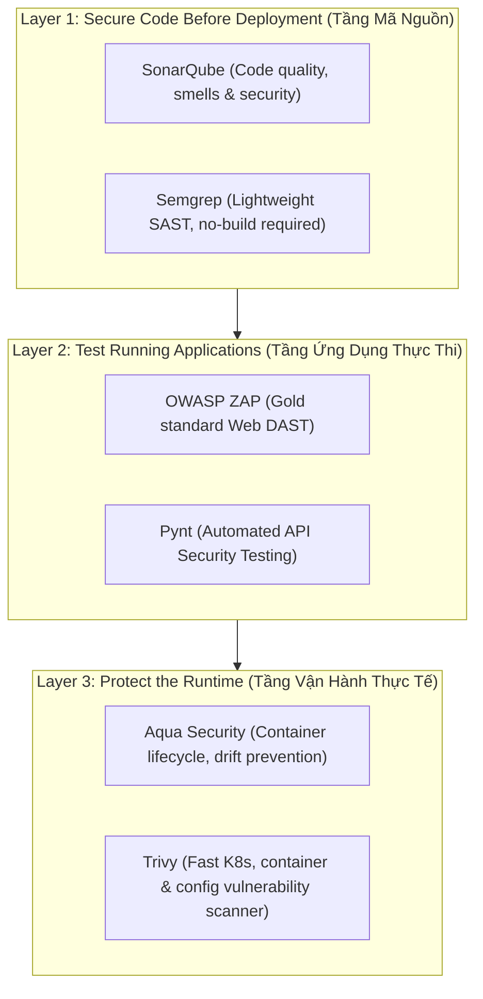

# Application Security Architecture Essentials

> **Khóa học**: Cybersecurity Architecture (IBM)  
> **Module 3**: Network, Application, and Data Security  
> **Bài học**: Application Security Architecture Essentials (Thời lượng: ~7 phút)

---

## 📌 Khái niệm Cốt lõi & Tầm nhìn Kiến trúc
Trong các doanh nghiệp hiện đại (nơi quản lý 600+ API endpoints và lưu lượng API chiếm tới hơn 71% tổng lưu lượng web), bảo mật ứng dụng không thể là tài liệu nằm trên giấy hay một bước kiểm tra sơ sài trước khi go-live. 

**Application Security Architecture** là một bản thiết kế phòng thủ nhiều tầng (**Layered Defense Blueprint**), bảo vệ toàn bộ stack: từ mã nguồn React frontend, backend Node.js, database PostgreSQL, bộ nhớ đệm Redis, Service Mesh microservices, cho đến hạ tầng Cloud nền tảng.

> *"Kiến trúc sống còn và bền vững không phải là kiến trúc nhồi nhét nhiều công cụ nhất, mà là kiến trúc nơi an ninh mạng vận hành hoàn toàn tự động ở hậu cảnh, lập trình viên nhận phản hồi tức thì, và bề mặt tấn công thu hẹp lại sau mỗi lần triển khai."*

---

## 🛡️ 3 Tầng Bảo Vệ Ứng Dụng Thiết Yếu (3 Critical Layers of Protection)

### Layer 1: Secure Code Before Deployment (Bảo vệ Mã trước khi Triển khai)
- **SonarQube**: Tích hợp trực tiếp vào quy trình Git workflow; liên tục phân tích chất lượng code, phát hiện lỗ hổng bảo mật, lỗi logic và code smells trong từng commit.
- **Semgrep**: Công cụ SAST hiện đại, quét trực tiếp mã nguồn mà không cần build toàn bộ dự án; kết quả ít nhiễu (low-noise), hỗ trợ đa ngôn ngữ với bộ luật định sẵn, cực kỳ lý tưởng cho kiểm tra real-time trong pipeline CI/CD.

### Layer 2: Test Running Applications (Kiểm thử Ứng dụng đang Thực thi)
- **OWASP ZAP (Zed Attack Proxy)**: Chuẩn vàng DAST mã nguồn mở; quét ứng dụng đang chạy tương tự như cách hacker tấn công (thử nghiệm SQL Injection, XSS, Broken Authentication, Misconfigurations). Dễ dàng quét 1-click cho cả người mới tiếp cận DevSecOps.
- **Pynt**: Chuyên biệt hóa tự động kiểm thử an ninh API với độ trễ bằng 0 (zero friction), bắt được các lỗ hổng API logic mà công cụ quét web truyền thống bỏ sót.

### Layer 3: Protect the Runtime (Bảo vệ Môi trường Vận hành Runtime)
- **Aqua Security**: Bảo vệ toàn bộ vòng đời container từ code commit đến runtime; sử dụng giám sát hành vi (behavioral monitoring) và chống trôi lệch cấu hình (drift prevention) để ngăn chặn tấn công thời gian thực.
- **Trivy**: Công cụ quét lỗ hổng siêu nhẹ cho môi trường Kubernetes; quét container images, các gói phụ thuộc (dependencies), và file cấu hình hạ tầng trong một công cụ duy nhất.

---

## 🛠️ 4 Công Cụ Nền Tảng Cho Chuyên Viên Hệ Thống (Essential Tools)

| Nhóm chức năng | Công cụ tiêu biểu | Cơ chế & Giá trị mang lại |
| :--- | :--- | :--- |
| **Tool 1: Infrastructure as Code (IaC) Security** | **Checkov** | Đối soát file IaC (Terraform, CloudFormation, ARM templates, Kubernetes manifests) với thư viện chính sách bảo mật; nhúng guardrails trực tiếp vào CI/CD để chặn đứng sai sót cấu hình trước khi đẩy lên production. |
| **Tool 2: Secret Management** | **GitGuardian** | Quét liên tục các kho mã (GitHub, GitLab, Bitbucket) để phát hiện API keys, mật khẩu, access token bị lộ; ngăn chặn triệt để tình trạng phát tán thông tin xác thực (*secrets sprawl*). |
| **Tool 3: Supply Chain Security** | **Snyk** | Quét mã nguồn và các thư viện phụ thuộc (dependencies) ngay trong IDE của lập trình viên và CI/CD; tự động chỉ ra gói thư viện chứa lỗ hổng và đề xuất phiên bản thay thế an toàn. |
| **Tool 4: Policy Enforcement** | **Open Policy Agent (OPA)** | Cho phép định nghĩa "Policy as Code" bằng ngôn ngữ **Rego**; tích hợp sâu vào Kubernetes để thực thi chính sách trên workloads (chẳng hạn: cấm chạy container có quyền root/privileged, áp đặt phân đoạn mạng). |

---

## 🏛️ 4 Nguyên Tắc Xây Dựng Kiến Trúc An Ninh Sống Còn (Architectural Principles)

### 1. Design for Zero Trust (Thiết kế theo triết lý Không Tin Tưởng)
- Loại bỏ hoàn toàn sự tin tưởng ngầm (implicit trust) giữa các dịch vụ nội bộ.
- Mọi lệnh gọi API — kể cả giữa các microservices nội bộ — đều bắt buộc phải xác thực (Authentication) và phân quyền (Authorization).
- Sử dụng **Service Mesh** (như **Istio**) để áp đặt mã hóa tương hỗ **mTLS (Mutual TLS)** và kiểm soát truy cập chi tiết (fine-grained access control).

### 2. Implement Defense in Depth (Phòng thủ đa tầng)
- Tích hợp kiểm tra an ninh xuyên suốt pipeline CI/CD với automated scans và policy as code.
- Thiết lập **Quality Gates**: Tự động chặn đứng quá trình deploy (block build) nếu phát hiện các lỗ hổng ở mức nghiêm trọng (Critical vulnerabilities).

### 3. Build Observability In (Tích hợp khả năng quan sát từ gốc)
- *"Bạn không thể bảo vệ những gì bạn không nhìn thấy."*
- Nhúng logging và security monitoring vào ứng dụng ngay từ ngày đầu tiên.
- Các công cụ kiểm thử động (Dynamic testing) cần trả về báo cáo mô phỏng tấn công chi tiết đi kèm điểm số khả năng khai thác thực tế (exploitability scores).

### 4. Automate Relentlessly (Tự động hóa không khoan nhượng)
- Bảo mật dựa vào kiểm duyệt thủ công (manual review) hoàn toàn thất bại ở quy mô lớn và tốc độ cao của DevSecOps.
- Sử dụng công cụ tự động quét, test và đề xuất remediation; tích hợp trực tiếp vào Slack/Jira để tự động định tuyến lỗi đến đúng đội ngũ lập trình viên chịu trách nhiệm.

---

## 🧠 Tóm tắt Cốt lõi cho Kiến trúc sư (Summary & Key Takeaways)
1. **Security by Design**: An ninh không phải là kết quả của một buổi kiểm duyệt cuối cùng, mà là thành quả của việc thiết kế phòng thủ ngay từ dòng code đầu tiên tới runtime.
2. **Layered Defense across the Full Stack**: Kết hợp đồng bộ Code-level (SonarQube, Semgrep) $\rightarrow$ Dynamic Testing (OWASP ZAP, Pynt) $\rightarrow$ Runtime/Container (Aqua, Trivy).
3. **Automated Continuous Security**: Mô hình duy nhất có thể mở rộng (scale) được trong môi trường DevSecOps.
4. **Visibility & Observability**: Yếu tố bắt buộc để phát hiện sớm các dị thường và nguy cơ tiềm ẩn trước khi bị tin tặc khai thác.
