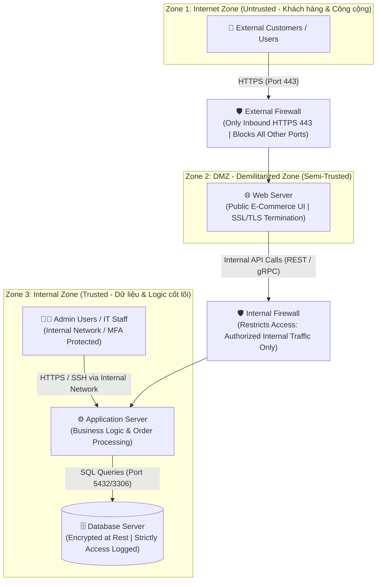

# Lab: Create a Security Architecture Diagram

> **Khóa học**: Cybersecurity Architecture (IBM)  
> **Module 3**: Network, Application, and Data Security  
> **Thực hành**: Lab: Create a Security Architecture Diagram (Thời lượng: ~30 phút)  
> **Tác giả**: Ramanujam Srinivasan

---

## 📌 Khái niệm & Mục tiêu của Sơ đồ Kiến trúc An ninh (Security Architecture Diagram)
- **Định nghĩa**: Sơ đồ kiến trúc an ninh là bản mô tả trực quan cách thức các thành phần hệ thống, chốt kiểm soát an ninh (security controls), và các luồng dữ liệu (data flows) được tổ chức để bảo vệ tài sản thông tin của doanh nghiệp.
- **Giá trị thực tế**:
  - Truyền đạt thiết kế bảo mật cho các bên liên quan (lãnh đạo, lập trình viên, kiểm toán viên, vận hành).
  - Nhận diện các điểm yếu tiềm tàng và các phân vùng ranh giới tin cậy.
  - Lập kế hoạch triển khai kiểm soát an ninh đa lớp (**Defense in Depth**).

---

## 🏢 Tình huống Thiết kế (E-Commerce Web Application Scenario)

Bạn là Kiến trúc sư thiết kế bảo mật cho một hệ thống ứng dụng thương mại điện tử đơn giản gồm:
1. **Public-facing Website**: Nơi khách hàng vãng lai truy cập duyệt hàng và mua sắm qua Internet.
2. **Database**: Lưu trữ thông tin cá nhân khách hàng, đơn hàng và thẻ thanh toán.
3. **Administrative Portal**: Cổng quản trị dành riêng cho nhân viên/IT nội bộ quản lý sản phẩm và xử lý đơn hàng.

---

## 🛡️ Xác định 3 Phân Vùng An Ninh (Security Zones & Trust Levels)

Các phân vùng mạng được nhóm theo mức độ tin cậy, ví von như cấu trúc an ninh của một ngôi nhà:

```
[Hiên trước nhà]            [Phòng khách]                    [Phòng ngủ & Két sắt]
Internet Zone (Untrusted) -> DMZ Zone (Semi-Trusted)      -> Internal Zone (Trusted)
```

1. **Internet Zone (Untrusted - Vùng Không Tin Cậy)**:
   - Màu nhận diện: **Đỏ nhạt (Light Red)**.
   - Nơi người dùng bên ngoài, khách hàng vãng lai và các mối đe dọa tiềm tàng tồn tại.
2. **DMZ Zone (Semi-Trusted - Vùng Đệm Bán Tin Cậy)**:
   - Màu nhận diện: **Vàng (Yellow)**.
   - Nơi đặt các dịch vụ công khai tiếp xúc trực tiếp với Internet nhưng có sự che chắn của External Firewall (ví dụ: Web Server).
3. **Internal Zone (Trusted - Vùng Nội Bộ Tin Cậy Cao)**:
   - Màu nhận diện: **Xanh lá (Green)**.
   - Nơi lưu trữ các hệ thống cốt lõi và dữ liệu nhạy cảm nhất (Application Server, Database, Cổng quản trị Admin, máy trạm nhân viên IT).

---

## 📐 Sơ đồ Kiến trúc An ninh Mẫu (Target Architecture Diagram)



---

## 🔄 Luồng Di Chuyển Dữ Liệu An Toàn (Secure Traffic Flows)

Mỗi kết nối dữ liệu bắt buộc phải đi qua một chốt kiểm soát an ninh (**Security Control / Firewall**), tuyệt đối không có kết nối trực tiếp nhảy cóc qua các phân vùng:

1. **Luồng Khách hàng (Customer Web Flow)**:
   - Khách hàng từ Internet $\xrightarrow{\text{HTTPS (Port 443)}}$ đi qua **External Firewall** $\rightarrow$ tiếp cận **Web Server** trong DMZ.
2. **Luồng Logic Ứng dụng (Application Flow)**:
   - **Web Server** (DMZ) $\xrightarrow{\text{Internal API}}$ đi qua **Internal Firewall** $\rightarrow$ gọi tới **Application Server** trong Internal Zone.
3. **Luồng Truy vấn Dữ liệu (Database Flow)**:
   - **Application Server** $\xrightarrow{\text{Database Queries}}$ truy vấn vào **Database Server** (nằm sâu nhất trong Internal Zone).
4. **Luồng Quản trị (Admin Flow)**:
   - Quản trị viên nội bộ (Admin/IT Staff) $\xrightarrow{\text{Internal Firewall / MFA}}$ kết nối an toàn vào **Application Server / Portal** để quản trị đơn hàng.

---

## 📝 Chú giải Chốt Kiểm Soát An Ninh (Security Controls & Annotations)

Để một bản vẽ kỹ thuật trở thành **Sơ đồ Kiến trúc An ninh** thực thụ, các chú giải kiểm soát là bắt buộc:

| Vị trí / Thành phần | Chốt kiểm soát an ninh (Security Controls) | Mục đích kỹ thuật |
| :--- | :--- | :--- |
| **External Firewall** | Lọc gói tin (Packet filtering), chỉ mở cổng **Inbound HTTPS (443)**, chặn toàn bộ các port và giao thức khác. | Giảm thiểu tối đa bề mặt tấn công từ Internet; chống quét cổng (port scanning). |
| **Web Server (DMZ)** | Cấu hình mã hóa SSL/TLS 1.3; vô hiệu hóa các cipher suites yếu. Giữ vai trò Reverse Proxy / UI. | Bảo vệ dữ liệu truyền tải của khách hàng khỏi bị nghe lén (Man-in-the-Middle). |
| **Internal Firewall** | Chỉ chấp nhận kết nối xuất phát từ IP của Web Server (DMZ) tới Port API cụ thể của Application Server; chặn mọi luồng kết nối ngược từ DMZ vào Database. | Ngăn ngừa việc kẻ tấn công nếu chiếm được Web Server sẽ tấn công leo thang hoặc di chuyển ngang vào Database. |
| **Application Server** | Xác thực & phân quyền (AuthN/AuthZ) chi tiết cho từng API request; kiểm soát phiên đăng nhập quản trị bằng MFA. | Đảm bảo tính toàn vẹn của logic nghiệp vụ. |
| **Database Server** | Mã hóa dữ liệu ở trạng thái nghỉ (**Encryption at Rest - AES-256**); ghi log truy cập nghiêm ngặt (**Access Logging & Auditing**); đặt sâu nhất trong mạng tin cậy. | Bảo vệ tài sản nhạy cảm nhất của doanh nghiệp ngay cả khi ổ đĩa vật lý bị đánh cắp hoặc bị tấn công nội bộ. |

---

## 📋 Checklist Tự Kiểm Tra Bản Vẽ (Architect's Verification Checklist)

- [x] **Traceability**: Có thể truy vết rõ ràng luồng dữ liệu của một khách hàng từ Internet đến Database Server mà không bị ngắt quãng không?
- [x] **Boundary Controls**: Có chốt kiểm soát an ninh (Firewall / Gateway) đặt tại mọi đường ranh giới giữa các vùng không?
- [x] **Isolation**: Dữ liệu nhạy cảm nhất (Database) có được đặt cách xa nhất so với vùng không tin cậy (Internet) không?
- [x] **Clarity**: Người không chuyên về an ninh mạng có thể dễ dàng hiểu được các luồng dữ liệu chính và ranh giới bảo mật không?
- [x] **Explicit Annotations**: Các mũi tên luồng dữ liệu có ghi rõ giao thức và port (HTTPS 443, API, DB Queries) không?
