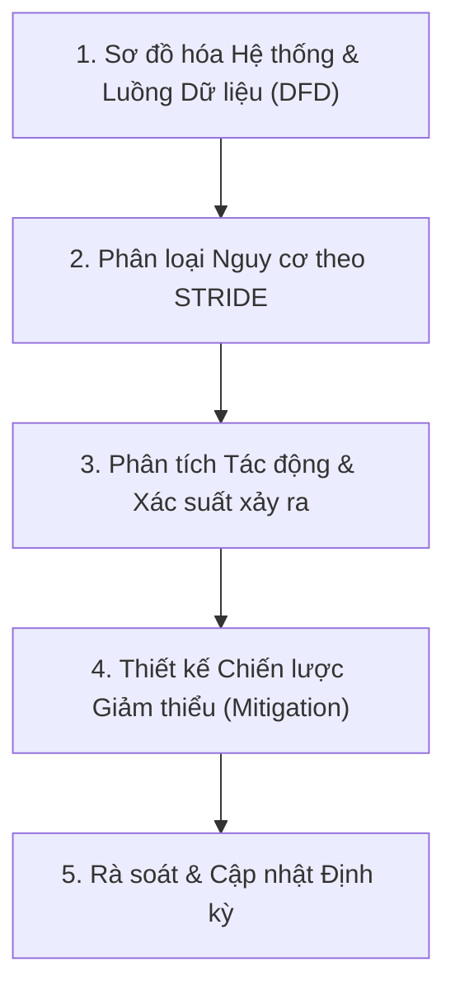

# Secure Coding Practices & Principles

> **Khóa học**: Cybersecurity Architecture (IBM)  
> **Module 3**: Network, Application, and Data Security  
> **Tài liệu**: Reading: Secure Coding Practices (Thời lượng: ~10 phút)  
> **Tác giả**: Dee Dee Collette (IBM)

---

## 📌 Tầm quan trọng của Lập trình An toàn (Introduction)
- **Định nghĩa**: Lập trình an toàn (**Secure Coding**) là việc phát triển phần mềm máy tính có chủ đích ngăn ngừa và phòng vệ trước các lỗ hổng bảo mật.
- **Tính cấp thiết**: Trong các ngành công nghiệp trọng yếu (tài chính, y tế, quốc phòng), một vụ rò rỉ dữ liệu bắt nguồn từ lỗ hổng code có thể gây ra thảm họa khôn lường.
- **Giá trị kinh tế & tuân thủ**: Thực hành viết mã an toàn giúp giảm thiểu rủi ro, đáp ứng các tiêu chuẩn quy định (compliance regulations), tránh các khoản phạt tiền nặng nề và bảo vệ uy tín thương hiệu.

---

## 🛡️ 6 Thực Hành Lập Trình An Toàn Cốt Lõi (Key Best Practices)

### 1. Input Validation (Kiểm tra dữ liệu đầu vào)
- **Mục tiêu**: Xác thực tính chính xác và an toàn của mọi dữ liệu do người dùng hoặc ứng dụng bên ngoài gửi tới hệ thống; đảm bảo dữ liệu đúng định dạng mong đợi và không chứa mã độc.
- **Các phương pháp phổ biến**:
  - **CAPTCHA**: Xác minh người dùng thực, ngăn chặn tự động hóa bởi bot hoặc AI.
  - **Định dạng & Regex (Regular Expressions)**: Ràng buộc chuẩn dữ liệu (ví dụ: email `user@domain`, số điện thoại `xxx-xxx-xxxx`).
  - **Ràng buộc độ dài & kiểu dữ liệu**: Chống tràn bộ nhớ.
- **Rủi ro khi thiếu Input Validation**: Gây ra các cuộc tấn công phá hủy nghiêm trọng nhất như **SQL Injection (SQLi)** và **Cross-Site Scripting (XSS)**.

---

### 2. Authentication & Authorization (Xác thực và Phân quyền)
Hai mắt xích bảo mật bắt buộc phải được thiết kế tách biệt và chặt chẽ:

| Yếu tố | Định nghĩa & Mục đích | Cơ chế triển khai |
| :--- | :--- | :--- |
| **Authentication (Xác thực)** | Xác minh danh tính: *"Bạn là ai?"*. Đảm bảo người dùng/thiết bị đúng là người mà họ tự nhận trước khi cho phép vào hệ thống. | Passwords mạnh, 2FA/MFA, Biometrics (vân tay, khuôn mặt). |
| **Authorization (Phân quyền)** | Xác định quyền hạn: *"Bạn được phép làm gì?"*. Quy định tài nguyên, dữ liệu và hành động mà người dùng được phép thực thi sau khi đã xác thực. | Role-Based Access Control (RBAC), Least Privilege (đặc quyền tối thiểu), ngăn ngừa rủi ro nội bộ (*malicious insider*). |

---

### 3. Encryption (Mã hóa dữ liệu)
- **Bản chất**: Biến đổi văn bản thuần (plaintext) thành dạng không thể đọc được (ciphertext). Chỉ có thể đọc lại được thông qua giải mã (decryption) với khóa bí mật (secret key).
- **Phạm vi bảo vệ bắt buộc**:
  - **Data in Transit (Dữ liệu trên đường truyền)**: Bảo vệ dữ liệu khi đi qua mạng (TLS/HTTPS), chống nghe lén (sniffing/man-in-the-middle).
  - **Data at Rest (Dữ liệu lưu trữ)**: Mã hóa mật khẩu người dùng (hashing kèm salt), bảo vệ số thẻ tín dụng, hồ sơ y tế trong cơ sở dữ liệu và ổ cứng.

---

### 4. Error Handling (Xử lý lỗi an toàn)
- **Nguyên tắc**: Dự đoán, bắt và xử lý các lỗi/ngoại lệ lập trình để ứng dụng không bị sập (crash) khi gặp dữ liệu bất thường hoặc sự cố hệ thống.
- **Quy tắc an ninh theo chuẩn OWASP**:
  - **Tuyệt đối không hiển thị Debugging hoặc Stack Trace** cho người dùng cuối trên giao diện web/API. Kẻ tấn công có thể lợi dụng tên bảng CSDL, cấu trúc thư mục, phiên bản phần mềm trong stack trace để khai thác hệ thống.
  - **Ghi log an toàn (Safe Logging)**: File log cần lưu đủ chi tiết để điều tra sự cố nhưng **không được chứa dữ liệu nhạy cảm** (như mật khẩu, số thẻ tín dụng, token cá nhân).
  - **Phân quyền truy cập log**: File log chỉ được mở cho nhân sự quản trị có thẩm quyền.

---

### 5. Threat Modeling (Mô hình hóa mối đe dọa)
Quy trình có hệ thống giúp xác định, hiểu rõ và khắc phục sớm các mối đe dọa ngay từ giai đoạn thiết kế kiến trúc:

- **Mô hình STRIDE kinh điển**:
  - **S**poofing (Giả mạo danh tính)
  - **T**ampering (Làm sai lệch/chỉnh sửa dữ liệu trái phép)
  - **R**epudiation (Chối bỏ trách nhiệm hành vi)
  - **I**nformation Disclosure (Lộ lọt thông tin nhạy cảm)
  - **D**enial of Service (Từ chối dịch vụ - DoS)
  - **E**levation of Privilege (Leo thang đặc quyền trái phép)

---

### 6. Secure Code Review (Đánh giá mã nguồn an toàn)
- **Bản chất**: Khảo sát có hệ thống toàn bộ mã nguồn của ứng dụng để phát hiện sớm các điểm yếu bảo mật và nâng cao chất lượng code.
- **Phương thức thực hiện**:
  - **Thủ công (Manual Review)**: Kiểm tra từng dòng mã (line-by-line inspection) bởi các chuyên gia bảo mật.
  - **Tự động hóa (Automated Review)**: Sử dụng các công cụ SAST/Linter để phát hiện các mẫu code không an toàn đã biết.
- **Giá trị**: Giúp lập trình viên "sửa sai ngay từ gốc" ở giai đoạn đầu, tiết kiệm chi phí gấp hàng trăm lần so với sửa ở production.

---

## 🔗 Tài nguyên Tham chiếu Chuẩn Công nghiệp
- **OWASP Secure Coding Practices Quick Reference Guide**:  
  [https://owasp.org/www-project-secure-coding-practices-quick-reference-guide/stable-en/](https://owasp.org/www-project-secure-coding-practices-quick-reference-guide/stable-en/)
