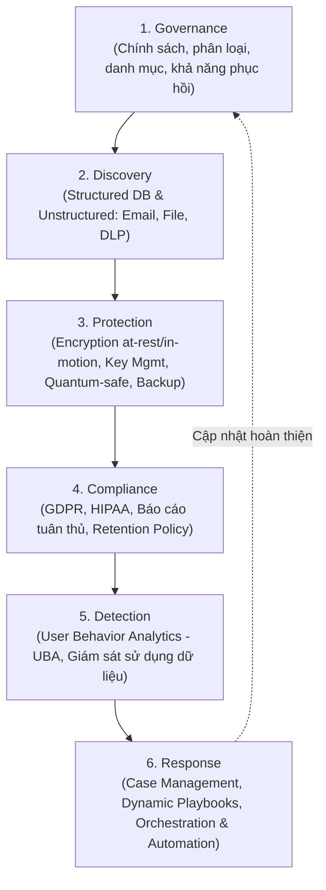

# Data Security Architecture & Governance

> **Khóa học**: Cybersecurity Architecture (IBM)  
> **Module 3**: Network, Application, and Data Security  
> **Bài học**: Data Security (Thời lượng: ~14 phút)

---

## 📌 Các Con Số Thống Kê Biết Nói (Cost of Data Breach)
Dữ liệu chính là "viên ngọc trên vương miện" (Crown Jewels) - đích ngắm cuối cùng của mọi kẻ tấn công. Theo báo cáo thường niên từ **Ponemon Institute & IBM**:

- **$4.35 \text{ triệu USD}$**: Chi phí trung bình toàn cầu cho **một vụ rò rỉ dữ liệu (Data Breach)**.
- **$9.44 \text{ triệu USD}$**: Chi phí trung bình cho một vụ rò rỉ dữ liệu tại **Mỹ (US)** (cao hơn gấp đôi mức trung bình thế giới).
- **$83\%$**: Tỷ lệ các tổ chức/doanh nghiệp từng bị tấn công rò rỉ dữ liệu **nhiều hơn một lần**.

---

## 🌐 Hệ Sinh Thái Bảo Mật Dữ Liệu (Data Security Ecosystem)

Kiến trúc an ninh dữ liệu là một chu trình khép kín gồm 6 giai đoạn:
$$\text{Governance} \longrightarrow \text{Discovery} \longrightarrow \text{Protection} \longrightarrow \text{Compliance} \longrightarrow \text{Detection} \longrightarrow \text{Response}$$

---

## 1. Governance & Discovery (Quản trị & Khám phá Dữ liệu)

### 1.1. Data Governance (Quản trị Dữ liệu)
- Không thể bảo vệ nếu không vạch rõ vạch đích:
  - **Data Security Policy**: Chính sách bảo mật dữ liệu quy định những gì nhạy cảm và những gì công khai.
  - **Classification Criteria (Tiêu chí phân loại)**: Phân định rõ đâu là "chìa khóa kho báu" (Keys to the Kingdom) và đâu là dữ liệu thông thường không cần bảo vệ nghiêm ngặt (như thực đơn phòng ăn trưa). Ví dụ: *Public, Internal, Confidential, Restricted/Secret*.
  - **Data Catalog**: Bản danh mục định vị chính xác dữ liệu nhạy cảm đang nằm ở đâu tại mọi thời điểm.
  - **Resilience Plan**: Kế hoạch phục hồi khi dữ liệu bị mất mát hoặc mã hóa.

### 1.2. Data Discovery (Khám phá Dữ liệu)
- **Structured Data (Dữ liệu có cấu trúc)**: Tìm kiếm trong các hệ thống Cơ sở dữ liệu (Databases).
- **Unstructured Data (Dữ liệu phi cấu trúc)**: Nơi dữ liệu thường bị rò rỉ ngoài ý muốn: email, file word/excel, slide thuyết trình, thư mục chia sẻ.
- **Data Loss Prevention (DLP)**: Công nghệ khám phá và phát hiện dữ liệu nhạy cảm theo thời gian thực khi nó di chuyển qua mạng hoặc lưu trên thiết bị đầu cuối.

---

## 2. Protection & Compliance (Bảo vệ & Tuân thủ)

### 2.1. Protection (Các Biện pháp Bảo vệ)
- **Encryption (Mã hóa)**:
  - **Data at Rest**: Mã hóa dữ liệu lưu trong database, ổ đĩa lưu trữ.
  - **Data in Motion (Transit)**: Mã hóa dữ liệu truyền qua mạng Internet, giữa web server và client (TLS/HTTPS).
- **Key Management (Quản lý khóa)**:
  > *"Mất khóa là mất dữ liệu (Lose the keys, lose the data)."*
  - Khóa mã hóa phải được sinh ngẫu nhiên hoàn toàn (Cryptographically Random).
  - Vận hành theo toàn bộ vòng đời (Key Lifecycle): không phải mã hóa rồi bỏ quên, mà phải liên tục **xoay vòng khóa (Key Rotation)** và tái mã hóa khi cần thiết.
- **Quantum-Safe Crypto (Mã hóa kháng lượng tử)**: Máy tính lượng tử trong tương lai gần sẽ bẻ gãy các thuật toán mã hóa khóa công khai hiện tại (RSA, ECC). Kiến trúc sư phải chủ động theo dõi và áp dụng các thuật toán mật mã kháng lượng tử (Post-Quantum Cryptography).
- **Access Control & IAM**: Mã hóa mạnh đến đâu cũng vô nghĩa nếu tài khoản có quyền truy cập lại đặt mật khẩu yếu dạng `password`.
- **Immutable Backup (Sao lưu chống Ransomware)**: Biện pháp phòng thủ tối thượng chống tống tiền. Có bản sao lưu độc lập, an toàn để phục hồi nguyên trạng hệ thống khi bị tấn công.

### 2.2. Compliance & Data Retention (Tuân thủ & Lưu trữ)
- **Quy định pháp lý**: **GDPR** (Châu Âu - mức phạt cực kỳ nặng, áp dụng cho mọi doanh nghiệp xử lý dữ liệu công dân EU), **HIPAA** (y tế tại Mỹ), v.v.
- **Data Retention Policy**: Chỉ lưu trữ dữ liệu trong khoảng thời gian luật pháp bắt buộc. Tránh lưu trữ vĩnh viễn vì chi phí lưu trữ tăng cao và làm tăng trách nhiệm pháp lý nếu bị rò rỉ dữ liệu.

---

## 3. Detection & Response (Phát hiện & Phản ứng Sự cố)

### 3.1. Detection (Phát hiện Dị thường)
- Giám sát luồng di chuyển và cách thức dữ liệu được sử dụng trong tổ chức.
- **User Behavior Analytics (UBA)**:
  - Xây dựng hồ sơ hành vi chuẩn của người dùng và nhóm đồng nghiệp (peer group).
  - Phát hiện dị thường: Ví dụ bình thường tải 1.000 file/ngày bỗng nhiên tải 1.000.000 file/ngày, hoặc người không có thẩm quyền đột nhiên truy cập dồn dập vào dữ liệu nhạy cảm.

### 3.2. Response (Phản ứng & Điều phối)
- Mở hồ sơ điều tra (**Case Management**), phân công chuyên gia điều tra.
- **Dynamic Playbook**: Kịch bản ứng phó động dẫn dắt người ứng cứu từng bước dựa trên kết quả điều tra thực tế, thay vì một kịch bản cứng nhắc.
- **Automation vs. Orchestration**:
  - **Automation (Tự động hóa)**: Dành cho các tình huống đã biết trước, lặp đi lặp lại.
  - **Orchestration (Điều phối)**: Dành cho các sự cố mới xuất hiện lần đầu (*first of a kind*) — đóng vai trò nhạc trưởng điều phối các công cụ và con người cùng xử lý nhịp nhàng.

---

## 🏆 Top 5 Yếu Tố Giúp Giảm Chi Phí Vụ Rò Rỉ Dữ Liệu (Top 5 Cost Reducers)

Theo nghiên cứu từ IBM & Ponemon Institute, đây là 5 yếu tố quan trọng nhất giúp giảm thiểu thiệt hại tài chính khi xảy ra vi phạm:

| Xếp hạng | Yếu tố giảm chi phí | Vai trò kiến trúc |
| :---: | :--- | :--- |
| **#1** | **Artificial Intelligence (AI)** | Ứng dụng AI/ML trong phát hiện dị thường (Detect), phân tích hành vi và tự động hóa điều tra sớm sự cố. |
| **#2** | **DevSecOps** | Xóa bỏ rào cản giữa Dev-Sec-Ops, áp dụng tư duy Shift-Left đưa an ninh vào từ dòng code đầu tiên. |
| **#3** | **Incident Response (IR)** | Kế hoạch phản ứng sự cố bài bản, có kịch bản Playbook động và đội ngũ IR chuyên trách. |
| **#4** | **Cryptography (Mã hóa)** | Mã hóa dữ liệu ở mọi trạng thái kết hợp với quản lý vòng đời khóa nghiêm ngặt. |
| **#5** | **Employee Training** | Đào tạo nhận thức an ninh cho nhân viên — con người luôn là mắt xích yếu nhất trong chuỗi bảo mật. |
