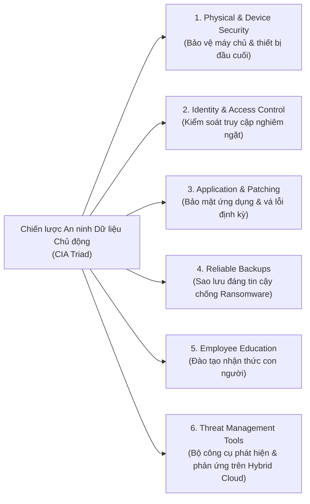

# Data Security: Why a Proactive Stance is Best

> **Khóa học**: Cybersecurity Architecture (IBM)  
> **Module 3**: Network, Application, and Data Security  
> **Tài liệu**: Reading: Data Security: Why a Proactive Stance is Best (Thời lượng: ~10 phút)  
> **Tác giả**: Dee Dee Collette (IBM Blog Reference)

---

## 📌 Tổng Quan (Overview)
Trong kỷ nguyên dữ liệu số, việc chuyển đổi từ tư thế bị động (chờ sự cố xảy ra mới phản ứng) sang **tư thế chủ động (Proactive Stance)** là yêu cầu sống còn của mọi tổ chức. Bài đọc phân tích sâu lý do vì sao doanh nghiệp cần chủ động bảo vệ dữ liệu dựa trên thiệt hại kinh tế, yêu cầu pháp lý khắt khe và các chỉ số chu kỳ tấn công thực tế.

---

## 1. Bảo Tồn Dữ Liệu & Quyền Riêng Tư (Data Preservation & Data Privacy)
- **Data Preservation (Bảo tồn dữ liệu)**: Bảo vệ thông tin trọng yếu khỏi bị phá hoại, hư hỏng, đánh cắp hoặc mất mát:
  - Thông tin định danh cá nhân (**PII - Personally Identifiable Information**).
  - Hồ sơ sức khỏe, bệnh án (**Health records**).
  - Dữ liệu tài chính, giao dịch (**Financial data**).
  - Sở hữu trí tuệ, bí mật kinh doanh (**Intellectual property**).
- **Hậu quả của vi phạm**:
  - Đối với doanh nghiệp: Thảm họa tài chính, phá hủy uy tín thương hiệu, trách nhiệm pháp lý.
  - Đối với cá nhân: Mất tiền, đánh cắp danh tính (Identity Theft), lừa đảo, khủng hoảng tâm lý và danh dự cá nhân.
- **Data Privacy (Quyền riêng tư dữ liệu)**: Tập trung vào cách thức dữ liệu được lưu trữ, truy cập và kiểm soát để ngăn chặn truy cập trái phép.  
  *Ví dụ điển hình*: Trong ngành y tế, việc duy trì tính bảo mật của bệnh nhân là nền tảng xây dựng lòng tin và bảo đảm tuân thủ luật định.

---

## 2. Chiến Lược An Ninh Dữ Liệu Toàn Diện (Comprehensive Strategy)
Mục tiêu cốt lõi là duy trì bộ ba **CIA (Confidentiality - Integrity - Availability)** xuyên suốt toàn bộ vòng đời dữ liệu (Lifecycle) trên môi trường Hybrid Cloud.

---

## 3. Tuân Thủ Pháp Lý & Các Mức Phạt Khổng Lồ (Data Security Compliance)
Trước mối lo ngại ngày càng tăng của công chúng về quyền riêng tư, chính phủ các nước đã ban hành các chế tài tài chính cực kỳ nghiêm khắc:

| Khung pháp lý / Cơ quan quản lý | Mức phạt vi phạm (Penalties) | Lưu ý đặc biệt |
| :--- | :--- | :--- |
| **GDPR (Châu Âu)** | Lên tới **$20 \text{ triệu EUR}$** hoặc **$4\%$ tổng doanh thu toàn cầu hàng năm** (tùy mức nào cao hơn). | Áp dụng cho mọi tổ chức xử lý dữ liệu công dân EU, bất kể trụ sở đặt ở đâu. |
| **HIPAA (Y tế Mỹ)** | Từ **$\$1.000$ đến $\$50.000$** cho **mỗi hành vi vi phạm**. | Quy chuẩn bảo mật thông tin sức khỏe cá nhân. |
| **FTC Act & COPPA (Mỹ)** | Lên tới **$\$40.000$ cho mỗi vi phạm** (bảo vệ quyền lợi trẻ em và người tiêu dùng). | **Mỗi ngày vi phạm tiếp diễn** được tính là một hành vi vi phạm độc lập kèm tiền phạt cộng dồn. |

---

## 4. Vì Sao Tư Thế Chủ Động (Proactive Stance) Mang Lại Lợi Ích Vượt Trội?

### 4.1. Con số thống kê về thời gian phát hiện vi phạm (2022 Data)
- **$277 \text{ ngày}$**: Thời gian trung bình để phát hiện và xử lý triệt để một vụ rò rỉ dữ liệu (Mean Time to Identify and Contain).
- **Tiết kiệm $\$1.12 \text{ triệu USD}$**: Nếu tổ chức chủ động rút ngắn thời gian này xuống **dưới 200 ngày**, mức tiết kiệm chi phí trung bình đạt tới hơn 1,1 triệu đô la.
- **Rủi ro từ thông tin xác thực bị đánh cắp (Stolen/Compromised Credentials)**:
  - Là nguyên nhân rò rỉ dữ liệu phổ biến nhất.
  - Tốn kém chi phí hơn **$\$150.000$** so với các loại vi phạm khác.
  - **Mất nhiều thời gian phát hiện nhất**: Trung bình lên tới **$327 \text{ ngày}$** (gần 11 tháng kẻ tấn công âm thầm nằm vùng trong hệ thống).

### 4.2. Giá trị thúc đẩy Đổi mới Sáng tạo (Enabling Innovation)
- Tiếp cận chủ động giúp thiết lập quy trình rõ ràng: truy cập, tuyển chọn (curating), phân loại (classifying) và phân phối dữ liệu an toàn.
- **Nghịch lý giá trị**: Tổ chức càng hiểu rõ và bảo vệ tốt dữ liệu nhạy cảm của mình bao nhiêu, thì càng tự tin và nhanh chóng khai phóng nguồn dữ liệu đó cho các dự án mới, phân tích dữ liệu lớn và đổi mới sáng tạo bấy nhiêu.

---

## 🧠 Tóm tắt Cốt lõi cho Kiến trúc sư (Key Takeaways)
1. **Chuyển dịch sang Proactive**: Đừng đợi đến khi bị xâm nhập; mọi ngày rút ngắn trong chu kỳ phát hiện đều tiết kiệm tiền bạc và danh tiếng.
2. **Chiến lược bao quát Hybrid Cloud**: Bảo vệ dữ liệu cả về vật lý, danh tính, ứng dụng, vá lỗi, sao lưu và công cụ quản lý mối đe dọa.
3. **Tuân thủ pháp lý là lá chắn tài chính**: Hiểu rõ chế tài của GDPR, HIPAA, FTC để thiết kế các chốt kiểm soát tương ứng.
4. **Bảo mật là đòn bẩy cho Đổi mới**: Doanh nghiệp chỉ có thể tự tin khai thác dữ liệu để tạo ra giá trị kinh doanh mới khi nền móng an ninh dữ liệu đã vững chắc.
