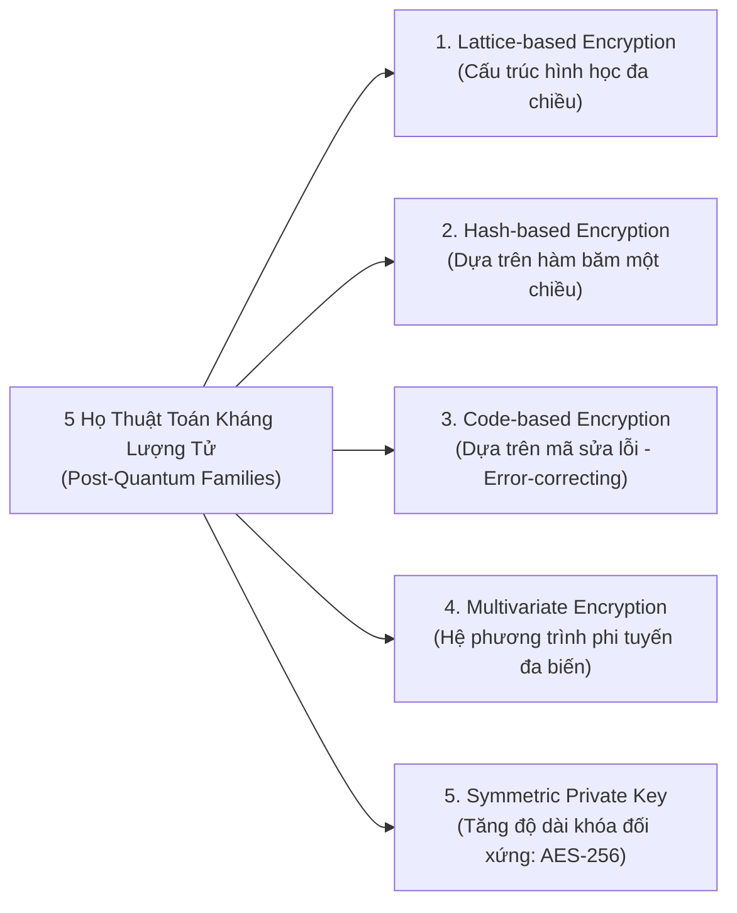

# Quantum-Safe Encryption (Post-Quantum Cryptography)

> **Khóa học**: Cybersecurity Architecture (IBM)  
> **Module 3**: Network, Application, and Data Security  
> **Tài liệu**: Reading: Quantum Safe Encryption (Thời lượng: ~5 phút)  
> **Tác giả**: Dee Dee Collette (IBM)

---

## 📌 Mối Đe Dọa Từ Máy Tính Lượng Tử (The Quantum Threat)
- **Bản chất của hiểm họa**: Nền tảng của mật mã học bất đối xứng hiện đại (như RSA, ECC) dựa trên độ khó toán học của việc phân tích các số nguyên tố cực lớn (**factorize large prime numbers**) và giải bài toán logarit rời rạc.
- **Sức mạnh lượng tử**: Khi máy tính lượng tử (Quantum Computers) đạt đủ độ ổn định và số lượng qubit, chúng có thể áp dụng thuật toán Shor để giải quyết bài toán này trong thời gian ngắn, biến các hệ thống mã hóa hiện nay thành vô dụng.
- **Chiến thuật tấn công "Thu hoạch trước, Giải mã sau" (Harvest Now, Decrypt Later)**:
  - Tin tặc và các cơ quan tình báo đã và đang tích cực đánh cắp, lưu trữ hàng loạt dữ liệu nhạy cảm được mã hóa ngày nay.
  - Mục tiêu: Chờ đợi đến khi máy tính lượng tử đủ mạnh trong tương lai để mở khóa toàn bộ kho dữ liệu này.
  - Do đó, việc nâng cấp lên mã hóa kháng lượng tử là nhiệm vụ **cấp bách ngay từ bây giờ**, không thể chờ đến khi máy tính lượng tử xuất hiện.

---

## ⏳ Khái Niệm "Q-Day" / "Years to Quantum" (Y2Q)
- **Định nghĩa**: Thời điểm được dự báo mà máy tính lượng tử sẽ chính thức bẻ gãy được các thuật toán mã hóa khóa công khai hiện tại.
- **Các mốc thời gian dự báo**:
  - *Báo cáo Quantum Threat Timeline*: Dự đoán trong vòng **15 năm tới**, máy tính lượng tử có thể bẻ gãy mã hóa RSA-2048.
  - *Cloud Security Alliance (CSA)*: Dự báo mốc thời gian này có thể đến sớm hơn rất nhiều, cụ thể là vào khoảng **14/04/2030**.

---

## 🛡️ Khái Niệm "Quantum-Safe" / Post-Quantum Cryptography (PQC)
- **Quantum-Safe (An toàn lượng tử)**: Đề cập đến các phương pháp, giao thức và thuật toán an ninh có khả năng chống cự lại các cuộc tấn công từ cả máy tính truyền thống (cổ điển) lẫn máy tính lượng tử mạnh nhất.
- **Mục tiêu**: Thay thế các hệ thống mã hóa khóa công khai dễ bị tổn thương bằng các thuật toán dựa trên các bài toán toán học phức tạp mà máy tính lượng tử không có lợi thế giải nhanh.

---

## 🧩 5 Họ Thuật Toán Mật Mã Kháng Lượng Tử Tiêu Biểu

Các họ thuật toán được nghiên cứu và chuẩn hóa (bởi NIST và các tổ chức tiêu chuẩn quốc tế) bao gồm:

| Họ thuật toán | Cơ chế hoạt động & Cơ sở toán học | Đặc điểm an ninh |
| :--- | :--- | :--- |
| **1. Lattice-based Encryption** *(Mật mã trên lưới)* | Sử dụng các cấu trúc hình học đa chiều (Multidimensional geometric structures) để tạo ra các câu đố mật mã cực kỳ khó giải đối với máy tính lượng tử. | Là hướng đi chủ lực, cân bằng tốt giữa tốc độ xử lý và kích thước khóa. |
| **2. Hash-based Encryption** *(Mật mã dựa trên hàm băm)* | Dựa trên độ khó toán học của hàm băm một chiều (One-way hash functions). Biến đổi dữ liệu thành chuỗi ký tự duy nhất cực kỳ khó đảo ngược. | Độ tin cậy rất cao, thường dùng cho chữ ký số (Digital Signatures). |
| **3. Code-based Encryption** *(Mật mã dựa trên mã)* | Chuyển đổi dữ liệu thành các thông điệp được mã hóa (dựa trên lý thuyết mã sửa sai) khiến việc giải mã nếu không có ma trận khóa đúng là bất khả thi. | Thuật toán rất lâu đời và bền vững (như McEliece), nhưng kích thước khóa thường lớn. |
| **4. Multivariate Encryption** *(Mật mã đa biến)* | Sử dụng đồng thời nhiều phương trình toán học phi tuyến tính với nhiều biến số, tạo nên hệ bài toán NP-hard thách thức khả năng tính toán lượng tử. | Phù hợp với các thiết bị tài nguyên hạn chế, chữ ký số ngắn. |
| **5. Symmetric Private Key** *(Khóa bí mật đối xứng)* | Sử dụng khóa bí mật chia sẻ chung giữa các bên. Thuật toán lượng tử Grover chỉ giảm một nửa độ an toàn của thuật toán đối xứng. | Chỉ cần **tăng gấp đôi độ dài khóa** (ví dụ nâng từ AES-128 lên **AES-256**) là đủ để kháng cự máy tính lượng tử một cách an toàn. |

---

## 🧠 Tóm tắt Cốt lõi cho Kiến trúc sư (Summary)
1. **Mối nguy "Harvest Now, Decrypt Later"**: Dữ liệu lưu trữ dài hạn (như hồ sơ y tế, bí mật quốc phòng, tài chính) nếu bị đánh cắp hôm nay sẽ bị giải mã vào ngày **Q-Day** (dự kiến quanh mốc 2030).
2. **Nâng cấp chủ động**: Doanh nghiệp cần kiểm kê và xây dựng lộ trình nâng cấp thuật toán mã hóa (Crypto-agility) ngay từ bây giờ.
3. **Hiểu rõ 5 họ thuật toán**: Lattice, Hash, Code, Multivariate và Symmetric keys (nâng cấp lên khóa 256-bit).
