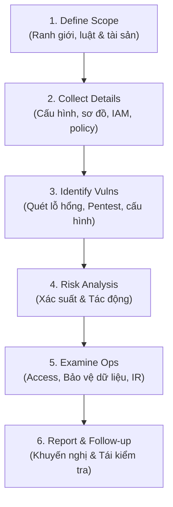

# Performing a Security Audit

> **Khóa học**: Cybersecurity Architecture (IBM)  
> **Module 3**: Network, Application, and Data Security  
> **Bài học**: Performing a Security Audit (Thời lượng: ~7 phút)

---

## 📌 Khái niệm & Mục tiêu
- **Kiểm toán an ninh (Security Audit)**: Đánh giá toàn diện kiến trúc an ninh mạng và hạ tầng số nhằm phát hiện điểm yếu, đo lường rủi ro và đảm bảo tuân thủ tiêu chuẩn/pháp lý (**GDPR, HIPAA, SOC 2, SOX**).

---

## 🔄 Quy Trình 6 Bước Kiểm Toán An Ninh

---

### Chi Tiết 6 Bước Thực Hiện

| Bước | Hoạt động trọng tâm | Yếu tố then chốt |
| :--- | :--- | :--- |
| **1. Define Audit Scope** | Xác định ranh giới hệ thống, quy trình nghiệp vụ và các khung pháp lý cần tuân thủ. | • Luật định: **GDPR, HIPAA, SOC 2, SOX**. • Xác định tài sản trọng yếu và khẩu vị rủi ro (**Risk Tolerance**). |
| **2. Collect Details** | Thu thập dữ liệu thực tế về hạ tầng và tài liệu vận hành. | • Đọc cấu hình phần cứng/phần mềm/cloud. • Phân tích **Sơ đồ mạng (Network Diagrams)** & luồng dữ liệu. • Kiểm tra cơ chế IAM (MFA, password policy) và tài liệu quy trình. |
| **3. Identify Threats & Vulns** | Rà quét kỹ thuật để tìm điểm yếu mà tin tặc có thể khai thác. | • **Vulnerability Scan**: Quét tự động theo cơ sở dữ liệu CVE. • **Penetration Testing**: Mô phỏng tấn công thực tế. • Kiểm tra lỗi cấu hình hệ thống (**Misconfigurations**). |
| **4. Risk Analysis** | Đo lường mức độ nguy hiểm của các lỗ hổng đã phát hiện. | • **Xác suất (Likelihood)**: Dựa trên độ khó khai thác và bối cảnh đe dọa. • **Tác động (Impact)**: Độ nhạy cảm dữ liệu (PII, tài chính) và thiệt hại vận hành/kinh doanh. |
| **5. Examine Protocols & Ops** | Kiểm tra việc thực thi chính sách an ninh trong vận hành hàng ngày. | • Kiểm soát truy cập: **RBAC**, nguyên tắc đặc quyền tối thiểu (**Least Privilege**), MFA. • Bảo vệ dữ liệu: Mã hóa (Encryption), che mặt nạ (Masking), Backup, **DLP**. • Kế hoạch ứng phó sự cố (**Incident Response Plan**). |
| **6. Report & Follow-up** | Ghi nhận kết quả, đề xuất khắc phục và giám sát triển khai. | • Lập **Báo cáo kiểm toán toàn diện** (phạm vi, lỗ hổng, rủi ro). • Đưa ra khuyến nghị khắc phục cụ thể. • **Follow-up / Re-audit** để đảm bảo các lỗ hổng đã được xử lý triệt để. |

---

## 🧠 Tóm tắt Cốt lõi (Key Takeaways)
1. **Kiểm toán đa diện**: Kết hợp chặt chẽ giữa **Quy trình - Công nghệ - Con người - Pháp lý**.
2. **Tiếp cận theo Rủi ro (Risk-based)**: Ưu tiên xử lý điểm yếu dựa trên xác suất xảy ra và mức độ thiệt hại kinh doanh.
3. **Giám sát sau kiểm toán**: Báo cáo chỉ thực sự có giá trị khi đi kèm hành động khắc phục và quy trình tái thẩm định định kỳ.
