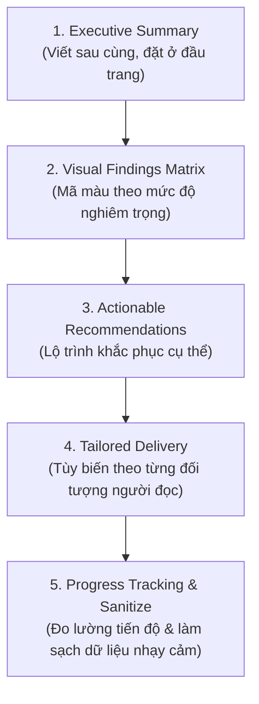

# Creating Effective Security Reports

> **Khóa học**: Cybersecurity Architecture (IBM)  
> **Module 3**: Network, Application, and Data Security  
> **Hoạt động**: Podcast: Creating Security Reports (Thời lượng: ~4 phút)  
> **Diễn giả**: Daniel (Host) & Emma (Cybersecurity Communication Expert)

---

## 📌 Tầm Quan Trọng của Báo Cáo An Ninh (Why Security Reports Matter)
- Báo cáo an ninh là **cầu nối** giữa công việc kỹ thuật chuyên sâu và các quyết định kinh doanh chiến lược của ban lãnh đạo.
- Nếu báo cáo không rõ ràng, ban lãnh đạo sẽ không hiểu, không đọc và **không ra quyết định hành động hay cấp ngân sách**.
- Báo cáo không đơn thuần là nơi "đổ dữ liệu kỹ thuật" (dumping findings) mà phải được thiết kế để định hướng hành động (**actionable**).

---

## 🏗️ Cấu Trúc & Thực Hành Xây Dựng Báo Cáo Chuẩn

---

### 1. Bản Tóm Tắt Dành Cho Lãnh Đạo (Executive Summary)
- **Vị trí**: Viết sau cùng nhưng đặt ngay ở trang đầu tiên.
- **3 câu hỏi lãnh đạo cần biết**:
  1. *Chuyện gì đã xảy ra? (What happened?)*
  2. *Nó ảnh hưởng thế nào đến hoạt động kinh doanh? (What does it mean for the business?)*
  3. *Cần phải làm gì tiếp theo? (What should be done next?)*
- **Bỏ thuật ngữ kỹ thuật (No Jargon)**: Thay vì ghi "Lỗ hổng SQL Injection", hãy diễn đạt: *"Kẻ tấn công có thể truy cập trái phép vào toàn bộ cơ sở dữ liệu khách hàng"*.
- **Thông tin thiết yếu cần kèm theo**: Mức độ rủi ro (Risk rating), ước tính chi phí khắc phục và khung thời gian dự kiến hoàn thành.

---

### 2. Thiết Kế Trực Quan & Định Lượng Rủi Ro (Visual & Specific Risk)
- **Thiết kế để đọc lướt (Design for Scanning)**: Tiêu đề rõ ràng, gạch đầu dòng ngắn gọn, biểu đồ hoặc bảng ma trận phát hiện (Findings Matrix).
- **Mã màu mức độ nghiêm trọng (Color-coded Severities)**:
  - 🔴 **Đỏ (Critical)**: Nghiêm trọng, cần xử lý khẩn cấp.
  - 🟠 **Cam (High)**: Cao.
  - 🟡 **Vàng (Medium)**: Trung bình.
  - 🔵 **Xanh (Low)**: Thấp.
- **Định lượng rủi ro cụ thể**: Đừng viết chung chung *"Có khả năng lộ dữ liệu"*, hãy nêu cụ thể: *"2,3 triệu bản ghi khách hàng (bao gồm thông tin thanh toán) có nguy cơ bị truy cập trái phép, dẫn tới nguy cơ bị phạt luật định và sụt giảm doanh thu"*.

---

### 3. Đề Xuất Khắc Phục Rõ Ràng (Remediation & Prioritization)
- **Chỉ dẫn chính xác (Clear path)**: Thay vì nói chung chung *"Vá máy chủ"*, hãy ghi cụ thể: *"Nâng cấp Apache lên phiên bản 2.4.50 hoặc mới hơn"*; đính kèm link bản vá, đoạn code mẫu hoặc cấu hình.
- **Ưu tiên theo rủi ro thực tế (Actual Risk)**: Một lỗi High trên môi trường Test ít cấp bách hơn một lỗi Medium trên hệ thống thanh toán chính (Production).
- **Phương án tạm thời**: Đưa ra giải pháp tình thế ngắn hạn nếu chưa thể sửa lỗi triệt để ngay lập tức.
- **Quản lý bằng chứng (Evidence & Appendices)**: Đưa bằng chứng vừa đủ trong báo cáo chính (chú thích rõ ràng chỗ cần nhìn trên ảnh chụp màn hình/log), chuyển dữ liệu thô (raw data) vào phần **Phụ lục (Appendices)**.

---

### 4. Tùy Biến Báo Cáo Theo Từng Đối Tượng (Tailored Delivery)

| Nhóm đối tượng | Nội dung trọng tâm cần truyền tải | Định dạng tài liệu |
| :--- | :--- | :--- |
| **Kỹ thuật / Dev / DevOps** | Chi tiết kỹ thuật: câu lệnh, file config, mã lỗi, URL bản vá. | Báo cáo chi tiết + Phụ lục thô |
| **Ban Quản lý (Management)** | Tác động kinh doanh, nguồn lực và ngân sách cần thiết để khắc phục. | Bản tóm tắt 2 trang (2-page briefing tập trung vào lỗi Critical & High) |
| **Hội đồng Quản trị (Board)** | Phân tích xu hướng dài hạn, so sánh với chuẩn ngành (industry benchmarks). | Dashboard & Trend Slides |

---

### 5. Theo Dõi Tiến Độ & Kiểm Tra Lần Cuối (Tracking & Final Checks)
- **Progress Tracker & Dashboard**: Đo lường tỷ lệ đã khắc phục (% remediated), thời gian trung bình để sửa lỗi (MTTR), xu hướng an ninh theo thời gian $\rightarrow$ Làm căn cứ thuyết phục đầu tư thêm cho an ninh mạng.
- **Sanitization (Làm sạch dữ liệu nhạy cảm)**: Trước khi gửi ra ngoài, bắt buộc xóa bỏ credentials (mật khẩu, tokens), địa chỉ IP nội bộ và thông tin bảo mật.
- **Kiểm tra chính tả (Spell-check)**: Lỗi chính tả làm giảm tính chuyên nghiệp và độ tin cậy của đội ngũ an ninh.

---

## 🧠 Tóm tắt Cốt lõi (Key Takeaways)
1. **Executive Summary là chìa khóa**: Lãnh đạo chỉ đọc trang đầu — hãy trả lời: Chuyện gì xảy ra? Tác động kinh doanh? Làm gì tiếp theo?
2. **Nói bằng ngôn ngữ kinh doanh**: Quy đổi lỗ hổng kỹ thuật thành số tiền phạt, số bản ghi dữ liệu có nguy cơ và doanh thu bị ảnh hưởng.
3. **Đề xuất khắc phục phải chi tiết**: Cung cấp phiên bản cập nhật cụ thể, link bản vá và code mẫu.
4. **Làm sạch tài liệu (Sanitize)**: Loại bỏ thông tin nhạy cảm trước khi phát hành báo cáo.
