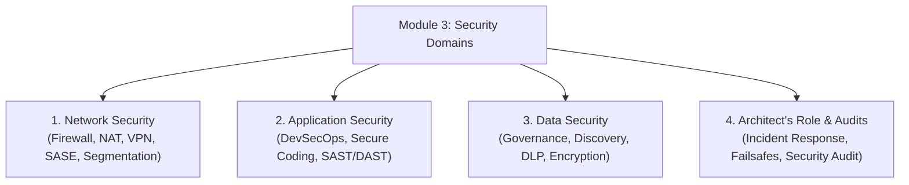

# Summary and Highlights: Network, Application, and Data Security

> **Khóa học**: Cybersecurity Architecture (IBM)  
> **Module 3**: Network, Application, and Data Security  
> **Tài liệu**: Module Summary and Highlights (Thời lượng đọc: ~5 phút)

---

## 📌 Tổng Kết Toàn Diện Module 3

Chúc mừng bạn đã hoàn thành **Module 3: Network, Application, and Data Security**! Dưới đây là bảng hệ thống hóa toàn bộ các điểm kiến thức trọng tâm cốt lõi theo 3 miền bảo mật và vai trò kiến trúc sư:

---

## 1. Network Security (Bảo Mật Mạng)
- **Mục tiêu**: Bảo vệ khả năng sử dụng (**Usability**) và tính toàn vẹn (**Integrity**) của dữ liệu; phân tách giữa mạng tin cậy (trusted) và không tin cậy (untrusted).
- **Packet Filtering**: Cho phép hoặc chặn lưu lượng dựa trên các luật định sẵn (IP nguồn/đích, Port, Protocol) ở phần header.
- **Data Packets (Gói tin)**: Các đơn vị dữ liệu nhỏ được truyền tải qua mạng và tái hợp ráp lại tại điểm đích.
- **Stateful Packet Inspection (SPI)**: Theo dõi trạng thái kết nối hoạt động và đánh giá gói tin theo ngữ cảnh phiên để nâng cao an ninh.
- **Application Firewall (WAF)**: Soi chiếu lưu lượng tầng ứng dụng (web traffic), ngăn chặn tấn công **SQL Injection (SQLi)** và **Cross-Site Scripting (XSS)**.
- **Proxy**: Đóng vai trò máy chủ ủy quyền trung gian giữa người dùng và Internet, ẩn địa chỉ IP nội bộ, hỗ trợ lọc và ghi log.
- **Network Address Translation (NAT)**: Ẩn IP private nội bộ bằng cách dịch sang IP public để giao tiếp ngoài Internet.
- **Virtual Private Network (VPN)**: Thiết lập kênh truyền được mã hóa qua Internet để truy cập an toàn vào mạng riêng.
- **IPSec**: Bộ giao thức mã hóa và xác thực lưu lượng IP ở tầng mạng (Layer 3), thường dùng cho kết nối VPN.
- **Secure Access Service Edge (SASE)**: Mô hình đám mây hợp nhất giữa hạ tầng mạng diện rộng (SD-WAN) và an ninh mạng (VPN, Firewall, Zero Trust).
- **Data Loss Prevention (DLP)**: Bộ công cụ và chính sách ngăn chặn rò rỉ, mất mát hoặc truy cập trái phép dữ liệu nhạy cảm qua mạng.

---

## 2. Application Security (Bảo Mật Ứng Dụng)
- **Xác định vị trí lỗ hổng**: Tập trung vào việc nhận diện các lỗ hổng bảo mật phát sinh trong suốt vòng đời phát triển phần mềm (**SDLC**).
- **Thực hành viết mã an toàn (Secure Coding Practices)**:
  - Sử dụng danh mục kiểm tra mã (**Coding Checklists**).
  - Tái sử dụng thư viện đáng tin cậy (**Trusted Libraries**).
  - Áp dụng các kiến trúc tiêu chuẩn (**Standard Architecture References**).
  - Chủ động phòng tránh các lỗ hổng đã biết trong **OWASP Top 10**.
- **Kiểm thử tự động**:
  - **SAST (Static Testing - Hộp trắng)**: Phân tích trực tiếp mã nguồn tĩnh để phát hiện lỗ hổng sớm ngay từ lúc lập trình.
  - **DAST (Dynamic Testing - Hộp đen)**: Kiểm thử ứng dụng đang chạy ở runtime bằng cách mô phỏng các đòn tấn công thực tế.
- **DevSecOps**: Tích hợp và tự động hóa bảo mật vào mọi giai đoạn của SDLC theo tư duy **Shift-Left**, duy trì tốc độ linh hoạt (Agility).
- **Security-by-Design**: Đưa các chốt kiểm soát an ninh, mô hình hóa mối đe dọa (**Threat Modeling - STRIDE**), ranh giới tin cậy và luồng dữ liệu vào kiến trúc ngay từ ngày đầu.

---

## 3. Data Security (Bảo Mật Dữ Liệu)
- **6 Cấu phần hệ sinh thái dữ liệu**: Governance $\rightarrow$ Discovery $\rightarrow$ Protection $\rightarrow$ Compliance $\rightarrow$ Detection $\rightarrow$ Incident Response.
- **Data Governance (Quản trị dữ liệu)**: Định nghĩa cách dữ liệu được quản lý, bảo vệ và sử dụng trong toàn doanh nghiệp.
- **Data Discovery (Khám phá dữ liệu)**: Định vị và phân loại nơi lưu trữ dữ liệu nhạy cảm (cả Structured Database và Unstructured File/Email).
- **Detection (Phát hiện)**: Giám sát và nhận diện các hoạt động đáng ngờ, bất thường (User Behavior Analytics - UBA) tác động tới hệ thống/dữ liệu.
- **Incident Response (Ứng phó sự cố)**: Các hành động khoanh vùng, khắc phục và phục hồi dữ liệu/hệ thống khi bị tấn công.
- **Top 5 yếu tố giảm chi phí Data Breach**:
  1. Trí tuệ nhân tạo (**AI**).
  2. **DevSecOps**.
  3. Kế hoạch ứng phó sự cố (**Incident Response - IR**).
  4. Mật mã học & Quản trị khóa (**Cryptography**).
  5. Đào tạo nhận thức an ninh cho nhân viên (**Employee Training**).

---

## 4. Vai Trò Của Kiến Trúc Sư & Kiểm Toán An Ninh
- **Kiến trúc sư hệ thống (System Architect)**:
  - Giữ vai trò quyết định trong việc ngăn ngừa sự cố thông qua thiết kế kiến trúc kiên cố và phát hiện sớm các sai sót thiết kế (*Design Flaws*).
  - Trong sự cố: Vẽ đường tấn công (24h đầu), tìm điểm nghẽn kiến trúc, thiết kế cơ chế dự phòng (**Failsafes**: Default Deny, Circuit Breakers, Immutable Infrastructure).
- **Kiểm toán an ninh (Security Audits)**: Đánh giá có hệ thống hiệu quả thực tế của các chốt kiểm soát, chính sách và mức độ tuân thủ quy định pháp luật (**GDPR, HIPAA, SOC 2, SOX**).
- **Báo cáo an ninh hiệu quả (Security Reports)**: Tạo cầu nối với lãnh đạo qua Executive Summary phi thuật ngữ, định lượng rủi ro bằng số liệu cụ thể, và cung cấp lộ trình khắc phục rõ ràng.
