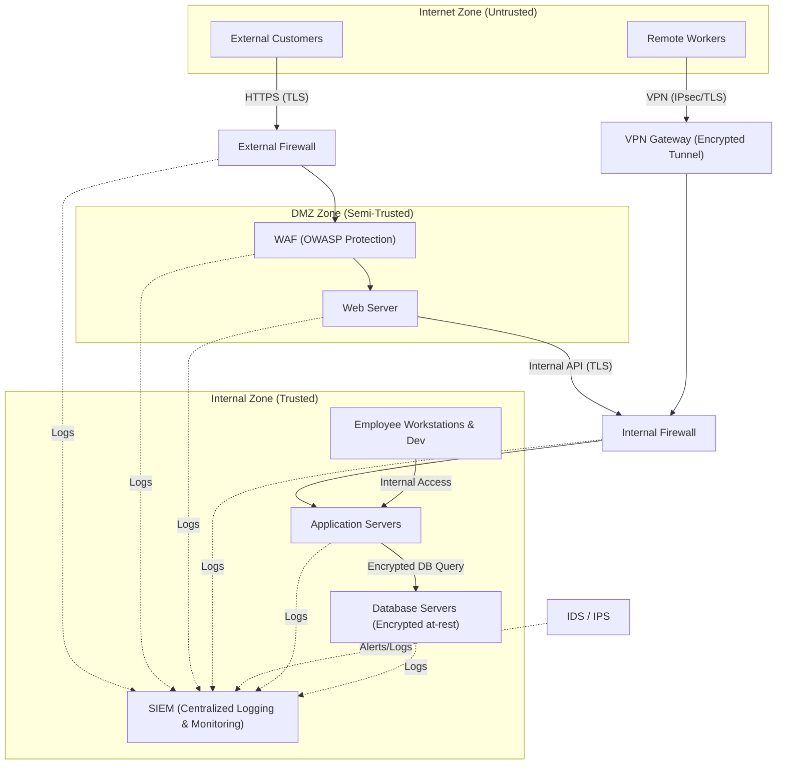

# [Optional] Lab: Create a Security Architecture Diagram for Jackson Corporation

- **Thời lượng ước tính:** 30 phút
- **Mục tiêu:** Chuyển các đề xuất bảo mật ở bài trước thành sơ đồ kiến trúc bảo mật nhiều lớp (Defense-in-Depth) với các vùng mạng (zones), kiểm soát ranh giới và luồng lưu lượng rõ ràng.

## 1. Phân vùng bảo mật (Security Zones)
1. **Internet Zone (Untrusted):** Người dùng bên ngoài, khách hàng, nhân viên làm việc từ xa (trước khi vào VPN).
2. **DMZ Zone (Semi-Trusted):** Chứa các dịch vụ hướng internet như **Web Server**, **WAF**, **VPN Gateway**.
3. **Internal Zone (Trusted):** Chứa **Application Servers**, **Database Servers** (nằm sâu nhất), **Employee Workstations**, **Development Environment**, và hệ thống **SIEM**.

## 2. Ánh xạ thành phần & kiểm soát bảo mật

| Thành phần | Security Zone | Vai trò / Lý do đặt |
| :--- | :--- | :--- |
| **External Firewall** | Ranh giới Internet ↔ DMZ | Lọc traffic từ internet vào DMZ, chặn truy cập trực tiếp vào Internal. |
| **WAF (Web Application Firewall)** | DMZ (trước Web Server) | Bảo vệ ứng dụng web trước các lỗ hổng OWASP (SQLi, XSS, input độc hại). |
| **Web Server** | DMZ | Tách khỏi mạng nội bộ để giảm thiểu rủi ro nếu bị xâm nhập. |
| **Internal Firewall** | Ranh giới DMZ ↔ Internal | Tạo lớp bảo vệ thứ 2; chỉ cho phép traffic hợp lệ từ DMZ vào App Server. |
| **VPN Gateway** | Ranh giới/DMZ | Mã hóa kết nối cho nhân viên từ xa truy cập tài nguyên nội bộ an toàn. |
| **IDS/IPS** | Các điểm nút chính (DMZ/Internal) | Phát hiện và ngăn chặn xâm nhập/hành vi bất thường theo thời gian thực. |
| **Application & Database Servers** | Internal (DB sâu nhất) | Xử lý nghiệp vụ & lưu trữ dữ liệu nhạy cảm (mã hóa at-rest, bảo vệ qua 2 lớp firewall). |
| **SIEM** | Internal | Thu thập log tập trung từ tất cả các vùng để giám sát & phản ứng sự cố. |

## 3. Sơ đồ kiến trúc tham khảo (Mermaid)

## 4. Checklist tự kiểm tra sơ đồ
- Web Server đã được chuyển từ Internal sang **DMZ** chưa?
- Database có được bảo vệ bởi **ít nhất 2 lớp firewall** (External + Internal) không?
- Người dùng bên ngoài có bị chặn truy cập trực tiếp vào Internal Network không?
- Tất cả kết nối đều có nhãn **giao thức** và **trạng thái mã hóa** chưa?
- Đã có **WAF**, **IDS/IPS**, **VPN Gateway**, **SIEM**, chú thích bảo mật và **Legend** chưa?
