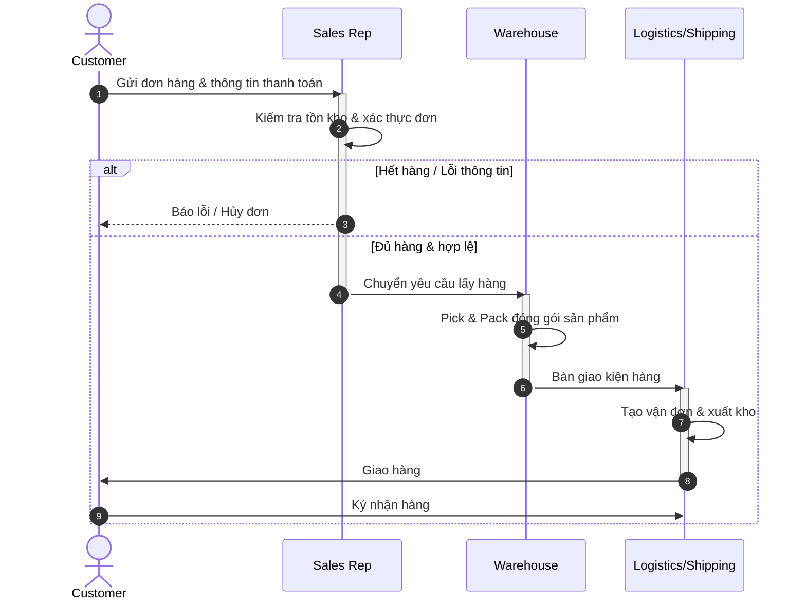
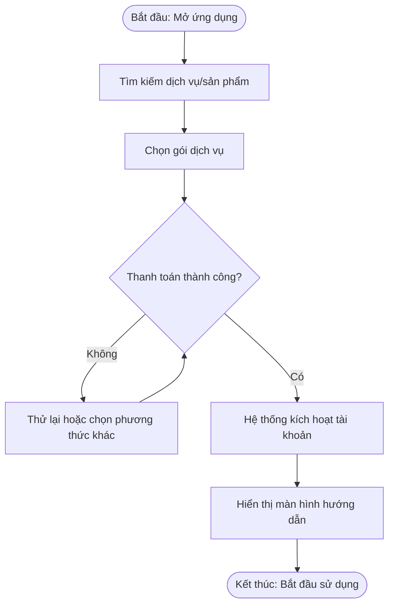
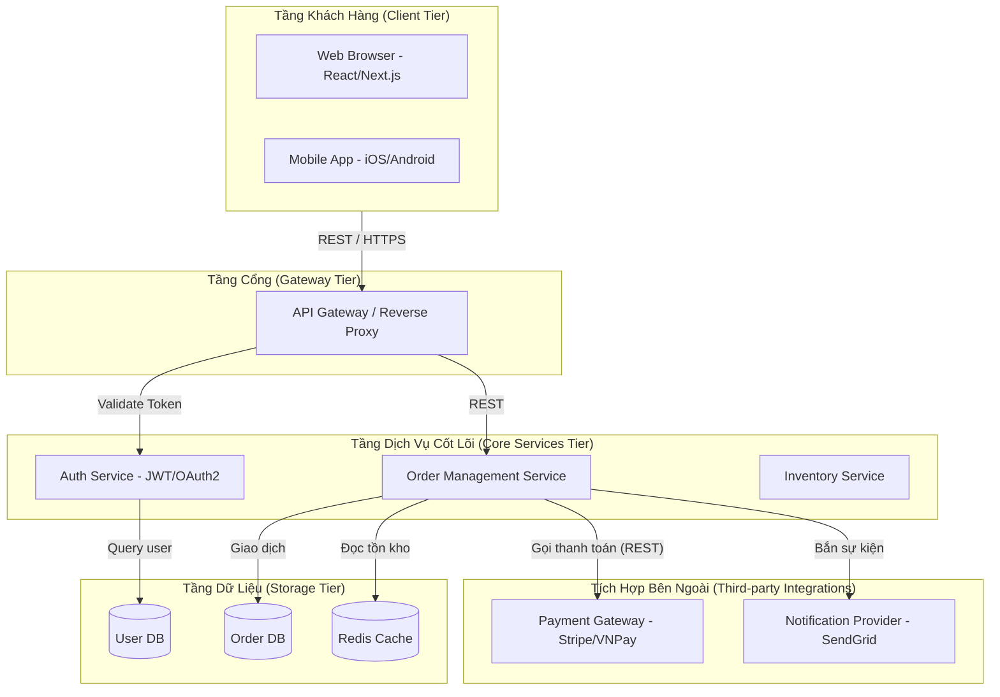

# Lab: Generating BPMN, Process Flowcharts, Customer Journey Maps, and System Architecture Diagrams with Generative AI

## 1. Tóm tắt nội dung thực hành (Lab Summary)

Lab cung cấp quy trình từng bước áp dụng Generative AI để chuyển đổi văn bản thô/phi cấu trúc thành 4 loại sơ đồ quan trọng:

### Bài tập 1: Tạo sơ đồ BPMN từ chuỗi email (Email Thread)
- **Mục tiêu:** Thể hiện luồng tác vụ, các điểm quyết định và sự bàn giao giữa các bên (người/hệ thống).
- **Quy trình:**
  1. Trích xuất actors (vai trò/hệ thống) và actions (tác vụ/quyết định).
  2. Dùng AI sinh sơ đồ dạng mã (Mermaid syntax, PlantUML hoặc XML) có phân làn (swimlanes).
  3. Rà soát phát hiện các điểm nghẽn (bottlenecks) hoặc bước lãng phí.
- **Prompt mẫu:**
  ```text
  "Based on this email thread, create a BPMN diagram in Mermaid syntax. Include swimlanes for each actor: [list actors]. Show the sequence of tasks, decision points, and handoffs between actors. Identify any bottlenecks or inefficiencies in the process."
  ```

---

### Bài tập 2: Tạo Flowchart và Customer Journey Map từ cùng một bản mô tả quy trình
- **Mục tiêu:** Nhìn nhận cùng một quy trình dưới 2 góc độ: kỹ thuật/logic và trải nghiệm/cảm xúc người dùng.
- **Phân biệt góc nhìn:**
  - **Flowchart:** Chuỗi logic, điều kiện rẽ nhánh (decision diamonds), vòng lặp và hướng xử lý của hệ thống.
  - **Customer Journey Map:** Hành trình người dùng qua các giai đoạn (Awareness -> Consideration -> Purchase -> Use -> Support), ghi nhận hành động, điểm tiếp xúc (touchpoints), cảm xúc và các điểm đau (pain points).
- **Prompt mẫu Flowchart:**
  ```text
  "Create a flowchart in Mermaid syntax for this process: [paste description]. Include start/end nodes, process steps, decision diamonds, and directional arrows showing the flow."
  ```
- **Prompt mẫu Customer Journey Map:**
  ```text
  "Create a customer journey map for this process: [paste description]. Include stages: Awareness, Consideration, Purchase, Use, Support. For each stage, identify: customer actions, touchpoints, emotions (positive/neutral/negative), pain points, and opportunities for improvement."
  ```

---

### Bài tập 3: Tạo Sơ đồ Kiến trúc Hệ thống (System Architecture Diagram) từ Yêu cầu (Requirements)
- **Mục tiêu:** Trực quan hóa cấu trúc kỹ thuật tổng thể trước khi phát triển.
- **Thành phần cần định hình:** UI (Web/Mobile), API Gateway, Business Services, Databases, Auth Service, External Integrations (Payment, SMS/Email).
- **Prompt mẫu:**
  ```text
  "Create a system architecture diagram in Mermaid syntax for: [paste requirements]. Include these components: [Web App, Mobile App, API Gateway, Database, Payment Service, Authentication Service]. Show the data flow between components with labeled arrows. Indicate which connections use REST APIs, which use databases, and which are external integrations."
  ```

---

## 2. Trả lời & Giải quyết các bài tập trong Lab (Exercises Execution & Answers)

### Trả lời Bài tập 1: BPMN Diagram từ chuỗi email xử lý đơn hàng
- **Actors & Actions trích xuất:**
  - *Customer:* Gửi đơn hàng, thanh toán, nhận hàng & xác nhận.
  - *Sales Rep:* Kiểm tra tính hợp lệ đơn hàng, kiểm tra tồn kho.
  - *Warehouse Team:* Lấy hàng (picking), đóng gói (packaging).
  - *Shipping Dept:* In nhãn vận chuyển, giao cho bên vận chuyển.
- **Mã Mermaid BPMN:**


---

### Trả lời Bài tập 2: So sánh Flowchart vs Customer Journey Map

#### Sơ đồ 1: Flowchart (Góc nhìn luồng logic)


#### Sơ đồ 2: Customer Journey Map (Góc nhìn trải nghiệm khách hàng)
| Giai đoạn (Stage) | Hành động của khách hàng (Actions) | Điểm tiếp xúc (Touchpoints) | Cảm xúc (Emotions) | Điểm nghẽn/Đau (Pain points) | Cơ hội cải tiến (Opportunities) |
| :--- | :--- | :--- | :--- | :--- | :--- |
| **Awareness** | Đọc bài viết so sánh giải pháp | Google Search, Blog, Mạng xã hội | Tò mò (Neutral) | Quá nhiều thông tin rác | Cung cấp bảng so sánh tính năng rõ ràng |
| **Consideration** | Xem bảng giá, dùng thử miễn phí | Landing Page, Pricing table | Băn khoăn (Neutral) | Bảng giá phức tạp, ẩn phụ phí | Cho dùng thử 1-click không cần thẻ tín dụng |
| **Purchase** | Điền thông tin và thanh toán | Checkout Form, Cổng thẻ ngân hàng | Lo lắng -> Nhẹ nhõm | Form quá dài, lỗi thanh toán OTP | Hỗ trợ Apple Pay, Google Pay, QR Code |
| **Use** | Thiết lập cấu hình lần đầu | Ứng dụng web, Dashboard | Hào hứng (Positive) | Khó tìm tài liệu hướng dẫn | Tự động mở Interactive Onboarding Tour |
| **Support** | Báo cáo lỗi khi gặp trục trặc | Chat widget, Ticketing email | Bực bội (Negative) | Phản hồi chậm, phải lặp lại thông tin lỗi | Tích hợp AI Bot hỗ trợ xử lý tức thì |

---

### Trả lời Bài tập 3: System Architecture Diagram (Kiến trúc hệ thống từ yêu cầu)

