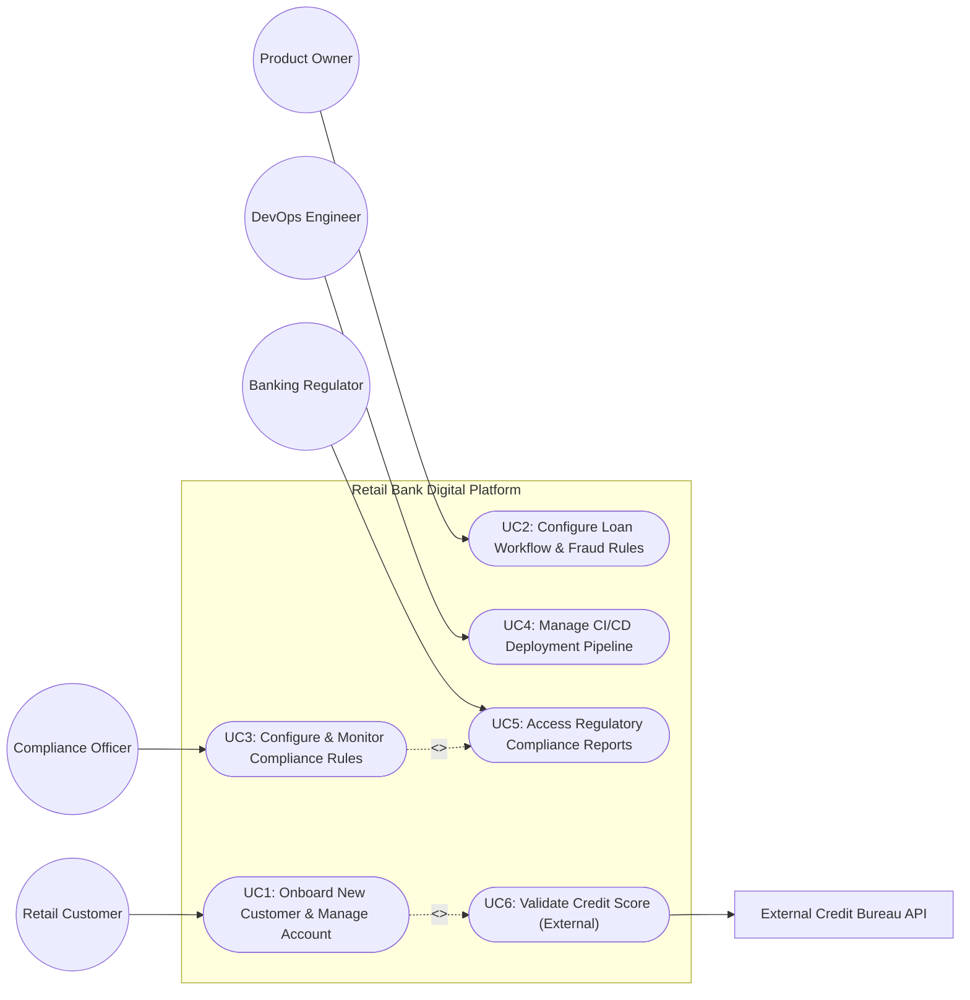

# LAB REPORT & DELIVERABLES: Requirements Gathering
**Dự án:** Retail Bank's Digital Core Transformation  
**Vai trò:** Systems and Solutions Architect  
**Chuẩn áp dụng:** PMI Professional in Business Analysis (PMI-PBA), TOGAF, BABOK  

---

# TASK 1: BUSINESS REQUIREMENTS DOCUMENT (BRD)

## 1. Project Title & Overview
- **Project Title:** Retail Bank Digital Core Transformation
- **Domain:** Banking & Financial Services
- **Document Version:** 1.0 (Baseline)
- **Author:** Systems & Solutions Architect

## 2. Project Scope (Phạm vi dự án)
Dự án chuyển đổi số toàn diện nhằm tích hợp và hiện đại hóa các hệ thống phân mảnh của Ngân hàng bán lẻ bao gồm:
- **Customer Onboarding & eKYC:** Định danh khách hàng điện tử tự động đa kênh (Web/Mobile).
- **Loan Servicing:** Quản lý quy trình phê duyệt, giải ngân và theo dõi khoản vay.
- **Fraud Detection:** Phát hiện và cảnh báo gian lận thời gian thực (Event-driven).
- **Compliance Monitoring:** Giám sát tuân thủ quy chuẩn tài chính tập trung trên nền tảng Cloud-Native thống nhất.

## 3. Business Objectives (Mục tiêu kinh doanh)
1. **OBJ-1 (Cloud Migration):** Hoàn thành chuyển đổi hệ thống Legacy sang hạ tầng Cloud-Native an toàn vào **Quý 4 (Q4)**.
2. **OBJ-2 (Efficiency):** Cải thiện và rút ngắn thời gian xử lý hồ sơ mở tài khoản (Onboarding) và quy trình duyệt vay ít nhất **40%**.
3. **OBJ-3 (Compliance):** Đạt **100% tuân thủ** các tiêu chuẩn quy chế tài chính quốc tế và nội địa: **KYC, AML, PCI-DSS, GDPR**.
4. **OBJ-4 (Availability & Scale):** Duy trì tính sẵn sàng của hệ thống đạt **99.99% SLA (Uptime)** với kiến trúc mở rộng linh hoạt.

## 4. Assumptions & Constraints (Giả định & Ràng buộc)
- **Assumptions:**
  - Hợp đồng với các nhà cung cấp nền tảng Cloud và giải pháp đối tác bên thứ ba đã hoàn tất ký kết.
  - Các bên liên quan (Product Owners, Compliance, DevOps, Security) luôn sẵn sàng tham gia các buổi workshop và thẩm định kết quả.
  - Môi trường Cloud được cấp phát sẵn, bảo mật theo đúng chính sách ngân hàng.
- **Constraints:**
  - Ngân sách và mốc thời gian cố định theo lộ trình chuyển đổi số của ngân hàng.
  - Phải tuân thủ nghiêm ngặt chính sách bảo mật dữ liệu khách hàng (không để rò rỉ dữ liệu PII).

## 5. Success Metrics & KPIs (Chỉ số đo lường thành công)
- **Zero Regulatory Violations:** 0 vi phạm quy định pháp lý sau khi Go-Live.
- **API Performance:** Thời gian phản hồi trung bình của toàn bộ API công khai **< 2 giây**.
- **Automated CI/CD:** Thiết lập thành công pipeline CI/CD tự động kèm tính năng tự động Rollback khi có sự cố.
- **Customer Satisfaction:** Chỉ số hài lòng của khách hàng (CSAT/NPS) tăng trưởng rõ rệt qua khảo sát sau triển khai.

---

# TASK 2: REQUIREMENTS ELICITATION (FRs & NFRs)

## 1. Kế hoạch khai thác qua Stakeholders (Interviews / Workshops)
- **Product Owners:** Khai thác logic kinh doanh cho quy trình Onboarding, luồng xử lý giao dịch và quy tắc phát hiện gian lận.
- **Compliance Teams:** Thu thập yêu cầu về nhật ký kiểm toán (Audit Trails), quản trị dữ liệu (Data Governance) và chuẩn báo cáo pháp lý.
- **DevOps Engineers:** Làm rõ nhu cầu về quy trình CI/CD tự động, công cụ giám sát (Monitoring), thực thi bảo mật và tần suất phát hành.
- **Customers / Users:** Thu thập kỳ vọng về độ ổn định dịch vụ, trải nghiệm số mượt mà và cơ chế bảo mật xác thực đăng nhập.

## 2. Đặc tả Yêu cầu Chức năng (Functional Requirements - FR)
- **FR1 (Customer Onboarding & Account Management):** Khách hàng có thể mở tài khoản trực tuyến bảo mật và tự quản lý tài khoản qua ứng dụng Web và Mobile.
- **FR2 (Real-time Audit Logs & Compliance Reporting):** Đội ngũ Pháp chế/Tuân thủ có thể truy xuất nhật ký kiểm toán thời gian thực và trích xuất báo cáo tuân thủ KYC/AML tự động.
- **FR3 (Workflow Configuration & Fraud Rules):** Product Owners có thể cấu hình động luồng phê duyệt khoản vay và cập nhật bộ quy tắc phát hiện gian lận.
- **FR4 (Automated Build, Test & Deployment):** Đội ngũ DevOps có thể kích hoạt quy trình tự động hóa đóng gói (build), kiểm thử (test) và triển khai (deployment) qua CI/CD.

## 3. Đặc tả Yêu cầu Phi chức năng (Non-Functional Requirements - NFR)
- **NFR1 (API Latency):** Thời gian phản hồi trung bình của tất cả các public-facing APIs phải đạt **dưới 2 giây** trong điều kiện tải chuẩn.
- **NFR2 (High Availability):** Hệ thống đạt độ sẵn sàng tối thiểu **99.99% Uptime** trên toàn bộ các dịch vụ lõi (Core Services).
- **NFR3 (Security & Encryption):** Mã hóa dữ liệu ở trạng thái nghỉ (**Data at Rest - AES-256**) và dữ liệu đang truyền tải (**Data in Transit - TLS 1.3**) tuân thủ tuyệt đối tiêu chuẩn bảo mật ngân hàng.

---

# TASK 3: USE CASE MODELING & DETAILED FLOW DESCRIPTIONS

## 1. Bảng phân loại Tác nhân (Actors)

| Actor | Phân loại | Vai trò trong hệ thống | Hình thức tương tác |
| :--- | :--- | :--- | :--- |
| **Retail Customer** | Primary (Chính) | Người sử dụng dịch vụ ngân hàng số | Tương tác trực tiếp qua Web Portal và Mobile Banking App |
| **Product Owner** | Primary (Chính) | Quản lý quy tắc nghiệp vụ và sản phẩm | Tương tác qua Admin Portal để cấu hình workflow và luật gian lận |
| **Compliance Officer** | Primary (Chính) | Giám sát tuân thủ pháp lý và phòng chống tội phạm tài chính | Tương tác qua Compliance Dashboard để kiểm tra log và ký duyệt báo cáo |
| **DevOps Engineer** | Primary (Chính) | Quản lý vận hành hạ tầng và phát hành phần mềm | Tương tác qua hệ thống CI/CD, Git Repository và Orchestration Console |
| **Banking Regulator** | Secondary (Phụ) | Cơ quan thanh tra, giám sát ngân hàng nhà nước | Nhận báo cáo định kỳ qua Secure Reporting API/Portal |
| **Credit Bureau API** | Secondary (Phụ) | Hệ thống chấm điểm tín dụng bên ngoài | Tích hợp qua hệ thống RESTful API an toàn |

---

## 2. Sơ đồ Use Case (Use Case Diagram)

---

## 3. Mô tả chi tiết các kịch bản luồng tương tác (Use Case Flows)

### UC1: Onboard New Customer
- **Tác nhân:** Retail Customer, Compliance Officer, Credit Bureau API.
- **Luồng chính (Main Flow):**
  1. Khách hàng tải ứng dụng, nhập thông tin cá nhân và chụp ảnh giấy tờ tùy thân (CCCD/Passport) + ảnh khuôn mặt.
  2. Hệ thống gọi AI eKYC Service để nhận diện khuôn mặt và trích xuất dữ liệu OCR.
  3. Hệ thống tự động gọi API tra cứu Credit Bureau để đánh giá lịch sử tín dụng.
  4. Nếu dữ liệu hợp lệ và không có cảnh báo gian lận, tài khoản được kích hoạt tự động.
  5. Nếu có nghi vấn, hồ sơ được chuyển sang màn hình của Compliance Officer để thẩm định thủ công.
  6. Khách hàng nhận thông báo mở tài khoản thành công qua SMS/Email và cấp quyền truy cập.

### UC2: Configure Loan Workflow & Fraud Detection Rules
- **Tác nhân:** Product Owner.
- **Luồng chính (Main Flow):**
  1. Product Owner đăng nhập hệ thống Admin Portal với xác thực 2 yếu tố (2FA).
  2. Thiết lập hạn mức tín dụng tự động phê duyệt và định nghĩa bộ quy tắc chấm điểm rủi ro gian lận.
  3. Lưu cấu hình; hệ thống kích hoạt kiểm tra tính hợp lệ và tự động cập nhật vào Rule Engine thời gian thực.
  4. Mọi giao dịch hoặc khoản vay mới sẽ lập tức áp dụng bộ quy tắc mới mà không cần restart hệ thống.

### UC3: Configure Compliance Rules & Monitor Audit Logs
- **Tác nhân:** Compliance Officer.
- **Luồng chính (Main Flow):**
  1. Compliance Officer thiết lập các ngưỡng giao dịch đáng ngờ (ví dụ: chuyển khoản vượt 50,000 USD hoặc giao dịch bất thường trong thời gian ngắn).
  2. Hệ thống áp dụng quy tắc vào luồng xử lý giao dịch thời gian thực (Event-Driven Stream).
  3. Khi phát hiện giao dịch chạm ngưỡng vi phạm, hệ thống tự động ghi nhật ký bất biến (Immutable Audit Log) và đẩy cảnh báo đến Compliance Dashboard.

### UC4: Manage Deployment Pipeline
- **Tác nhân:** DevOps Engineer.
- **Luồng chính (Main Flow):**
  1. Kỹ sư DevOps đẩy mã nguồn mới hoặc kích hoạt bản build trên Git Repository.
  2. CI/CD Server (Jenkins) tự động chạy Unit Test, Linting và Static Security Scan (SAST).
  3. Nếu kiểm thử thành công, hệ thống đóng gói Docker container image và đẩy vào Secure Container Registry.
  4. Tự động triển khai lên môi trường Staging/Production theo chiến lược Canary hoặc Blue/Green.
  5. Nếu phát hiện lỗi hoặc vi phạm chỉ số SLA, pipeline tự động kích hoạt cơ chế Rollback về phiên bản an toàn trước đó.

### UC5: Access Regulatory Reports
- **Tác nhân:** Banking Regulator, Compliance Officer.
- **Luồng chính (Main Flow):**
  1. Hệ thống định kỳ tự động tổng hợp báo cáo tuân thủ giao dịch và báo cáo AML theo mẫu quy chuẩn của cơ quan giám sát.
  2. Báo cáo được ký số điện tử và lưu trữ mã hóa trong kho dữ liệu tuân thủ.
  3. Cơ quan quản lý truy cập cổng thông tin an toàn (Secure Portal) với chứng thư số để tải báo cáo hoặc nhận tự động qua cổng tích hợp API chuyên dụng.

---

# TASK 4: REQUIREMENTS TRACEABILITY MATRIX (RTM)

| Req ID | Requirement Description | Type | Business Objective | Associated Use Case | Acceptance Criteria | Verification Method | Associated Risk Notes |
| :--- | :--- | :--- | :--- | :--- | :--- | :--- | :--- |
| **FR1** | Khách hàng có thể onboarding và quản lý tài khoản an toàn qua Web và Mobile app | Functional | OBJ-2 (Giảm 40% thời gian xử lý) | UC1 | Khách hàng hoàn thành mở tài khoản trực tuyến hợp lệ trong thời gian < 3 phút | Functional UAT, Mobile End-to-End Testing | Rủi ro gian lận giả mạo khuôn mặt / hình ảnh giả mạo |
| **FR2** | Nhân viên tuân thủ có thể truy cập audit log thời gian thực và trích xuất báo cáo KYC/AML | Functional | OBJ-3 (100% tuân thủ KYC/AML) | UC3, UC5 | Log giao dịch hiển thị trên dashboard trong vòng < 2 giây; báo cáo xuất đúng mẫu chuẩn cơ quan quản lý | Audit Trail Testing, Compliance Validation | Rủi ro ghi thiếu trường thông tin do tải cao dẫn đến phạt hành chính |
| **FR3** | Product Owner có thể cấu hình workflow phê duyệt vay và luật phòng chống gian lận | Functional | OBJ-2 (Tối ưu vận hành) | UC2 | Thay đổi luật có hiệu lực tức thì (zero-downtime) trên Rule Engine | Business Rule Engine Testing, Integration Testing | Cấu hình sai luật dẫn đến chặn nhầm giao dịch hợp lệ của khách hàng |
| **FR4** | DevOps có thể tự động hóa build, test và deployment pipeline | Functional | OBJ-1, OBJ-4 (Triển khai nhanh, ổn định) | UC4 | Pipeline chạy tự động 100%; tự động rollback khi test thất bại trong < 5 phút | CI/CD Pipeline Automation Test, Rollback Drill Test | Cấu hình sai credentials khiến pipeline bị gián đoạn phát hành |
| **NFR1** | Thời gian phản hồi trung bình < 2 giây cho tất cả các public-facing APIs | Non-Functional | OBJ-4 (Hiệu năng & Khả năng mở rộng) | UC1, UC2, UC3 | Đạt P95 latency < 2s dưới tải 10,000 người dùng đồng thời | Load & Performance Testing (JMeter/k6) | Nghẽn cổ chai mạng hoặc database connection pool |
| **NFR2** | Hệ thống đạt 99.99% Uptime trên toàn bộ các dịch vụ lõi | Non-Functional | OBJ-4 (Tính sẵn sàng cao) | UC1, UC3, UC4 | Thời gian gián đoạn (Downtime) không vượt quá 52.6 phút/năm | Chaos Engineering, High Availability Failover Test | Rủi ro sự cố hạ tầng Cloud hoặc phân vùng mạng |
| **NFR3** | Mã hóa dữ liệu lưu trữ (AES-256) và truyền tải (TLS 1.3) theo chuẩn an ninh ngân hàng | Non-Functional | OBJ-3 (Tuân thủ PCI-DSS, GDPR) | UC1, UC3, UC5 | 100% dữ liệu nhạy cảm được mã hóa; đạt chứng nhận thẩm định bảo mật độc lập | Penetration Testing, Security Vulnerability Scanning | Rủi ro lộ master key quản lý chứng thư số nếu quản trị yếu |
