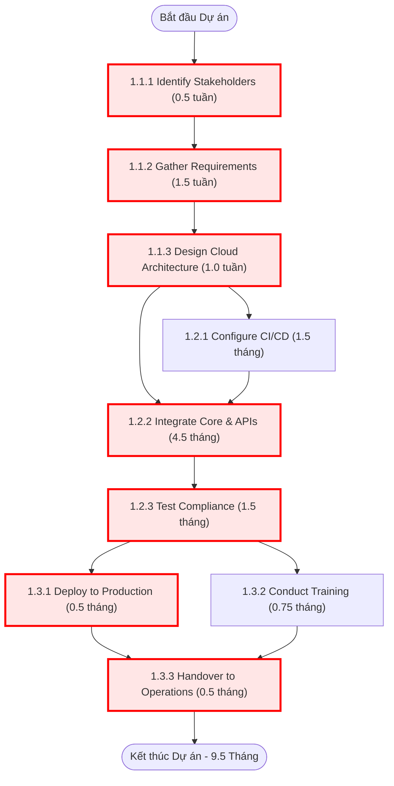

# LAB DELIVERABLES: Project Planning and Risk Analysis
**Module:** Module 2 - Project Planning and Process Modeling  
**Dự án:** Core Digital Transformation for Retail Banking  
**Thời gian thực hiện tối đa:** 12 tháng (Thực tế kế hoạch: ~9.5 tháng)  
**Các bên liên quan chính:** CTO Rachel Singh, Architect Arjun Desai, Compliance Officer Nina Patel, Product Owner Sameer Khan.  

---

# EXERCISE 1: WORK BREAKDOWN STRUCTURE (WBS) & NETWORK DIAGRAM

## Task 1: Work Breakdown Structure (WBS)

```
1.0 Core Digital Transformation for Retail Banking
│
├── 1.1 Planning Phase (Thời lượng: ~2 tuần)
│   ├── 1.1.1 Identify Stakeholders (Định danh & phân loại bên liên quan)
│   ├── 1.1.2 Gather Requirements (Thu thập yêu cầu FRs, NFRs & xây dựng BRD/RTM)
│   └── 1.1.3 Design Cloud-Native Architecture (Thiết kế kiến trúc Cloud, Microservices, EDA)
│
├── 1.2 Execution Phase (Thời lượng: ~6 tháng)
│   ├── 1.2.1 Configure CI/CD Pipeline (Thiết lập pipeline Jenkins/GitOps & auto-rollback)
│   ├── 1.2.2 Integrate Core Banking & API Layers (Xây dựng API Gateway, Microservices, Data Sync)
│   └── 1.2.3 Test Compliance [KYC/AML/PCI-DSS] (Kiểm thử bảo mật, kiểm toán, tải & quy chuẩn)
│
└── 1.3 Closure Phase (Thời lượng: ~1.5 tháng)
    ├── 1.3.1 Deploy to Production (Triển khai chính thức qua Canary/Blue-Green)
    ├── 1.3.2 Conduct User Training (Đào tạo nhân viên chi nhánh, vận hành & hỗ trợ)
    └── 1.3.3 Perform Handover to Operations (Bàn giao kỹ thuật cho đội ngũ vận hành 24/7)
```

---

## Task 2: Network Diagram & Schedule Calculation

### Bảng phụ thuộc tác vụ và thời lượng (Task Dependencies & Duration)

| WBS ID | Tên công việc (Activity) | Công việc tiên quyết (Predecessors) | Thời lượng ước tính | Loại quan hệ |
| :--- | :--- | :---: | :---: | :---: |
| **1.1.1** | Identify Stakeholders | None | 0.5 tuần | Bắt đầu dự án |
| **1.1.2** | Gather Requirements | 1.1.1 | 1.5 tuần | FS (Finish-to-Start) |
| **1.1.3** | Design Cloud-Native Architecture | 1.1.2 | 1 tuần | FS (Có thể gối đầu SS+0.5w) |
| **Tổng Phase 1.1** | **Planning Phase** | | **2 tuần** (~0.5 tháng) | |
| **1.2.1** | Configure CI/CD Pipeline | 1.1.3 | 1.5 tháng | FS |
| **1.2.2** | Integrate Core Banking & API Layers | 1.1.3 (song song 1.2.1) | 4.5 tháng | SS với 1.2.1 |
| **1.2.3** | Test Compliance (KYC/AML/PCI-DSS) | 1.2.2 | 1.5 tháng | FS (Gối đầu phần cuối 1.2.2) |
| **Tổng Phase 1.2** | **Execution Phase** | | **6 tháng** | |
| **1.3.1** | Deploy to Production | 1.2.3 | 0.5 tháng | FS |
| **1.3.2** | Conduct User Training | 1.2.3 (song song 1.3.1) | 0.75 tháng | SS với 1.3.1 |
| **1.3.3** | Perform Handover to Operations | 1.3.1, 1.3.2 | 0.5 tháng | FS |
| **Tổng Phase 1.3** | **Closure Phase** | | **1.5 tháng** | |
| **TỔNG DỰ ÁN** | **Toàn bộ vòng đời** | **1.1 + 1.2 + 1.3** | **~9.5 tháng** | **Nằm an toàn trong giới hạn 12 tháng** |

### Sơ đồ mạng và Đường găng (Network Diagram & Critical Path)


> **Đường găng (Critical Path):** `1.1.1` $\rightarrow$ `1.1.2` $\rightarrow$ `1.1.3` $\rightarrow$ `1.2.2` $\rightarrow$ `1.2.3` $\rightarrow$ `1.3.1` $\rightarrow$ `1.3.3`. Bất kỳ sự chậm trễ nào trên chuỗi này sẽ làm chậm thời điểm Go-Live của toàn ngân hàng.

---

# EXERCISE 2: SWOT ANALYSIS REPORT

| Yếu tố (Category) | Nội dung chi tiết trong bối cảnh Retail Bank | Ý nghĩa chiến lược & Hành động kiến trúc |
| :--- | :--- | :--- |
| **Strengths (Điểm mạnh - Nội tại)** | - **Experienced DevOps team:** Đội ngũ DevOps có kinh nghiệm vững vàng.<br>- **CTO sponsorship:** Sự ủng hộ và bảo trợ mạnh mẽ từ CTO Rachel Singh.<br>- **Secured cloud partnerships:** Đã có thỏa thuận đối tác hạ tầng đám mây an toàn (IBM Cloud/AWS). | - Tận dụng tối đa để tự động hóa hạ tầng và rút ngắn thời gian thiết lập ban đầu.<br>- Quyết định kiến trúc được thông qua nhanh chóng từ lãnh đạo kỹ thuật cao nhất. |
| **Weaknesses (Điểm yếu - Nội tại)** | - **Legacy integration risk:** Hệ thống lõi cũ thiếu tài liệu, giao thức kết nối lạc hậu.<br>- **Skill silos:** Phân hóa kỹ năng, kỹ sư cũ chưa quen Cloud-Native/Microservices.<br>- **Compliance complexity:** Độ phức tạp cao trong việc đáp ứng đồng thời KYC, AML, PCI-DSS, GDPR. | - Xây dựng lớp bọc API Gateway / Anti-Corruption Layer (ACL) để bảo vệ lõi mới khỏi sự phức tạp của hệ thống cũ.<br>- Tổ chức đào tạo chéo (cross-skilling) ngay từ giai đoạn Planning. |
| **Opportunities (Cơ hội - Ngoại cảnh)** | - **Real-time banking:** Cung cấp trải nghiệm ngân hàng tức thì, nâng cao tính cạnh tranh.<br>- **Advanced fraud detection:** Ứng dụng AI/Event-Driven để phát hiện gian lận real-time.<br>- **RegTech (Regulatory Technology):** Tự động hóa báo cáo kiểm toán, giảm chi phí vận hành pháp lý. | - Đẩy mạnh kiến trúc EDA (Kafka/Event Streams) để xử lý luồng sự kiện giao dịch.<br>- Mở rộng Open Banking APIs đón đầu xu thế kinh tế số. |
| **Threats (Thách thức - Ngoại cảnh)** | - **API dependencies:** Phụ thuộc vào độ ổn định của API bên thứ ba (Credit Bureau, Cổng thanh toán).<br>- **Fintech competition:** Sự cạnh tranh khốc liệt từ các công ty Fintech thế hệ mới.<br>- **Audit nonconformance:** Nguy cơ bị đình chỉ hoặc phạt tiền nặng nếu trượt các kỳ sát hạch kiểm toán. | - Áp dụng mẫu thiết kế Circuit Breaker và Retry Pattern khi gọi API đối tác.<br>- Đưa tiêu chí "Security by Design" và "Audit-first" vào từng sprint phát triển. |

---

# EXERCISE 3: RISK REGISTER (SỔ THEO DÕI RỦI RO)

Thang đo:
- **Probability (P):** 1 (Rất thấp) $\rightarrow$ 5 (Rất cao)
- **Impact (I):** 1 (Không đáng kể) $\rightarrow$ 5 (Thảm họa) đối với Nguy cơ (Threat); Điểm âm đối với Cơ hội (Opportunity: -1 đến -5).
- **Risk Score = $P \times I$**

| Risk ID | Risk Title | Cause (Nguyên nhân) | Event (Sự kiện rủi ro) | Impact (Hệ quả) | Category | P (1-5) | I (1-5) | Score ($P \times I$) | Early Triggers (Dấu hiệu cảnh báo sớm) | Mitigation / Response Strategy (Chiến lược ứng phó) | Risk Owner |
| :---: | :--- | :--- | :--- | :--- | :---: | :---: | :---: | :---: | :--- | :--- | :---: |
| **R1** | **KYC API SLA Violation** | Độ trễ lớn từ nhà cung cấp API định danh bên thứ 3 | Quá trình onboarding khách hàng mới bị treo/chậm trễ | Rủi ro tuân thủ, khách hàng rời bỏ, tổn hại uy tín thương hiệu | Threat | 4 | 5 | **20** | Tỷ lệ lỗi timeout tăng trên log, API response > 3s | Triển khai cơ chế giám sát SLA chủ động, xây dựng failover sang nhà cung cấp phụ, kích hoạt escalation matrix | Product Owner (Sameer Khan) |
| **R2** | **Legacy System Integration Failure** | API cũ lạc hậu, sai lệch cấu trúc dữ liệu (schema mismatch) | Lỗi giao dịch hoặc thất thoát dữ liệu trong quá trình đồng bộ | Dự án bị đình trệ, phải rollback, phát sinh chi phí lớn | Threat | 4 | 4 | **16** | Lỗi validation schema khi chạy thử nghiệm trên môi trường Staging | Thiết kế Anti-Corruption Layer (ACL), kiểm thử sandbox nghiêm ngặt, rà soát kiểm toán phiên bản API | Solutions Architect (Arjun Desai) |
| **R3** | **CI/CD Pipeline Breakdown** | Cơ chế tự động hóa rollback chưa hoàn thiện | Thất bại khi phát hành bản build lên Production | Gián đoạn dịch vụ (Downtime), vỡ tiến độ sprint release | Threat | 3 | 5 | **15** | Tỷ lệ build fail tăng, test môi trường Staging phản hồi chậm | Cải tiến kịch bản rollback tự động, bổ sung kiểm tra chất lượng (Quality Gates) trước khi deploy | DevOps Lead / Rachel Singh |
| **R4** | **Positive Stakeholder Adoption** | Luồng giao diện (UX/UI) trực quan, bảng điều khiển dễ thao tác | Nhân viên chi nhánh và khách hàng hưởng ứng mạnh mẽ | Đẩy nhanh chu kỳ phản hồi, rút ngắn thời gian chuyển đổi | Opportunity | 2 | -4 | **-8** | Khảo sát sớm người dùng khen ngợi trải nghiệm và độ mượt mà | Tuyên truyền các câu chuyện thành công nội bộ, đẩy mạnh tính năng self-service cho người dùng | Product Owner (Sameer Khan) |

---

# EXERCISE 4: RISK MATRIX VISUALIZATION (MA TRẬN RỦI RO)

## 1. Threat Matrix ($5 \times 5$)

| Probability \ Impact | 1 (Insignificant) | 2 (Minor) | 3 (Moderate) | 4 (Major) | 5 (Catastrophic) |
| :---: | :---: | :---: | :---: | :---: | :---: |
| **5 (Almost Certain)** | Moderate | High | High | Extreme | Extreme |
| **4 (Likely)** | Moderate | Moderate | High | <mark style="background-color: #ffcccc; color: red; font-weight: bold;">R2 (Score 16)</mark> | <mark style="background-color: #ff0000; color: white; font-weight: bold;">R1 (Score 20)</mark> |
| **3 (Possible)** | Low | Moderate | Moderate | High | <mark style="background-color: #ffcccc; color: red; font-weight: bold;">R3 (Score 15)</mark> |
| **2 (Unlikely)** | Low | Low | Moderate | Moderate | High |
| **1 (Rare)** | Low | Low | Low | Low | Moderate |

## 2. Opportunity Matrix ($5 \times 5$)

| Probability \ Impact | -1 (Slight Benefit) | -2 (Minor Benefit) | -3 (Moderate Benefit) | -4 (Significant Benefit) | -5 (Transformational) |
| :---: | :---: | :---: | :---: | :---: | :---: |
| **2 (Unlikely)** | Low Opp | Low Opp | Med Opp | <mark style="background-color: #ccffcc; color: green; font-weight: bold;">R4 (Score -8)</mark> | High Opp |

## 3. Phân cấp ưu tiên hành động (Color-coded Action Priority)
- **Vùng ĐỎ (Extreme / High Risk - Score $\ge$ 15):** 
  - **R1 (KYC API Violation - 20)** & **R2 (Legacy Integration Failure - 16)** & **R3 (CI/CD Breakdown - 15)**: Yêu cầu hành động ngăn chặn ngay lập tức. Cần bố trí nguồn lực senior để thiết kế Circuit Breakers, Anti-Corruption Layers và Automated Rollback Pipelines.
- **Vùng XANH LÁ (Opportunities - R4):** 
  - Tận dụng tối đa sự đón nhận tích cực của người dùng để biến thành đòn bẩy thúc đẩy quá trình bàn giao và nghiệm thu sản phẩm.
