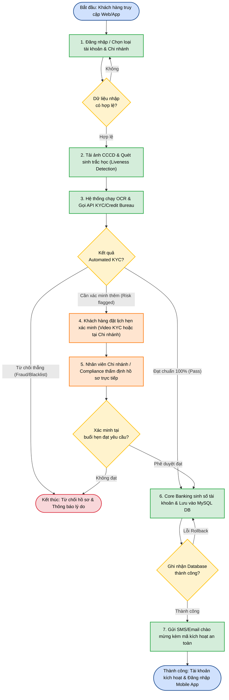

# LAB DELIVERABLES: Create Process Models and Visualization
**Module:** Module 2 - Project Planning and Process Modeling  
**Dự án:** Core Digital Transformation for Retail Banking  
**Vai trò:** Systems and Solutions Architect  
**Mục tiêu:** Mô hình hóa quy trình Đăng ký tài khoản, Đặt lịch hẹn và Thẩm định eKYC (Onboarding & KYC Appointment Scheduling Process)  
**Công nghệ tích hợp:** Unified Core Banking System, MySQL Database, Tableau Real-time Dashboards, RBI Compliance Standards  

---

# TASK 1 & TASK 2: PHÂN RÃ CÁC GIAI ĐOẠN QUY TRÌNH (PROCESS COMPONENTS & STAGES)

Bảng phân rã chi tiết hành trình từ khi khách hàng yêu cầu mở tài khoản, tải giấy tờ, đặt lịch hẹn thẩm định (nếu cần), kiểm tra eKYC/tín dụng đến khi tạo tài khoản và gửi thông báo:

| Stage (Giai đoạn) | Description (Mô tả chi tiết) | Department Involved (Bộ phận tham gia) | Key Actions (Hành động chính) | Decision Points (Điểm quyết định & Rẽ nhánh) |
| :--- | :--- | :--- | :--- | :--- |
| **1. Request Account (Yêu cầu mở tài khoản)** | Khách hàng đăng nhập cổng thông tin / ứng dụng di động, chọn loại tài khoản (Tiết kiệm, Thanh toán) và chi nhánh phục vụ. | Customer Services / Frontend Channel | - Đăng nhập / Đăng ký tài khoản ban đầu. - Chọn loại tài khoản và chi nhánh quản lý. - Đồng ý các điều khoản dịch vụ ngân hàng. | Thông tin đăng ký ban đầu có hợp lệ không? (Yes/No) |
| **2. Document & Biometric Submission (Nộp hồ sơ eKYC)** | Khách hàng chụp và tải ảnh CCCD/Hộ chiếu và quét khuôn mặt (liveness check) trực tuyến. | Digital Banking / eKYC Service Engine | - Tải ảnh mặt trước/sau giấy tờ tùy thân. - Thực hiện quét sinh trắc học khuôn mặt. - Trích xuất dữ liệu tự động bằng OCR. | Ảnh giấy tờ và sinh trắc học có đạt chuẩn chất lượng không? (Yes/No) |
| **3. Automated KYC & Credit Validation (Thẩm định tự động)** | Hệ thống tự động đối chiếu thông tin qua API dịch vụ định danh quốc gia và Credit Bureau. | Risk Management / Core Banking API | - Kiểm tra danh sách đen (Watchlist/PEP/Sanctions). - Tra cứu điểm tín dụng từ Credit Bureau API. - Đánh giá rủi ro gian lận tự động qua Rule Engine. | **Is KYC & Credit Check Passed?** - Tự động đạt (Auto-approved) - Cần thẩm định thêm (Needs Review) - Bị từ chối (Rejected) |
| **4. Appointment Scheduling (Đặt lịch hẹn xác minh bổ sung)** | Áp dụng khi hồ sơ rơi vào nhóm rủi ro trung bình hoặc giấy tờ mờ cần gặp mặt xác minh trực tiếp tại chi nhánh hoặc qua Video Call. | Branch Operations / Customer Support | - Khách hàng chọn ngày, giờ và hình thức hẹn (In-person tại quầy hoặc Video KYC). - Hệ thống cấp mã số hẹn và gửi xác nhận qua SMS/Email. | Khách hàng có hoàn thành buổi hẹn xác minh đúng giờ không? (Yes/No) |
| **5. Branch/Compliance Verification (Thẩm định chuyên sâu)** | Nhân viên chi nhánh hoặc Chuyên viên tuân thủ đối soát giấy tờ gốc trong buổi hẹn. | Compliance / Branch Tellers | - Đối chiếu hồ sơ thực tế với dữ liệu số hóa. - Cập nhật trạng thái phê duyệt trên giao diện Core Banking. | Hồ sơ bổ sung có được phê duyệt không? (Approved/Rejected) |
| **6. Account Creation (Cấp phát tài khoản)** | Core Banking tự động sinh số tài khoản, kích hoạt các dịch vụ đi kèm và ghi nhận vào cơ sở dữ liệu MySQL. | Core Banking System / Database Engine | - Sinh số tài khoản và CIF khách hàng. - Thiết lập cấu hình bảo mật (Mã PIN, SMS OTP/Soft OTP). - Đồng bộ trạng thái vào Data Warehouse phục vụ Tableau Dashboard. | Giao dịch tạo tài khoản trên Database có thành công không? (Yes/No) |
| **7. Customer Notification & Onboarding Complete (Thông báo hoàn tất)** | Gửi thông báo chào mừng kèm thông tin tài khoản và hướng dẫn kích hoạt cho khách hàng. | Customer Communications / Notification Gateway | - Gửi Email/SMS mã kích hoạt an toàn. - Hướng dẫn đăng nhập ứng dụng Mobile Banking lần đầu. | Không |

---

# TASK 3: LƯU ĐỒ QUY TRÌNH CHUẨN UML (ONBOARDING & APPOINTMENT FLOWCHART)

### Quy ước màu sắc theo chuẩn UML:
- **Xanh lam (Blue):** Bắt đầu / Kết thúc (`Start` / `End`)
- **Vàng (Yellow):** Điểm quyết định (`Decision Diamonds`)
- **Xanh lục (Green):** Bước xử lý hành động (`Action Rectangles`)
- **Cam (Orange):** Xử lý ngoại lệ / Buổi hẹn (`Appointment / Exception Sub-process`)

---

# TASK 4: THẨM ĐỊNH LƯU ĐỒ (FLOWCHART VALIDATION & CHECKLIST)

Bảng đánh giá thẩm định lưu đồ quy trình theo tiêu chí chuẩn kiến trúc:

| Tiêu chí thẩm định (Validation Criteria) | Kết quả kiểm tra (Status) | Đánh giá chi tiết và Tối ưu hóa |
| :--- | :---: | :--- |
| **1. Tuân thủ chuẩn UML (UML Compliance)** | **ĐẠT** | Sử dụng chính xác hình khối tiêu chuẩn: Oval (Start/End), Rectangle (Task/Action), Diamond (Decision point) với các hướng mũi tên đơn hướng rõ ràng. |
| **2. Tính hoàn chỉnh của các nhánh rẽ (Valid Branching)** | **ĐẠT** | 100% các điểm quyết định (`DecInput`, `DecAutoKYC`, `DecApptVerify`, `DecDBSave`) đều có đầy đủ các luồng xử lý `Yes/No` hoặc phân nhánh cụ thể, không để lại luồng cụt. |
| **3. Phản ánh đúng xu hướng dữ liệu (Data Trends)** | **ĐẠT** | Tách bạch giữa **Auto-Approval** (phần lớn hồ sơ đạt chuẩn đi thẳng đến bước tạo tài khoản để tối ưu thời gian) và **Exception Workflow** (đặt lịch hẹn gặp mặt/Video KYC chỉ áp dụng cho hồ sơ rủi ro/nghi vấn). |
| **4. Loại bỏ các bước thừa thãi (Eliminate Redundancy)** | **ĐẠT** | Tích hợp trích xuất OCR và xác thực sinh trắc học vào cùng một luồng eKYC tự động, loại bỏ việc khách hàng phải nhập lại thông tin thủ công nhiều lần. |
| **5. Tính toàn vẹn dữ liệu & Kiểm soát lỗi (Fault Tolerance)** | **ĐẠT** | Bước `6. Tạo tài khoản` có cơ chế kiểm tra Transaction DB (`DecDBSave`) kèm tính năng Rollback tự động nếu gặp lỗi ghi dữ liệu, đảm bảo nguyên tắc ACID trong ngân hàng. |
