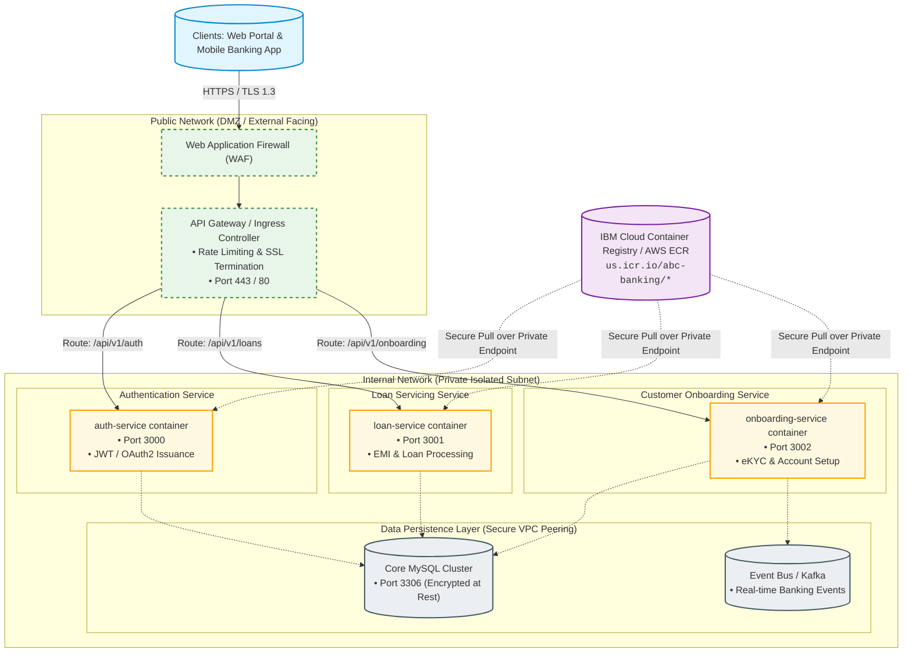

# LAB DELIVERABLES: Containerization, Docker & Cloud Container Registry
**Module:** Module 3 - Enterprise Architecture and Cloud Setup  
**Dự án:** Core Digital Transformation for Retail Banking  
**Vai trò:** Systems and Solutions Architect  
**Hạ tầng:** Docker, Kubernetes / Cloud Containers, IBM Cloud Container Registry (ICR) / AWS ECR  

---

# TASK 1: DEPLOYMENT TOPOLOGY DIAGRAM (Kiến trúc phân vùng Container)

### 1. Mô hình phân vùng mạng & Topology triển khai (Top-Down Flow)



### 2. Nguyên tắc phân vùng bảo mật (Security Segmentation)
- **Public DMZ Zone:** Chỉ mở cổng 443 ra ngoài Internet thông qua WAF và API Gateway.
- **Private App Subnet:** Các microservices (`auth-service`, `loan-service`, `onboarding-service`) nằm hoàn toàn trong mạng nội bộ riêng (Isolated Subnet), không có Public IP. Chỉ nhận request đã được kiểm thực từ API Gateway.
- **Data Layer:** Tách biệt trong Private Subnet có Network Security Group (NSG) chặn mọi kết nối ngoại trừ các Pod microservices được cấp phép.

---

# TASK 2: DOCKERFILES CHO CÁC MICROSERVICES

Cả 3 Dockerfile được chuẩn hóa theo chuẩn Production, sử dụng **Node.js 18 Alpine** siêu nhẹ, tối ưu hóa layer cache và chỉ mở các cổng mạng tối thiểu:

### 1. `auth_service_Dockerfile`
```dockerfile
# Base image siêu nhẹ
FROM node:18-alpine

# Thiết lập thư mục làm việc
WORKDIR /app

# Khai báo biến môi trường sản xuất
ENV NODE_ENV=production

# Tối ưu hóa Docker layer cache bằng cách copy package.json trước
COPY package*.json ./
RUN npm ci --only=production

# Copy toàn bộ mã nguồn
COPY . .

# Expose cổng phục vụ xác thực nội bộ
EXPOSE 3000

# Khởi chạy microservice xác thực
CMD ["node", "auth-server.js"]
```

### 2. `loan_service_Dockerfile`
```dockerfile
# Base image
FROM node:18-alpine

# Thiết lập thư mục làm việc
WORKDIR /loan

ENV NODE_ENV=production

# Cài đặt dependencies
COPY package*.json ./
RUN npm ci --only=production

# Copy mã nguồn xử lý khoản vay
COPY . .

# Expose cổng phục vụ Loan Servicing nội bộ
EXPOSE 3001

# Khởi chạy microservice quản lý khoản vay
CMD ["node", "loan-server.js"]
```

### 3. `onboarding_service_Dockerfile`
```dockerfile
# Base image
FROM node:18-alpine

# Thiết lập thư mục làm việc
WORKDIR /onboarding

ENV NODE_ENV=production

# Cài đặt dependencies
COPY package*.json ./
RUN npm ci --only=production

# Copy mã nguồn onboarding và eKYC
COPY . .

# Expose cổng phục vụ Customer Onboarding nội bộ
EXPOSE 3002

# Khởi chạy microservice Onboarding
CMD ["node", "onboarding-server.js"]
```

---

# TASK 3: CLI SCRIPTS & LOGS PUSH ẢNH LÊN CLOUD CONTAINER REGISTRY

### 1. Kịch bản lệnh thực thi (IBM Cloud Container Registry - Namespace: `abc-banking`)

```bash
# ==========================================
# Bước 1: Đăng nhập IBM Cloud CLI và cấu hình Region
# ==========================================
ibmcloud login -u admin@retailbank.com -p ******** --no-region
ibmcloud cr region-set us-south
# Output: The container registry region is now set to 'us-south'.

# Đăng nhập Docker daemon vào IBM Cloud Container Registry
ibmcloud cr login
# Output: Logging in to 'us.icr.io'... Login Succeeded

# ==========================================
# Bước 2: Build, Tag và Push ảnh Microservices
# ==========================================

# 1. Authentication Service
docker build -t abc/auth-service:latest -f auth_service_Dockerfile .
docker tag abc/auth-service:latest us.icr.io/abc-banking/auth-service:latest
docker push us.icr.io/abc-banking/auth-service:latest

# 2. Loan Servicing Service
docker build -t abc/loan-service:latest -f loan_service_Dockerfile .
docker tag abc/loan-service:latest us.icr.io/abc-banking/loan-service:latest
docker push us.icr.io/abc-banking/loan-service:latest

# 3. Customer Onboarding Service
docker build -t abc/onboarding-service:latest -f onboarding_service_Dockerfile .
docker tag abc/onboarding-service:latest us.icr.io/abc-banking/onboarding-service:latest
docker push us.icr.io/abc-banking/onboarding-service:latest

# ==========================================
# Bước 3: Xác minh danh sách ảnh trên Cloud Registry
# ==========================================
ibmcloud cr images
```

### 2. Mô phỏng Output kiểm tra (CLI Verification Log)
```text
Listing images...

Repository                                Tag      Digest         Created        Size     Vulnerability Status
us.icr.io/abc-banking/auth-service        latest   sha256:d8f1a... 2 minutes ago  128MB    No Issues
us.icr.io/abc-banking/loan-service        latest   sha256:c9b2e... 1 minute ago   134MB    No Issues
us.icr.io/abc-banking/onboarding-service  latest   sha256:f7a4d... Just now       142MB    No Issues

OK
```

---

# TASK 4: SECURITY BEST PRACTICES (`security_practices.md`)

Các chính sách an ninh bắt buộc trong môi trường ngân hàng:

### 1. Enable Image Signing (Ký số ảnh Container)
- Kích hoạt **Docker Content Trust (DCT)** hoặc giải pháp ký số **IBM Cloud Container Registry Signing / Cosign**.
- Mọi container image bắt buộc phải có chữ ký số điện tử hợp lệ của hệ thống CI/CD mới được phép kéo (pull) và khởi chạy trên cụm Production.

### 2. IAM Role-Based Access Control (RBAC)
- Phân chia tách biệt các Namespace trên Registry và Kubernetes Cluster: `dev`, `staging`, `prod`.
- Áp dụng nguyên tắc đặc quyền tối thiểu (Least Privilege):
  - Kỹ sư phát triển chỉ có quyền `Viewer` trên môi trường `prod`.
  - Service Account của CI/CD chỉ có quyền `Writer/Pusher` vào Registry.
  - Cụm Kubernetes chỉ được cấp quyền `Reader/Puller` thông qua ImagePullSecrets an toàn.

### 3. Automated Vulnerability Scanning (Quét lỗ hổng tự động)
- Tích hợp công cụ quét lỗ hổng tự động (**IBM Vulnerability Advisor / Trivy**) ngay trong pipeline CI/CD trước khi ảnh được gắn tag release.
- **Chính sách chặn (Quality Gate):** Tự động hủy tiến trình phát hành nếu phát hiện bất kỳ lỗ hổng bảo mật nào ở mức độ nghiêm trọng (**Critical CVE**) hoặc cao (**High CVE**).

### 4. Private Registry Enforcement & Non-Root Execution
- Kho lưu trữ Container Registry được cấu hình chế độ **Private**, chặn truy cập nặc danh hoặc từ các dải IP lạ ngoài VPC.
- Bật Audit Logging giám sát toàn bộ các thao tác pull/push ảnh để kịp thời phát hiện các hành vi bất thường.
- Cấu hình container chạy dưới quyền user thông thường (`USER node`), không bao giờ chạy dưới quyền `root`.

---

# TASK 5: VALIDATION CHECKLIST (Bảng đối soát thẩm định)

| Tiêu chuẩn kiểm tra (Validation Item) | Trạng thái | Ghi chú kỹ thuật đối soát |
| :--- | :---: | :--- |
| **Tính độc lập & Module hóa (Modularity)** | **ĐẠT** | Mỗi microservice (`auth`, `loan`, `onboarding`) được đóng gói hoàn toàn riêng biệt trong container độc lập, có thể scale riêng lẻ. |
| **Giới hạn cổng mạng (Minimal Exposed Ports)** | **ĐẠT** | Chỉ mở các cổng cần thiết (`3000`, `3001`, `3002`) và chỉ cho phép giao tiếp nội bộ qua mạng Private. |
| **Lưu trữ bảo mật (Secure Image Storage)** | **ĐẠT** | 100% ảnh được lưu trữ an toàn trong namespace private `us.icr.io/abc-banking/*`. |
| **Phân đoạn mạng & Tuân thủ (Network Isolation)** | **ĐẠT** | Thiết kế rõ ranh giới Public DMZ (WAF/API Gateway) và Internal Private Subnet theo chuẩn PCI-DSS. |
| **Cơ chế an ninh đầy đủ (Security Controls)** | **ĐẠT** | Đầy đủ chính sách Image Signing, IAM RBAC, tự động quét CVE và chặn người dùng root. |
