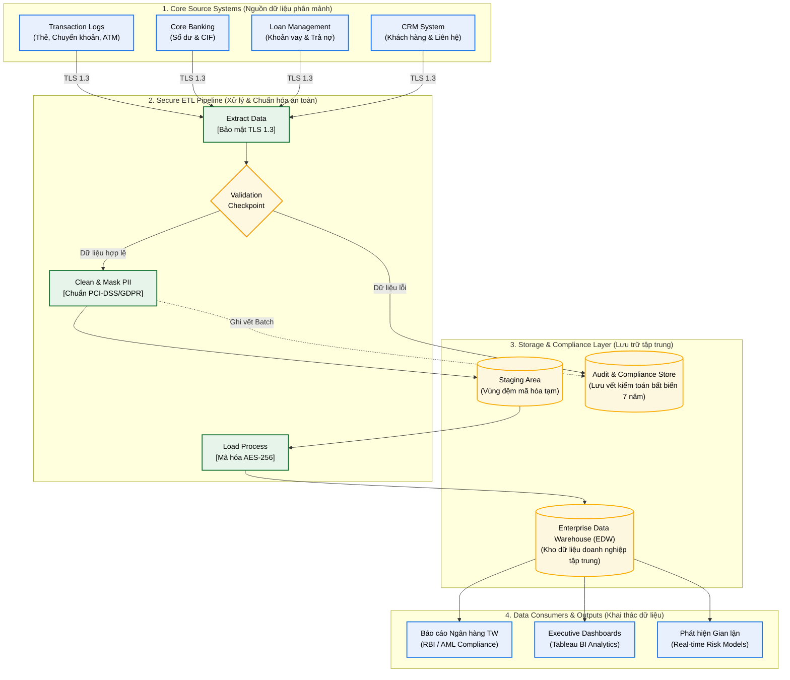

# LAB DELIVERABLES: Data Flowchart for Consolidation of Data Infrastructure
**Module:** Module 3 - Enterprise Architecture and Cloud Setup  
**Dự án:** Core Digital Transformation for Retail Banking  
**Vai trò:** Systems and Solutions Architect  
**Trọng tâm:** Hợp nhất hệ thống dữ liệu phân mảnh thành Kiến trúc Kho dữ liệu Doanh nghiệp tập trung (Enterprise Data Warehouse - EDW)  
**Tiêu chuẩn áp dụng:** PCI-DSS, GDPR, AML/KYC, RBI Regulatory Reporting, Data Lineage & Auditability  

---

# TASK 1: XÁC ĐỊNH THÀNH PHẦN LUỒNG DỮ LIỆU (DATA FLOW COMPONENTS)

### 1. Bảng phân loại các nguồn dữ liệu nguồn (Source Systems)
| Source System (Entity) | Loại dữ liệu trích xuất | Ý nghĩa nghiệp vụ | Giao thức / Định dạng |
| :--- | :--- | :--- | :--- |
| **CRM System** | Hồ sơ khách hàng, lịch sử liên hệ, sở thích sản phẩm | Quản trị quan hệ khách hàng, phân khúc thị trường | REST API / JSON |
| **Loan Management System** | Đơn vay, lịch trình trả góp (EMI), tình trạng nợ xấu | Quản lý rủi ro tín dụng và dòng tiền vay | Batch DB Export / CDC |
| **Core Banking System** | Số dư tài khoản, mã khách hàng (CIF), trạng thái tài khoản | Xử lý giao dịch sổ cái lõi (General Ledger) | CDC (Debezium/Kafka) / ISO 8583 |
| **Transaction Logs** | Nhật ký quẹt thẻ POS, thanh toán trực tuyến, rút tiền ATM | Giám sát gian lận và thống kê thanh toán | Event Streams / File Log Batches |

---

### 2. Bảng ký hiệu DFD chuẩn áp dụng (Standard DFD Notation)
| Ký hiệu DFD | Hình khối hiển thị | Quy ước màu sắc | Ý nghĩa trong hệ thống ngân hàng | Ví dụ cụ thể |
| :--- | :--- | :--- | :--- | :--- |
| **External Entity** | Hình chữ nhật (Rectangle) | **Xanh dương (Blue)** | Hệ thống nguồn hoặc đích dữ liệu | CRM, Core Banking, Báo cáo Ngân hàng TW |
| **ETL Process** | Hình chữ nhật bo góc (Process Box) | **Xanh lục (Green)** | Tác vụ trích xuất, xử lý, làm sạch hoặc nạp dữ liệu | Extract, Data Cleansing, PII Masking, Load |
| **Data Store** | Hình trụ / Hai vạch ngang (Cylinder) | **Cam (Orange)** | Vùng đệm tạm thời hoặc kho lưu trữ dài hạn | Secure Staging Area, Enterprise Data Warehouse |
| **Audit Checkpoint** | Hình thoi (Diamond) | **Vàng (Yellow)** | Điểm kiểm soát kiểm toán, tính toàn vẹn và xác thực | Audit Log Created?, Checksum Valid? |
| **Data Flow** | Mũi tên có nhãn (Labeled Arrow) | Nét liền / Nét đứt | Hướng di chuyển và trạng thái dữ liệu | Data (Encrypted via TLS 1.3) |

---

# TASK 2: SƠ ĐỒ LUỒNG DỮ LIỆU TÍCH HỢP HẠ TẦNG (DATA FLOW DIAGRAM)

### 1. Sơ đồ DFD kiến trúc tích hợp (End-to-End Pipeline)

---

### 2. Các chú giải kỹ thuật về Bảo mật và Tuân thủ (Security Annotations)
1. **Transmission Security:** 100% dữ liệu truyền từ Source Systems đến ETL Pipeline được bảo vệ bởi **TLS 1.3** và Mutual TLS (mTLS).
2. **Data Masking (PCI-DSS & GDPR):** Dữ liệu định danh cá nhân (PII như CCCD, Địa chỉ) và thông tin thẻ (PAN) được mã hóa một chiều hoặc che giấu (masking `****-****-****-1234`) ngay tại vùng Staging trước khi nạp vào EDW.
3. **Storage Security:** Vùng đệm Staging và Enterprise Data Warehouse (EDW) áp dụng mã hóa **AES-256** ở trạng thái nghỉ (Data at Rest) với khóa quản lý qua Cloud KMS.
4. **Audit Trail & Lineage:** Mọi tiến trình ETL đều ghi nhận dấu ấn thời gian (Timestamp), số lượng bản ghi (Row Count Batch Checksum) vào kho lưu trữ bất biến **Audit Store** phục vụ thanh tra pháp lý trong vòng **7 năm**.

---

# TASK 3: BẢNG ĐỐI SOÁT THẨM ĐỊNH (DATA INFRA VALIDATION CHECKLIST)

| Hạng mục đối soát (Checklist Item) | Trạng thái | Minh chứng kỹ thuật & Đánh giá |
| :--- | :---: | :--- |
| **1. Hiện diện đầy đủ các hệ thống lõi** | **ĐẠT** | Tích hợp 4 nguồn dữ liệu chủ đạo: CRM (Khách hàng), Loan Management (Khoản vay), Core Banking (Số dư), Transaction Logs (Giao dịch). |
| **2. Pipeline ETL module hóa & tuần tự logic** | **ĐẠT** | Tách bạch 3 giai đoạn độc lập: Extract $\rightarrow$ Validate/Mask/Audit $\rightarrow$ Load, hỗ trợ cả cơ chế Batch Ingestion và CDC Streaming. |
| **3. Phân tầng lưu trữ rõ ràng (Staging & Warehouse)** | **ĐẠT** | Có tầng Staging đệm dữ liệu mã hóa tạm thời và tầng EDW trung tâm mô hình hóa theo chuẩn phục vụ phân tích đa chiều. |
| **4. Thực thi an ninh dữ liệu tường minh** | **ĐẠT** | Ghi rõ cơ chế Data Masking cho số thẻ/PII theo PCI-DSS, mã hóa TLS 1.3 khi truyền tải và AES-256 khi lưu trữ. |
| **5. Tính năng truy vết nguồn gốc (Traceability & Audit)** | **ĐẠT** | Có thành phần Audit Logger ghi nhận Timestamp, Batch ID và lưu trữ tại kho WORM bất biến phục vụ kiểm toán tài chính. |
| **6. Đầu ra hỗ trợ toàn diện các nhu cầu nghiệp vụ** | **ĐẠT** | EDW cung cấp dữ liệu trực tiếp cho: Báo cáo tuân thủ Ngân hàng TW (RBI/SBV), Dashboard Tableau điều hành, và Mô hình phân tích rủi ro/gian lận. |
