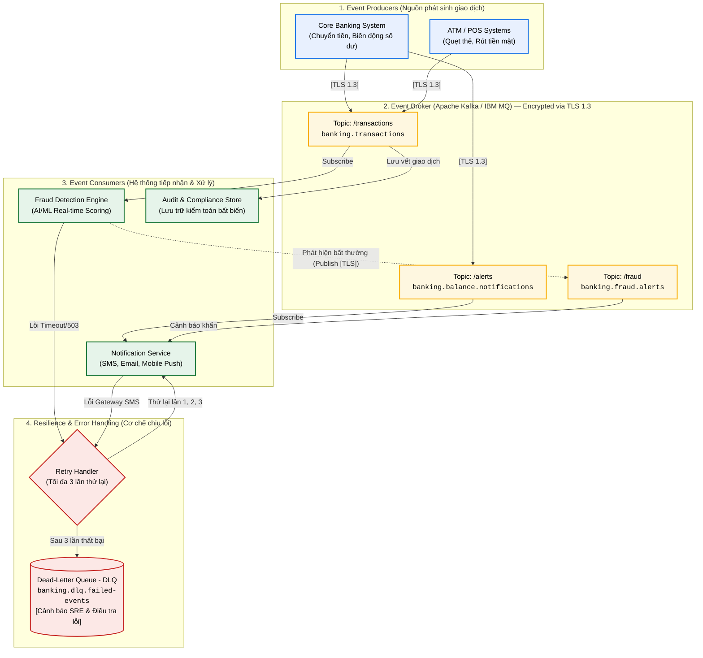

# LAB DELIVERABLES: Design EDA Blueprint (Event-Driven Architecture)
**Module:** Module 3 - Enterprise Architecture and Cloud Setup  
**Dự án:** Core Digital Transformation for Retail Banking  
**Vai trò:** Systems and Solutions Architect  
**Trọng tâm:** Xây dựng bản thiết kế kiến trúc hướng sự kiện (EDA Blueprint) phục vụ giám sát giao dịch thời gian thực, cảnh báo gian lận và thông báo tức thì.  
**Công nghệ:** Apache Kafka / IBM MQ / IBM Event Streams, DLQ (Dead-Letter Queue), Retry Logic, TLS 1.3 Encryption, RBAC  

---

# TASK 1: ĐỊNH NGHĨA CÁC THÀNH PHẦN KIẾN TRÚC EDA

Hệ sinh thái kiến trúc hướng sự kiện của Ngân hàng bán lẻ được chia thành 4 trụ cột chính:

### 1. Event Producers (Nguồn phát sinh sự kiện)
- **Core Banking System:** Phát sinh các sự kiện hạch toán tài khoản, thay đổi số dư, thanh toán khoản vay, chuyển khoản liên ngân hàng.
- **ATM / POS Systems:** Phát sinh các sự kiện quẹt thẻ chi tiêu, rút tiền mặt tại máy ATM, các giao dịch ngoại tệ hoặc giao dịch nghi vấn tại điểm bán.

### 2. Event Broker (Lớp đệm & điều phối sự kiện ở tầng giữa)
- **Công nghệ đề xuất:** **Apache Kafka** (hoặc **IBM MQ / Event Streams**).
- **Trách nhiệm:** Lưu trữ luồng sự kiện phân tán, bảo đảm thứ tự thông điệp (ordering), hỗ trợ nhiều consumer đọc độc lập (pub/sub), đệm tải khi lưu lượng giao dịch tăng đột biến.
- **Các Topics phân vùng chính:**
  - `banking.transactions` (Toàn bộ giao dịch hoàn tất)
  - `banking.fraud.alerts` (Cảnh báo gian lận & hoạt động bất thường)
  - `banking.balance.notifications` (Biến động số dư & cảnh báo số dư thấp)

### 3. Event Consumers (Hệ thống tiếp nhận & xử lý sự kiện)
- **Fraud Detection System (AI/ML Engine):** Lắng nghe luồng giao dịch thời gian thực, chạy mô hình phát hiện gian lận và đánh giá điểm rủi ro (Risk Scoring).
- **Notification Service (Multi-channel):** Tiếp nhận thông điệp để gửi SMS OTP, Email sao kê hoặc Push Notifications qua Mobile Banking App.
- **Audit & Analytics Consumer:** Ghi nhận nhật ký kiểm toán vào kho lưu trữ tuân thủ.

### 4. Security & Reliability Elements (Bảo mật & Độ tin cậy)
- **TLS 1.3:** Mã hóa toàn bộ dữ liệu đang truyền tải (Data in Transit) giữa Producers $\rightarrow$ Broker và Broker $\rightarrow$ Consumers.
- **Retry Mechanism:** Tự động thử lại tối đa 3 lần với chiến lược giãn cách lũy thừa (Exponential Backoff: `attempt 1`, `attempt 2`, `attempt 3`).
- **Dead-Letter Queue (DLQ):** Hàng đợi đặc biệt cô lập các thông điệp bị lỗi (poison pills/schema invalid) sau 3 lần retry thất bại để đội vận hành phân tích mà không làm nghẽn luồng xử lý chính.
- **Role-Based Access Control (RBAC):** Chỉ cấp quyền đọc/ghi (read/write) theo từng topic cụ thể dựa trên chứng chỉ SSL / SASL SCRAM.

---

# TASK 2: SƠ ĐỒ THIẾT KẾ KIẾN TRÚC EDA (SIMPLIFIED EDA BLUEPRINT)

Sơ đồ trực quan hóa luồng sự kiện từ Producers qua Broker đến Consumers kèm theo cơ chế **Retry (3 attempts)**, **DLQ** và nhãn bảo mật **TLS 1.3**:

---

# TASK 3: BẢNG ÁNH XẠ SỰ KIỆN (EVENT MAPPING TABLE)

Bảng chuẩn hóa mối quan hệ giữa loại sự kiện, nguồn sinh, chủ đề định tuyến và các hệ thống tiêu thụ:

| Event ID | Event Type (Tên sự kiện) | Event Producer (Nguồn phát sinh) | Topic Name (Kênh Broker) | Event Payload Details (Tóm tắt dữ liệu gói tin) | Event Consumers (Hệ thống tiêu thụ) | Action Triggered (Hành động xử lý) |
| :---: | :--- | :--- | :--- | :--- | :--- | :--- |
| **EVT-01** | `TransactionComplete` | Core Banking / POS / ATM | `/transactions` (`banking.transactions`) | Account ID, Amount, Currency, Merchant, Timestamp | Fraud Detection System, Audit Store | Chạy mô hình chấm điểm gian lận tức thì; ghi nhật ký kiểm toán |
| **EVT-02** | `HighRiskActivity` | Fraud Detection System | `/fraud` (`banking.fraud.alerts`) | Risk Score, Alert Reason, Account ID, Geo Location | Notification Service, Core Banking (Khóa thẻ) | Gửi SMS cảnh báo đỏ đến khách hàng; tự động phong tỏa thẻ nghi vấn |
| **EVT-03** | `LowBalanceWarning` | Core Banking System | `/alerts` (`banking.balance.notifications`) | Customer ID, Current Balance, Threshold Limit | Notification Service | Bắn Push Notification trên ứng dụng Mobile nhắc nạp tiền |
| **EVT-04** | `LoanDisbursed` | Loan Servicing Engine | `/transactions` (`banking.transactions`) | Loan ID, Disbursed Amount, Beneficiary Account | Notification Service, Core Ledger | Gửi tin nhắn chúc mừng giải ngân; ghi nhận dư nợ vào sổ cái |
| **EVT-05** | `PoisonEventFailed` | Notification / Fraud Service | `/dlq` (`banking.dlq.failed-events`) | Original Payload, Failure Reason, Retry Count (3) | IT Operations Team, SRE Dashboard | Kích hoạt cảnh báo PagerDuty cho đội trực hệ thống điều tra thủ công |

---

# TASK 4: CHECKLIST THẨM ĐỊNH BẢN THIẾT KẾ EDA (VERIFICATION CHECKLIST)

| Tiêu chuẩn thẩm định (Verification Item) | Kết quả kiểm tra | Minh chứng kiến trúc cụ thể |
| :--- | :---: | :--- |
| **1. Sử dụng Broker trung gian điều phối** | **ĐẠT** | Ứng dụng Apache Kafka / IBM MQ làm tầng trung chuyển độc lập, đảm bảo tính phân tán và chịu tải cao. |
| **2. Tích hợp cơ chế Retry & DLQ** | **ĐẠT** | Thiết kế rõ luồng **Retry Handler (3 attempts)** và hàng đợi chết **DLQ** để hứng và cô lập thông điệp lỗi. |
| **3. Hiện diện tối thiểu 2 Producers** | **ĐẠT** | Bao gồm **Core Banking System** và hệ thống đầu cuối **ATM / POS Systems**. |
| **4. Gắn nhãn an ninh dữ liệu (TLS Tag)** | **ĐẠT** | Gắn nhãn tường minh `[TLS 1.3 Encrypted]` trên toàn bộ các mũi tên truyền tải thông điệp. |
| **5. Sơ đồ rõ ràng, có đầy đủ Topic Labels** | **ĐẠT** | Thể hiện cụ thể các topics: `/transactions`, `/fraud`, `/alerts`, `/dlq` kèm luồng Consumer đăng ký rõ ràng. |
