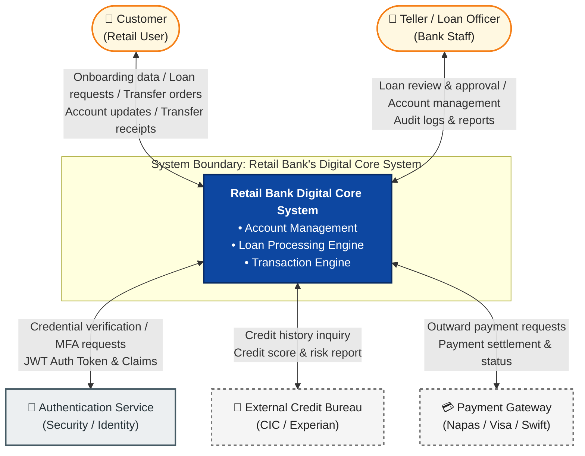

# Task 1: System Context Model - Retail Bank Digital Core System

Mô hình System Context Model xác định rõ ranh giới hệ thống (**System Boundary**), các thực thể bên ngoài (**External Entities / Actors**) và các dòng dữ liệu trao đổi giữa chúng.

---

## 1. Thành phần cấu tạo

### Ranh giới hệ thống (System Boundary)
- **Hệ thống trung tâm:** `Retail Bank's Digital Core System`
  - Đóng vai trò là hạt nhân điều phối nghiệp vụ, quản lý tài khoản, xử lý luồng nghiệp vụ onboarding, tín dụng và giao dịch.

### Các Actors / External Entities
1. **Customer (Retail User):** Khách hàng cá nhân thao tác qua Mobile Banking / Internet Banking.
2. **Teller / Loan Officer (Bank Staff):** Giao dịch viên / Cán bộ tín dụng thực hiện quản trị hồ sơ, đối soát và phê duyệt thủ công.
3. **Authentication Service (Security Subsystem):** Dịch vụ xác thực danh tính tập trung (OAuth2/OIDC, MFA, Token Provider).
4. **External Credit Bureau (External Partner):** Trung tâm thông tin tín dụng (như CIC/Experian) cung cấp điểm tín dụng để thẩm định hồ sơ vay.
5. **Payment Gateway (External Partner):** Cổng thanh toán liên ngân hàng / mạng lưới thẻ (Napas, Swift, Visa/Mastercard).

---

## 2. Luồng dữ liệu trao đổi (Data Flow Specifications)

| Từ (Source) | Đến (Target) | Dữ liệu / Luồng thông điệp | Mô tả |
| :--- | :--- | :--- | :--- |
| **Customer** | **Digital Core System** | Request mở tài khoản, Yêu cầu vay, Lệnh chuyển khoản | Khách hàng gửi thông tin giao dịch qua ứng dụng số |
| **Digital Core System** | **Customer** | Trạng thái tài khoản, Thông báo biến động số dư, Kết quả khoản vay | Trả về phản hồi và biên lai giao dịch |
| **Digital Core System** | **Authentication Service** | Thông tin đăng nhập, Yêu cầu xác thực MFA | Kiểm tra thông tin định danh người dùng |
| **Authentication Service** | **Digital Core System** | Auth Token, Quyền hạn (Claims), Xác nhận MFA | Cho phép/từ chối phiên làm việc |
| **Digital Core System** | **External Credit Bureau** | Truy vấn lịch sử nợ, Điểm tín dụng cá nhân | Dùng cho việc đánh giá rủi ro khoản vay |
| **External Credit Bureau** | **Digital Core System** | Báo cáo xếp hạng tín dụng (Credit Report / Score) | Trả về dữ liệu để ra quyết định hạn mức vay |
| **Digital Core System** | **Payment Gateway** | Lệnh thanh toán / Chuyển tiền liên ngân hàng | Gửi yêu cầu trừ tiền / chuyển tiền ngoài hệ thống |
| **Payment Gateway** | **Digital Core System** | Xác nhận trạng thái giao dịch (Success / Failure) | Trả về mã tham chiếu và kết quả thanh toán |
| **Teller / Loan Officer**| **Digital Core System** | Phê duyệt hồ sơ vay, Quản lý tài khoản, Báo cáo | Nhân viên thao tác trên giao diện nghiệp vụ nội bộ |
| **Digital Core System** | **Teller / Loan Officer**| Danh sách hồ sơ chờ duyệt, Thống kê rủi ro | Dữ liệu hỗ trợ ra quyết định nghiệp vụ |

---

## 3. Biểu đồ System Context (Mermaid Diagram)

---

## 4. Hướng dẫn xuất hình ảnh bàn giao (Deliverable)
- **Tên file yêu cầu:** `System_Context_Model.png` (hoặc `.pdf`)
- Khi vẽ trên Lucidchart/Draw.io:
  1. Đặt 1 khung hộp lớn trung tâm có tiêu đề: `Retail Bank's Digital Core System`.
  2. Bố trí 2 Actor con người bên trái (`Customer`, `Teller/Loan Officer`).
  3. Bố trí các External Systems bên phải và phía trên (`Authentication Service`, `Payment Gateway`, `Credit Bureau`).
  4. Sử dụng mũi tên 2 chiều với nhãn rõ ràng như trong bảng trên.
