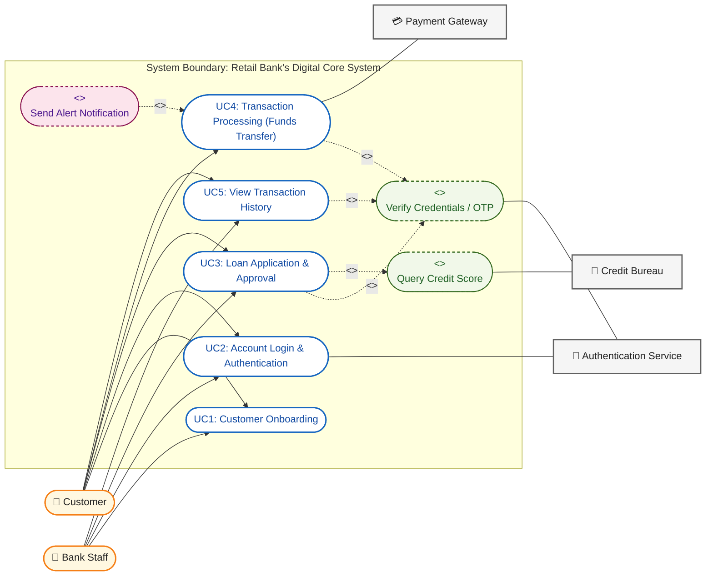

# Task 2: Use Case Diagram - Retail Bank Digital Core

Biểu đồ Use Case chuẩn UML thể hiện các chức năng cốt lõi của ngân hàng bán lẻ và quan hệ với các Actors liên quan.

---

## 1. Danh sách Actors và Use Cases

### Actors
- **Primary Actors:**
  - `Customer` (Khách hàng cá nhân)
  - `Bank Staff` (Gồm Teller và Loan Officer)
- **Secondary / Supporting Actors:**
  - `Authentication Service` (Hệ thống xác thực)
  - `Credit Bureau` (Trung tâm tín dụng)
  - `Payment Gateway` (Cổng thanh toán)

### Danh sách Use Cases
- `UC1: Customer Onboarding` (Đăng ký mở tài khoản ngân hàng trực tuyến - eKYC)
- `UC2: Account Login & Authentication` (Đăng nhập, MFA, sinh phiên làm việc)
- `UC3: Loan Application and Approval` (Nộp hồ sơ vay vốn và phê duyệt hạn mức)
- `UC4: Transaction Processing (Funds Transfer)` (Chuyển khoản nội bộ & liên ngân hàng)
- `UC5: View Transaction History` (Xem sao kê và lịch sử giao dịch)
- **Sub / Supporting Use Cases:**
  - `UC_Verify_ID`: Xác minh danh tính điện tử eKYC (`<<include>>` vào UC1)
  - `UC_Verify_Auth`: Xác thực phiên đăng nhập / OTP (`<<include>>` vào UC3, UC4, UC5)
  - `UC_Check_Credit`: Thẩm định điểm tín dụng (`<<include>>` vào UC3)
  - `UC_Notify`: Gửi thông báo SMS / Push / Email (`<<extend>>` sau khi hoàn tất giao dịch)

---

## 2. Bảng ma trận Actor - Use Case Mapping

| Use Case ID | Tên Use Case | Primary Actor | Secondary Actor(s) | Quan hệ UML áp dụng |
| :--- | :--- | :--- | :--- | :--- |
| **UC1** | Customer Onboarding | Customer, Bank Staff | Authentication Service | `<<include>>` UC_Verify_ID |
| **UC2** | Account Login and Auth | Customer, Bank Staff | Authentication Service | Cơ sở bảo mật |
| **UC3** | Loan Application & Approval | Customer (Apply), Bank Staff (Approve) | Credit Bureau, Auth Service | `<<include>>` UC_Verify_Auth, UC_Check_Credit |
| **UC4** | Transaction Processing | Customer | Payment Gateway, Auth Service | `<<include>>` UC_Verify_Auth, `<<extend>>` UC_Notify |
| **UC5** | View Transaction History | Customer, Bank Staff | Auth Service | `<<include>>` UC_Verify_Auth |

---

## 3. Biểu đồ Use Case (Mermaid UML)

---

## 4. Hướng dẫn xuất hình ảnh bàn giao (Deliverable)
- **Tên file yêu cầu:** `Use_Case_Diagram_Retail_Bank.png` (hoặc `.pdf`)
- Khi vẽ trên Lucidchart/Draw.io:
  1. Vẽ khung chữ nhật System Boundary: `Retail Bank's Digital Core System`.
  2. Bên ngoài bên trái: Hình người (Stick figure) cho `Customer` và `Bank Staff`.
  3. Bên ngoài bên phải: Hình chữ nhật/người đại diện hệ thống ngoài (`Authentication Service`, `Credit Bureau`, `Payment Gateway`).
  4. Bên trong khung: Các hình ovan tượng trưng cho từng Use Case.
  5. Dùng đường nét đứt có mũi tên nhãn `<<include>>` hướng tới use case được phụ thuộc và `<<extend>>` từ extension point.
