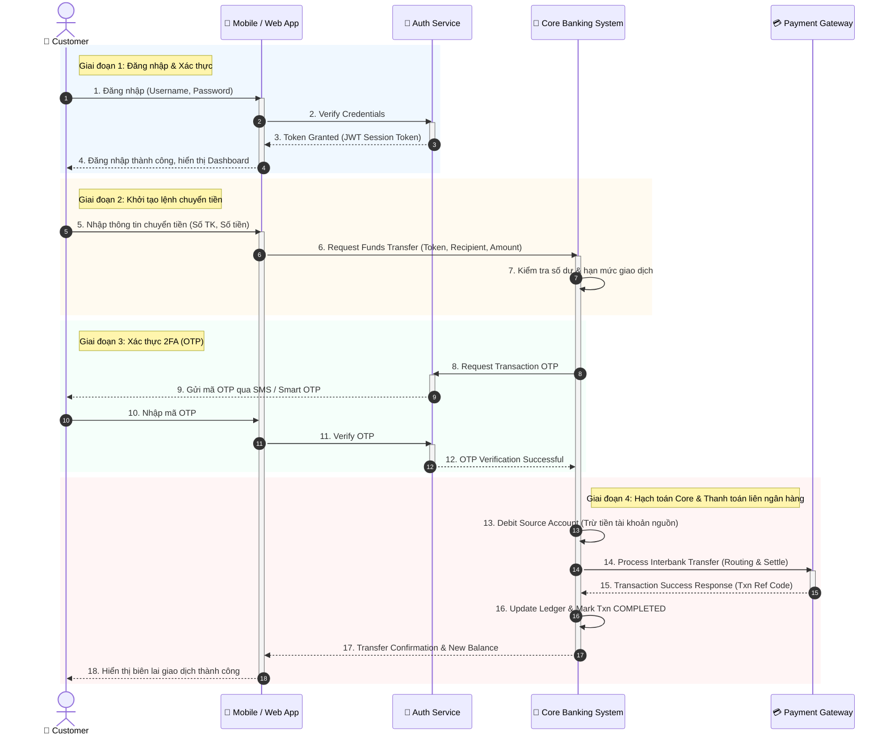

# Task 3: Sequence Diagram - Transaction Processing (Funds Transfer)

Biểu đồ tuần tự (Sequence Diagram) chi tiết hóa quy trình **Chuyển tiền (Funds Transfer)** - quy trình quan trọng nhất minh họa đầy đủ tương tác giữa Actor, giao diện người dùng, hệ thống bảo mật xác thực, lõi ngân hàng và cổng thanh toán bên thứ ba.

---

## 1. Các thành phần tham gia (Lifelines & Participants)

1. `Customer` (Actor): Khách hàng cá nhân thao tác trên ứng dụng di động.
2. `Web Portal / Mobile App` (UI Layer): Ứng dụng client tương tác trực tiếp với người dùng.
3. `Authentication Service` (Security Layer): Dịch vụ thẩm định thông tin đăng nhập, sinh token và xác thực mã OTP giao dịch.
4. `Core Banking System` (Core Processing Layer): Hệ thống quản lý tài khoản nguồn, kiểm tra hạn mức số dư và thực hiện ghi nợ (debit).
5. `Payment Gateway` (External Service): Mạng lưới thanh toán liên ngân hàng thực hiện chuyển tiền đến ngân hàng thụ hưởng.

---

## 2. Kịch bản luồng tương tác (End-to-End Interaction Flow)

1. **Giai đoạn Đăng nhập (Authentication):**
   - Customer gửi thông tin đăng nhập (`Login Request: username, password`) lên App.
   - App gọi Auth Service để kiểm tra thông tin (`Verify Credentials`).
   - Auth Service xác thực hợp lệ và cấp phiên (`JWT Token Granted`).
   - App hiển thị màn hình chính cho khách hàng.

2. **Giai đoạn Khởi tạo & Kiểm tra Giao dịch (Transfer Initiation & Validation):**
   - Customer nhập thông tin chuyển tiền (`Recipient Account, Amount, Bank ID`) và bấm Chuyển tiền.
   - App gửi yêu cầu kèm JWT Token (`Request Funds Transfer`) vào Core Banking System.
   - Core Banking thực hiện kiểm tra nội bộ (`Validate Account Balance & Transfer Limit`).

3. **Giai đoạn Xác thực giao dịch (Transaction Authorization / 2FA):**
   - Core Banking yêu cầu mã OTP giao dịch qua Auth Service.
   - Auth Service gửi mã OTP về máy khách hàng.
   - Customer nhập OTP xác nhận giao dịch (`Submit OTP`).
   - Auth Service phê duyệt tính hợp lệ của OTP (`OTP Validated`).

4. **Giai đoạn Xử lý & Thanh toán (Processing & Settlement):**
   - Core Banking thực hiện khóa/trừ tiền tài khoản nguồn (`Debit Source Account`).
   - Core Banking chuyển tiếp yêu cầu đến Cổng thanh toán bên ngoài (`Process Interbank Transaction`).
   - Cổng thanh toán định tuyến và ghi có cho ngân hàng nhận, sau đó trả về mã giao dịch thành công (`200 OK: Transaction Success`).
   - Core Banking cập nhật trạng thái giao dịch sang `COMPLETED` và lưu lịch sử.

5. **Giai đoạn Phản hồi kết quả (Confirmation):**
   - Core Banking trả về thông tin biên lai (`Transfer Confirmation Receipt`) cho App.
   - App hiển thị thông báo chuyển khoản thành công và số dư mới cho Customer.

---

## 3. Biểu đồ Sequence Diagram (Mermaid UML)

---

## 4. Hướng dẫn xuất hình ảnh bàn giao (Deliverable)
- **Tên file yêu cầu:** `Sequence_Diagram_Retail_Bank.png` (hoặc `.pdf`)
- Khi vẽ trên Lucidchart/Draw.io:
  1. Đặt 5 đường thẳng đứng (Lifelines) nét đứt với 5 hộp đại diện: `Customer`, `Mobile/Web App`, `Authentication Service`, `Core Banking System`, `Payment Gateway`.
  2. Vẽ các thanh hình chữ nhật hẹp (Activation Box) trên từng lifeline trong khoảng thời gian thành phần đó đang thực thi.
  3. Mũi tên nét liền cho thông điệp gọi (Call/Request), mũi tên nét đứt cho thông điệp phản hồi (Return/Response).
  4. Đánh số bước tuần tự từ 1 đến 18 như kịch bản trên để đảm bảo tính trực quan.
