# Task 2: Build a Small-Scale Prototype (Setup & Configuration)

Tài liệu thiết kế kiến trúc và cấu hình triển khai Prototype thu nhỏ cho luồng phát hiện gian lận thời gian thực.

---

## 1. Kiến trúc Prototype (Prototype Architecture)

```mermaid
flowchart LR
    Producer["🧪 Test Producer / API<br/>(Transaction Simulator)"]:::simNode
    KafkaBroker["⚡ Apache Kafka Broker<br/>Topic: <code>fraud-events</code><br/>Port: 9092"]:::brokerNode
    SpringBootApp["☕ Spring Boot Microservice<br/>Fraud Detection Engine<br/>Port: 8080"]:::appNode
    PostgresDB["🐘 PostgreSQL DB<br/>Table: <code>fraud_event_log</code><br/>Port: 5432"]:::dbNode
    MockAPI["🏢 Mock Credit / Sanction API<br/>WireMock Port: 8089"]:::mockNode

    Producer -->|"1. Publish Transaction Event (JSON)"| KafkaBroker
    KafkaBroker -->|"2. Consume Event Stream"| SpringBootApp
    SpringBootApp <-->|"3. Verify User Risk Score"| MockAPI
    SpringBootApp -->|"4. Persist Audit & Decision"| PostgresDB

    %% Chuẩn bảng màu Enterprise Architecture (Navy/Slate/Neutral/Dashed):
    %% Ứng dụng xử lý trung tâm (Spring Boot): Xanh Navy đậm (#0d47a1), chữ trắng (#ffffff)
    classDef appNode fill:#0d47a1,stroke:#082a63,stroke-width:2px,color:#ffffff;
    %% Message Broker & Database (Hạ tầng lưu trữ & truyền phát): Xanh Slate xám thép (#eceff1 / viền #455a64)
    classDef brokerNode fill:#eceff1,stroke:#455a64,stroke-width:2px,color:#263238;
    classDef dbNode fill:#eceff1,stroke:#455a64,stroke-width:2px,color:#263238;
    %% Test Tool / Simulator nội bộ: Vàng da bò trung tính (#fff8e1 / viền #f57f17)
    classDef simNode fill:#fff8e1,stroke:#f57f17,stroke-width:2px,color:#212121;
    %% External / Mock Third-party Service: Xám bạc trung tính viền nét đứt (#f5f5f5 / viền #757575)
    classDef mockNode fill:#f5f5f5,stroke:#757575,stroke-width:2px,stroke-dasharray: 4 4,color:#212121;
```



---

## 2. Bảng cấu hình các thành phần (Component Setup Details)

| Thành phần (Component) | Công nghệ / Phiên bản | Cổng (Port) | Chi tiết thiết lập & Tham số cấu hình (Setup Details) |
| :--- | :--- | :--- | :--- |
| **Microservice** | Java 17, Spring Boot 3.2.x | `8080` | Đóng gói Docker container (Alpine JRE), tích hợp `spring-kafka`, `spring-data-jpa`, kết nối thread-pool HikariCP tối đa 20 kết nối. |
| **Event Broker** | Apache Kafka 3.6 (KRaft mode) | `9092` | Tạo topic `fraud-events` với 3 partitions; thiết lập `acks=all`, `min.insync.replicas=1`, tự động quản lý commit offset thủ công (`ackMode = MANUAL_IMMEDIATE`). |
| **Database** | PostgreSQL 15 | `5432` | Containerized database; Database: `bank_core`; Khởi tạo bảng `fraud_event_log` với index trên `transaction_id`, `account_id`, và `created_at`. |
| **Mock Gateway** | WireMock / Mockoon | `8089` | Giả lập dịch vụ kiểm tra rủi ro bên thứ ba; trả về HTTP 200 kèm payload `{ risk_level: "LOW", score: 750 }` với độ trễ trễ cố định 30ms. |
| **Orchestration Tool**| Docker Compose v2.20+ | - | Điều phối toàn bộ mạng lưới nội bộ `bank-network` với chính sách tự khởi động lại `restart: unless-stopped`. |

---

## 3. Cấu trúc Schema cơ sở dữ liệu (PostgreSQL Schema)

```sql
CREATE TABLE IF NOT EXISTS fraud_event_log (
    event_id UUID PRIMARY KEY DEFAULT gen_random_uuid(),
    transaction_id VARCHAR(64) NOT NULL UNIQUE,
    account_id VARCHAR(32) NOT NULL,
    amount NUMERIC(15, 2) NOT NULL,
    currency VARCHAR(3) DEFAULT 'USD',
    risk_score INT NOT NULL,
    decision VARCHAR(20) NOT NULL, -- 'APPROVED', 'FLAGGED', 'BLOCKED'
    reason TEXT,
    processing_time_ms BIGINT NOT NULL,
    created_at TIMESTAMP WITH TIME ZONE DEFAULT CURRENT_TIMESTAMP
);

CREATE INDEX idx_fraud_event_account ON fraud_event_log(account_id);
CREATE INDEX idx_fraud_event_created ON fraud_event_log(created_at);
```
