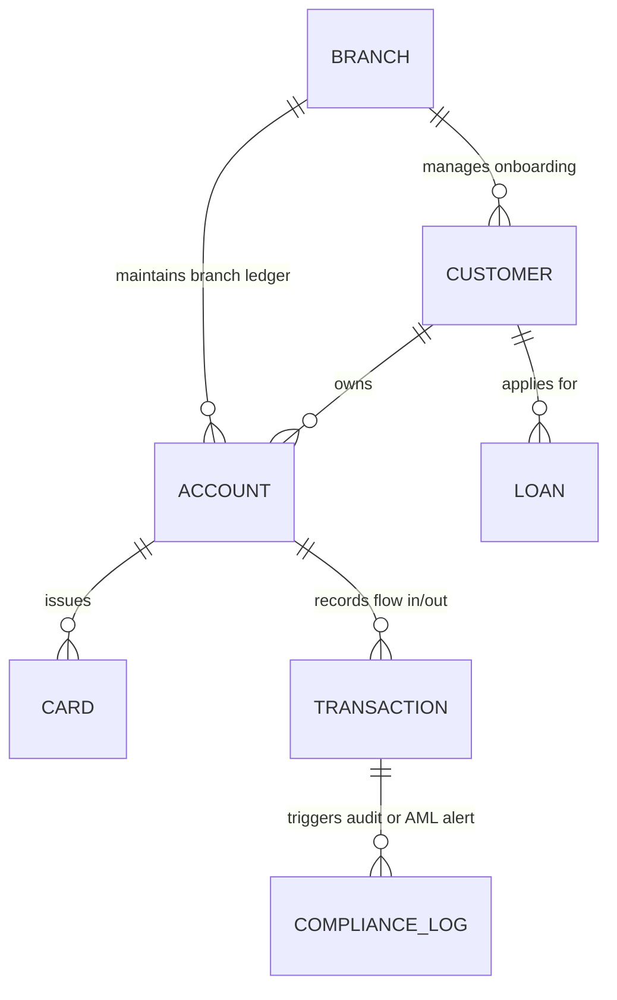

# Task 2: Conceptual ERD (Entity-Relationship Diagram)

Biểu đồ thực thể mức khái niệm thể hiện mối quan hệ nghiệp vụ cấp cao giữa các thực thể trong ngân hàng mà không đi sâu vào chi tiết thuộc tính.

---

## 1. Mối quan hệ và Bản số (Relationships & Cardinalities)

- **Branch → Customer (1:N):** Một chi nhánh quản lý mở hồ sơ cho nhiều khách hàng.
- **Branch → Account (1:N):** Một chi nhánh quản lý mở nhiều tài khoản thanh toán.
- **Customer → Account (1:N):** Một khách hàng có thể sở hữu một hoặc nhiều tài khoản (thanh toán, tiết kiệm).
- **Customer → Loan (1:N):** Một khách hàng có thể đăng ký vay nhiều khoản vay khác nhau.
- **Account → Card (1:N):** Một tài khoản có thể liên kết phát hành nhiều thẻ (thẻ chính, thẻ phụ).
- **Account → Transaction (1:N):** Một tài khoản phát sinh nhiều giao dịch tài chính.
- **Transaction → Compliance Log (1:N):** Một giao dịch tài chính (hoặc một chuỗi giao dịch) có thể kích hoạt một hoặc nhiều bản ghi cảnh báo giám sát tuân thủ (AML / Audit flag).

---

## 2. Sơ đồ Conceptual ERD (Mermaid Diagram)

---

## 3. Hướng dẫn xuất tệp bàn giao (Deliverable)
- Tên tệp yêu cầu: `ConceptualERD.pdf` (hoặc `.png`).
- Khi vẽ trên Lucidchart/Draw.io:
  1. Sử dụng 7 khối chữ nhật tương ứng 7 thực thể: `CUSTOMER`, `ACCOUNT`, `LOAN`, `TRANSACTION`, `COMPLIANCE_LOG`, `CARD`, `BRANCH`.
  2. Nối các đường kết nối thể hiện đúng ký hiệu Crow's Foot (1 bên một vạch, 1 bên ba chân quạ thể hiện quan hệ 1:N).
  3. Không thêm các trường cột bên trong để bảo đảm đúng định dạng Conceptual ERD.
