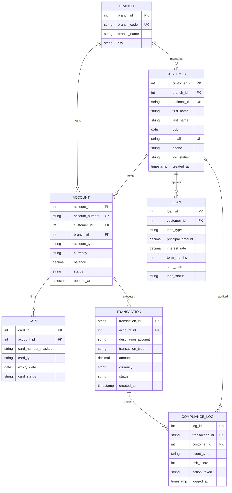

# Task 3: Logical ERD with Attributes and Keys

Sơ đồ quan hệ thực thể mức logic bổ sung chi tiết toàn bộ các trường thuộc tính, xác định rõ Khóa chính (**PK**), Khóa ngoại (**FK**) và kiểu dữ liệu.

---

## 1. Danh sách thực thể & Cấu trúc thuộc tính

### 1. `BRANCH`
- `branch_id` (PK, INT): Mã định danh duy nhất chi nhánh.
- `branch_code` (VARCHAR, UNIQUE): Mã viết tắt chi nhánh (ví dụ: `BR-HO-001`).
- `branch_name` (VARCHAR): Tên chi nhánh giao dịch.
- `city` (VARCHAR): Tỉnh/Thành phố.

### 2. `CUSTOMER`
- `customer_id` (PK, INT): Mã khách hàng duy nhất.
- `branch_id` (FK, INT): Chi nhánh mở tài khoản.
- `national_id` (VARCHAR, UNIQUE): Số CCCD / Hộ chiếu.
- `first_name` (VARCHAR): Tên.
- `last_name` (VARCHAR): Họ và tên đệm.
- `dob` (DATE): Ngày sinh.
- `email` (VARCHAR, UNIQUE): Địa chỉ email.
- `phone` (VARCHAR): Số điện thoại chính.
- `kyc_status` (VARCHAR): Trạng thái KYC (`Pending`, `Verified`, `Rejected`).
- `created_at` (TIMESTAMP): Thời gian tạo hồ sơ.

### 3. `ACCOUNT`
- `account_id` (PK, INT): Mã tài khoản trong hệ thống.
- `account_number` (VARCHAR, UNIQUE): Số tài khoản ngân hàng hiển thị (10-14 chữ số).
- `customer_id` (FK, INT): Mã khách hàng sở hữu.
- `branch_id` (FK, INT): Chi nhánh quản lý tài khoản.
- `account_type` (VARCHAR): Loại tài khoản (`CHECKING`, `SAVINGS`).
- `currency` (VARCHAR): Loại tiền tệ (`USD`, `VND`, `EUR`).
- `balance` (DECIMAL): Số dư khả dụng hiện tại.
- `status` (VARCHAR): Trạng thái (`ACTIVE`, `FROZEN`, `CLOSED`).
- `opened_at` (TIMESTAMP): Ngày mở tài khoản.

### 4. `CARD`
- `card_id` (PK, INT): Mã định danh bản ghi thẻ.
- `account_id` (FK, INT): Tài khoản thanh toán liên kết.
- `card_number_masked` (VARCHAR): Số thẻ che (ví dụ: `4111-XXXX-XXXX-1234`).
- `card_type` (VARCHAR): Loại thẻ (`DEBIT`, `CREDIT`).
- `expiry_date` (DATE): Tháng/Năm hết hạn.
- `card_status` (VARCHAR): Trạng thái (`ACTIVE`, `BLOCKED`, `EXPIRED`).

### 5. `LOAN`
- `loan_id` (PK, INT): Mã hợp đồng khoản vay.
- `customer_id` (FK, INT): Khách hàng đứng tên vay.
- `loan_type` (VARCHAR): Loại khoản vay (`MORTGAGE`, `PERSONAL`, `AUTO`).
- `principal_amount` (DECIMAL): Số tiền giải ngân gốc.
- `interest_rate` (DECIMAL): Lãi suất theo năm (%/năm).
- `term_months` (INT): Kỳ hạn vay (số tháng).
- `start_date` (DATE): Ngày bắt đầu tính lãi.
- `loan_status` (VARCHAR): Trạng thái (`APPROVED`, `ACTIVE`, `DEFAULTED`, `CLOSED`).

### 6. `TRANSACTION`
- `transaction_id` (PK, UUID/VARCHAR): Mã tham chiếu giao dịch toàn cầu.
- `account_id` (FK, INT): Tài khoản nguồn thực hiện.
- `destination_account` (VARCHAR): Tài khoản thụ hưởng (nội bộ hoặc liên ngân hàng).
- `transaction_type` (VARCHAR): Loại giao dịch (`DEPOSIT`, `WITHDRAWAL`, `TRANSFER`).
- `amount` (DECIMAL): Số tiền giao dịch.
- `currency` (VARCHAR): Loại tiền giao dịch.
- `status` (VARCHAR): Trạng thái xử lý (`PENDING`, `COMPLETED`, `FAILED`).
- `created_at` (TIMESTAMP): Thời điểm thực hiện giao dịch.

### 7. `COMPLIANCE_LOG`
- `log_id` (PK, INT): Mã định danh bản ghi kiểm toán.
- `transaction_id` (FK, UUID/VARCHAR, NULLABLE): Giao dịch liên quan (nếu có).
- `customer_id` (FK, INT, NULLABLE): Khách hàng liên quan.
- `event_type` (VARCHAR): Loại sự kiện (`AML_SUSPICIOUS`, `LARGE_TRANSACTION`, `LOGIN_FAILURE`).
- `risk_score` (INT): Điểm rủi ro (1 - 100).
- `action_taken` (VARCHAR): Hành động xử lý (`FLAGGED`, `BLOCKED`, `REPORTED_TO_FIU`).
- `logged_at` (TIMESTAMP): Thời gian ghi log kiểm toán.

---

## 2. Sơ đồ Logical ERD (Mermaid Diagram)

---

## 3. Hướng dẫn xuất tệp bàn giao (Deliverable)
- Tên tệp yêu cầu: `Logical_ERD.pdf` (hoặc `.png`).
