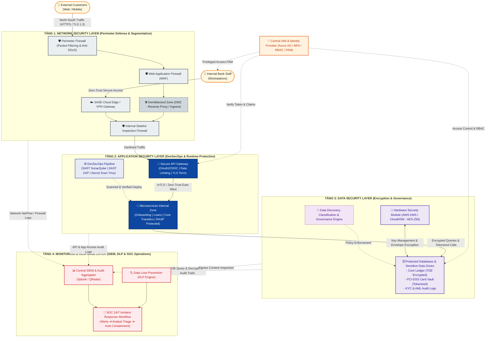

# Task 2: Multi-Layered Security Architecture Diagram

Sơ đồ kiến trúc an ninh bảo mật đa tầng trực quan mô phỏng mô hình **Defense-in-Depth** và **Zero-Trust** bảo vệ toàn diện hệ thống Retail Bank.

---

## 1. Biểu đồ Kiến trúc An ninh Đa tầng (Mermaid Security Architecture Diagram)

---

## 2. Hướng dẫn xuất tệp bàn giao (Deliverable)
- **Tên tệp yêu cầu:** `security_architecture_diagram.pdf` (hoặc `.png`).
- Khi vẽ trên Lucidchart / Draw.io / PowerPoint:
  1. Vẽ 4 khối hộp hình chữ nhật nằm ngang (Horizontal Swimlanes) theo thứ tự từ trên xuống dưới:
     - Tầng 1: `Network Security Layer` (trên cùng tiếp nhận traffic bên ngoài).
     - Tầng 2: `Application Security Layer` (ở giữa xử lý nghiệp vụ).
     - Tầng 3: `Data Security Layer` (tầng lõi bảo vệ dữ liệu).
     - Tầng 4: `Monitoring & Response Layer` (chân đế tiếp nhận log từ 3 tầng trên).
  2. Bố trí khối `Identity & Access Management (IAM)` ở cột bên cạnh thể hiện tính chất cắt ngang (cross-cutting) kiểm soát tất cả các tầng.
  3. Sử dụng các đường mũi tên liền cho luồng nghiệp vụ (North-South Traffic) và đường mũi tên nét đứt cho luồng đẩy Log về SIEM/DLP.
